# group conflict 在 FlashMLA 上的优化

目录

1.  [真武 M890 TSM](#tsm-overview)
2.  [TSM bank conflict](#bank-conflict)
3.  [TSM group conflict](#group-conflict)
4.  [TSM group conflict 是否值得优化](#optimization-value)
5.  [FlashMLA 优化实例](#flashmla-case)

## 1\. 真武 M890 TSM

### 1.1 真武 M890 TSM 编址

```
真武 M890
├── typical CU count: 39 CUs
└── TSM per CU: 256KB
    ├── 4 groups, 64×1KB, 1KB interleave.             -- group conflict
    └── 每个 group: 32 banks
        └── 每个 bank: 64×8×4B, 4B interleave         -- bank conflict
```

为了获得高带宽，TSM（Thread block Shared Memory）先被分成 4 个 group，每个 group 的大小是 64×1KB。而每个 group 又被分成 32 个相等大小的 bank，每个 bank 为 64×8×4B，4B interleave。无冲突时，这些 bank（共 4×32 个）可以被同时访问。如果每个 bank 至多只访问一个内存地址，那么只需要一次内存传输；否则需要多次传输，内存带宽利用率会下降。

**注意**：这里的 **1KB interleave 是地址到 group 的映射粒度**，不是单个 group 的容量。

TSM 地址到 group 和 bank 是循环映射。详见：TSM 地址到 group 和 bank 的映射图。

图1-1：TSM 地址到 group 和 bank 的映射

真武 M890 一般有 39 个 CU（Compute Unit）；每个 CU 有 256KB 的 TSM，分为 4 个 group；每个 group 的大小是 64×1KB；每个 group 含 32 个 bank，group 里的每个 bank 为 64×8×4B，4B interleave。如果想把 TSM 带宽打满，就需要把 4 个 group 里的 4×32 bank 都用起来。地址到 group 采用 1KB interleave，G0/G1/G2/G3 循环 64 次；每个 1KB group block 包含 8 条 128B line，每条 128B line 就是一个完整的 32-bank 访问单元。

真武 M890 / TSM per CU

39 CUs · 256KB

真武 M890 一般有 39 个 CU；每个 CU 有 256KB TSM。

Group 映射

4 groups · 64×1KB

每个 group 大小为 64×1KB；`group = floor(addr / 1024B) % 4`

Group 内 Line / Bank

32 banks · 64×8×4B

每个 group 含 32 个 bank；1KB group block 内含 8 条 128B line

① TSM 地址到 group 和 bank 的映射：1KB interleave（4 个 group 独立端口并行，各自内部 32 bank 满宽访问）

0KB block → Group 0
0–1023B

L00B

B0

B1

…

B30

B31

L1128B

B0

B1

…

B30

B31

L2256B

B0

B1

…

B30

B31

L3384B

B0

B1

…

B30

B31

L4512B

B0

B1

…

B30

B31

L5640B

B0

B1

…

B30

B31

L6768B

B0

B1

…

B30

B31

L7896B

B0

B1

…

B30

B31

1KB block → Group 1
1024–2047B

L01024B

B0

B1

…

B30

B31

L11152B

B0

B1

…

B30

B31

L21280B

B0

B1

…

B30

B31

L31408B

B0

B1

…

B30

B31

L41536B

B0

B1

…

B30

B31

L51664B

B0

B1

…

B30

B31

L61792B

B0

B1

…

B30

B31

L71920B

B0

B1

…

B30

B31

2KB block → Group 2
2048–3071B

L02048B

B0

B1

…

B30

B31

L12176B

B0

B1

…

B30

B31

L22304B

B0

B1

…

B30

B31

L32432B

B0

B1

…

B30

B31

L42560B

B0

B1

…

B30

B31

L52688B

B0

B1

…

B30

B31

L62816B

B0

B1

…

B30

B31

L72944B

B0

B1

…

B30

B31

3KB block → Group 3
3072–4095B

L03072B

B0

B1

…

B30

B31

L13200B

B0

B1

…

B30

B31

L23328B

B0

B1

…

B30

B31

L33456B

B0

B1

…

B30

B31

L43584B

B0

B1

…

B30

B31

L53712B

B0

B1

…

B30

B31

L63840B

B0

B1

…

B30

B31

L73968B

B0

B1

…

B30

B31

4KB block → Group 0
4096–5119B

L04096B

B0

B1

…

B30

B31

L14224B

B0

B1

…

B30

B31

L24352B

B0

B1

…

B30

B31

L34480B

B0

B1

…

B30

B31

L44608B

B0

B1

…

B30

B31

L54736B

B0

B1

…

B30

B31

L64864B

B0

B1

…

B30

B31

L74992B

B0

B1

…

B30

B31

5KB block → Group 1
5120–6143B

L05120B

B0

B1

…

B30

B31

L15248B

B0

B1

…

B30

B31

L25376B

B0

B1

…

B30

B31

L35504B

B0

B1

…

B30

B31

L45632B

B0

B1

…

B30

B31

L55760B

B0

B1

…

B30

B31

L65888B

B0

B1

…

B30

B31

L76016B

B0

B1

…

B30

B31

6KB block → Group 2
6144–7167B

L06144B

B0

B1

…

B30

B31

L16272B

B0

B1

…

B30

B31

L26400B

B0

B1

…

B30

B31

L36528B

B0

B1

…

B30

B31

L46656B

B0

B1

…

B30

B31

L56784B

B0

B1

…

B30

B31

L66912B

B0

B1

…

B30

B31

L77040B

B0

B1

…

B30

B31

7KB block → Group 3
7168–8191B

L07168B

B0

B1

…

B30

B31

L17296B

B0

B1

…

B30

B31

L27424B

B0

B1

…

B30

B31

L37552B

B0

B1

…

B30

B31

L47680B

B0

B1

…

B30

B31

L57808B

B0

B1

…

B30

B31

L67936B

B0

B1

…

B30

B31

L78064B

B0

B1

…

B30

B31

8KB block → Group 0
8192–9215B

L08192B

B0

B1

…

B30

B31

L18320B

B0

B1

…

B30

B31

L28448B

B0

B1

…

B30

B31

L38576B

B0

B1

…

B30

B31

L48704B

B0

B1

…

B30

B31

L58832B

B0

B1

…

B30

B31

L68960B

B0

B1

…

B30

B31

L79088B

B0

B1

…

B30

B31

9KB block → Group 1
9216–10239B

L09216B

B0

B1

…

B30

B31

L19344B

B0

B1

…

B30

B31

L29472B

B0

B1

…

B30

B31

L39600B

B0

B1

…

B30

B31

L49728B

B0

B1

…

B30

B31

L59856B

B0

B1

…

B30

B31

L69984B

B0

B1

…

B30

B31

L710112B

B0

B1

…

B30

B31

10KB block → Group 2
10240–11263B

L010240B

B0

B1

…

B30

B31

L110368B

B0

B1

…

B30

B31

L210496B

B0

B1

…

B30

B31

L310624B

B0

B1

…

B30

B31

L410752B

B0

B1

…

B30

B31

L510880B

B0

B1

…

B30

B31

L611008B

B0

B1

…

B30

B31

L711136B

B0

B1

…

B30

B31

11KB block → Group 3
11264–12287B

L011264B

B0

B1

…

B30

B31

L111392B

B0

B1

…

B30

B31

L211520B

B0

B1

…

B30

B31

L311648B

B0

B1

…

B30

B31

L411776B

B0

B1

…

B30

B31

L511904B

B0

B1

…

B30

B31

L612032B

B0

B1

…

B30

B31

L712160B

B0

B1

…

B30

B31

12KB block → Group 0
12288–13311B

L012288B

B0

B1

…

B30

B31

L112416B

B0

B1

…

B30

B31

L212544B

B0

B1

…

B30

B31

L312672B

B0

B1

…

B30

B31

L412800B

B0

B1

…

B30

B31

L512928B

B0

B1

…

B30

B31

L613056B

B0

B1

…

B30

B31

L713184B

B0

B1

…

B30

B31

13KB block → Group 1
13312–14335B

L013312B

B0

B1

…

B30

B31

L113440B

B0

B1

…

B30

B31

L213568B

B0

B1

…

B30

B31

L313696B

B0

B1

…

B30

B31

L413824B

B0

B1

…

B30

B31

L513952B

B0

B1

…

B30

B31

L614080B

B0

B1

…

B30

B31

L714208B

B0

B1

…

B30

B31

14KB block → Group 2
14336–15359B

L014336B

B0

B1

…

B30

B31

L114464B

B0

B1

…

B30

B31

L214592B

B0

B1

…

B30

B31

L314720B

B0

B1

…

B30

B31

L414848B

B0

B1

…

B30

B31

L514976B

B0

B1

…

B30

B31

L615104B

B0

B1

…

B30

B31

L715232B

B0

B1

…

B30

B31

15KB block → Group 3
15360–16383B

L015360B

B0

B1

…

B30

B31

L115488B

B0

B1

…

B30

B31

L215616B

B0

B1

…

B30

B31

L315744B

B0

B1

…

B30

B31

L415872B

B0

B1

…

B30

B31

L516000B

B0

B1

…

B30

B31

L616128B

B0

B1

…

B30

B31

L716256B

B0

B1

…

B30

B31

② 三层地址解码

先按 1KB 粒度选 group：`group = floor(addr / 1024B) % 4`
1KB group block 内含 8 条 128B line：`line_in_group = floor((addr % 1024B) / 128B)`
每条 128B line 就是一个 32-bank 访问单元：`bank = floor(addr / 4B) % 32`

③ 128B → Group Hash
（可编程 / 默认线性）

映射粒度 = `128B`（一条线 = 32 bank × 4B）
默认线性：`group = (addr / 1024) % 4` ＝ 连续 8 条线(1024B)同一 group
可配置：`group = hash(addr / 128)`（如按 128B 交错轮转，打散 stride 热点）

### 图例说明

**彩色 1KB 块**表示 TSM 地址到 group 和 bank 的映射：0KB→G0、1KB→G1、2KB→G2、3KB→G3，之后每 4KB 循环；每个 group 大小为 64×1KB。

**1KB group block** 在第 ① 部分画成 8 条横向 128B line；每条横条左侧标出该 line 的起始地址，例如 0KB block 中 L0 = 0B，L1 = 128B，L2 = 256B，以此类推；横条内部表示 Bank0～Bank31，为了可读性只显示 B0、B1、…、B30、B31，中间 bank 省略。

**Bank 小格**表示 group 内部的 32 个 bank，group 里的每个 bank 为 64×8×4B，4B interleave。若要打满 TSM 带宽，需要同时用起 4 个 group 里的 4×32 bank；第 ① 部分横条语义上覆盖 Bank0～Bank31。

读图顺序：先看 256KB 被切成 256 个 1KB block，并按 G0/G1/G2/G3 循环 64 次；再看每个 1KB block 包含 8 条 128B line，它们属于同一个 group，每条 line 覆盖该 group 的 32 个 bank。图中仅展示前 16 个 1KB block。性能分析时需要同时关注 group pattern 和 bank pattern。

### 1.2 TSM group hash

TSM group hash 不改变软件看到的逻辑地址，而是对逻辑地址到物理地址的映射做扰动。硬件会在地址解码阶段，对部分地址位做简单散列，例如 XOR、位翻转或其他轻量级组合逻辑。这样，原本按线性规则会落到同一个 group 的访问，经过 hash 后可能被打散到不同物理 group 上。

## 2\. TSM bank conflict

### 2.1 bank conflict 介绍

shared memory bank conflict 是指：如果一个 memory request 中的多个地址映射到同一个 bank，硬件需要把这次请求拆成多个 conflict-free request 来执行，等价于访问被串行化，effective bandwidth 会按拆分次数下降。

1.  warp 内多个 threads 读不同 bank 的数据：无冲突，并行访问。
2.  多个 threads 读同一个 bank 的同一个数据：仅一个 thread 读取，然后 broadcast 到其他 threads。
3.  多个 threads 读同一个 bank 中的不同数据：串行化排队处理，即 bank conflict。

### 2.2 tsm.ld.swzl：解决 bank conflict 的一种方式

解决 bank conflict 的核心思路，就是改变地址到 bank 的映射关系，让同一 phase 内的访问尽量分散到不同 bank。以真武 M890 上的 `tsm.ld.swzl` 为例，通过 XOR 或其他地址重排方式，把逻辑上连续或规则的坐标映射到更均匀的物理 bank 分布。

以一个 `16×64` 的 bf16 tile 为例，它的大小为 `16 × 64 × 2B = 2048B`，占两个 group。每一行大小为 `64 × 2B = 128B`，正好占满 32 bank。下图左侧是 global memory 中的逻辑顺序，右侧是经 swizzle 进入 TSM 后的物理存储顺序。一次 `tsm.ld.swzl` 会拆成 4 笔 `8×8` 的数据 load，也就是左侧红框圈出来的数据；经过 swizzle 后，每笔 load 会恰好打满一个 group 的 32 个 bank。

图2-1：16×64 bf16 tile 的 global memory 顺序与 TSM swizzle 布局

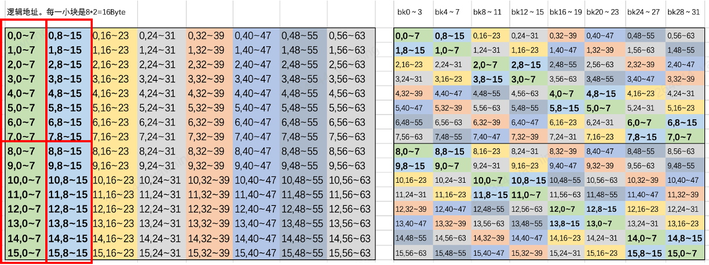

## 3\. TSM group conflict

### 3.1 warp 与 PU 的映射关系

在真武 M890 上，每个 CU 有 4 个 PU（Processing Unit）。假设一个 kernel 有 2 个 block、每个 block 有 8 个 warp。那么每个 PU 依次放一个 warp（round-robin），即 `PU = warp_id % 4`。因此 block 0 和 block 1 的 warp0/4 都在 PU0，warp1/5 都在 PU1，warp2/6 都在 PU2，warp3/7 都在 PU3。但如果上一个 kernel 的最后一个 warp 放到了 PU1 上，那么这个 kernel 的 warp0 就会放到 PU2。之后的 warp 顺延。

图3-1：warp 与 PU 的映射关系

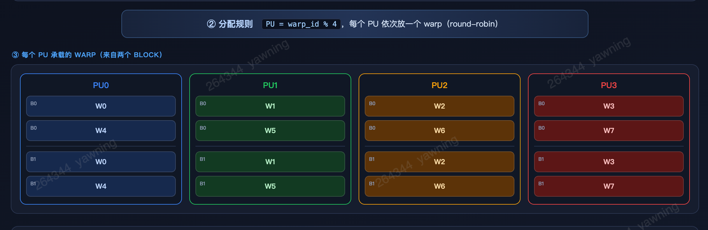

### 3.2 4PU to 4TSM group arbitration logic

在不考虑 bank conflict 的前提下，每 cycle 每个 PU 会拆出一个 group 访问请求；4 个 PU 的请求共同进入 TSM group arbitration，每 cycle 由 arbitration 逻辑将这些请求映射到 4 个 TSM group。

对于 `tsm.ld.swzl.x4`，每个 PU 都可能有一条 `x4` 指令；这条指令会拆出 4 个 group 请求，并在后续 cycle 中逐步参与 arbitration。

下图展示了 4 个 PU 的 group 请求队列通过 arbitration 映射到 4 个 TSM group 的过程。PU0 和 PU1 的 group 请求是 0、1、0、1，PU2 和 PU3 的 group 请求是 2、3、2、3。

图3-2：4 个 PU 到 4 个 TSM group 的请求仲裁

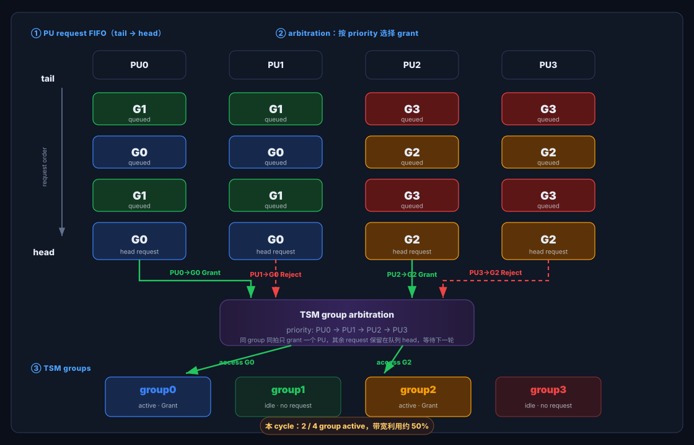

**读图顺序**：PU 队列上方是 tail，下方是 head；当前 cycle 取最下面一行 head request。

**Grant / Reject**：同 group 同拍只能 grant 一个 PU，其余 request 留在队列 head，等待下一轮。

**本拍结果**：只有 group0 和 group2 被访问，group1 和 group3 空闲，带宽利用约 50%。

4 个 PU 之间按照 FIFO 队列进行优先级调度。假设初始优先级为：`PU0 -> PU1 -> PU2 -> PU3`。

当前这一拍 arbitration 中出现下面的请求：

```
PU0 -> G0  Grant
PU1 -> G0  Reject
PU2 -> G2  Grant
PU3 -> G2  Reject
```

那么这一拍只有 G0 和 G2 被真正访问，G1 和 G3 没有请求，TSM 带宽浪费约 50%。

当 PU0 的当前 `x4` 指令处理完后，优先级会轮转，变为：`PU1 -> PU2 -> PU3 -> PU0`。

如果一条 `tsm.ld.swzl.x4` 拆出来的访问 pattern 类似 `0101` 或 `2323`，TSM 带宽效率最高约为 75%。

### 3.3 消除 TSM group conflict

**所有 PU 以相同 pattern 访问 4 个不同的 TSM group**，例如 `{0,1,2,3}`。这样只需要在开始的前几拍通过 conflict/reject 机制，让 4 个 PU 错开相位，后续请求就不再产生 conflict。详见：前五拍 Arbitration Logic。这样在进入稳态后，每个 cycle 中 PU0～PU3 分别访问不同 group，从而充分利用 4 个 TSM group。

图3-3：前五拍 Arbitration Logic

所有 PU 以相同 group pattern 访问时，前几拍通过 conflict/reject 形成相位错开。每个 PU 队列展示 6 个 entry：从 head 往 tail 按 `G0,G1,G2,G3,G0,G1...` 顺序排列。

队列方向

tail → head

图中每列最上方是 tail，最下方是当前 cycle 的 head request。

仲裁时序

Cycle 0–4

展示前五拍的仲裁过程，后两拍均为 4 路 grant。

稳态

4 / 4 groups

Cycle 3 和 Cycle 4 的所有 PU request 均被 grant，4 个 TSM group 全部 active。

**交互演示：**点击下方 Cycle 按钮，逐拍查看仲裁过程。

✓ Cycle 0 Cycle 1 Cycle 2 Cycle 3 Cycle 4

Cycle 0

**PU0→G0 Grant**；PU1/PU2/PU3 Reject

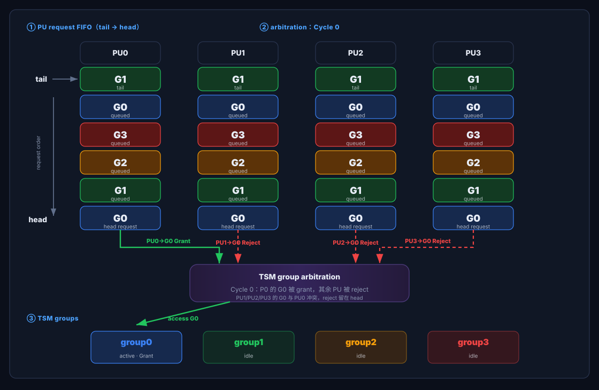

Cycle 1

**PU0→G1 Grant，PU1→G0 Grant**；PU2/PU3 Reject

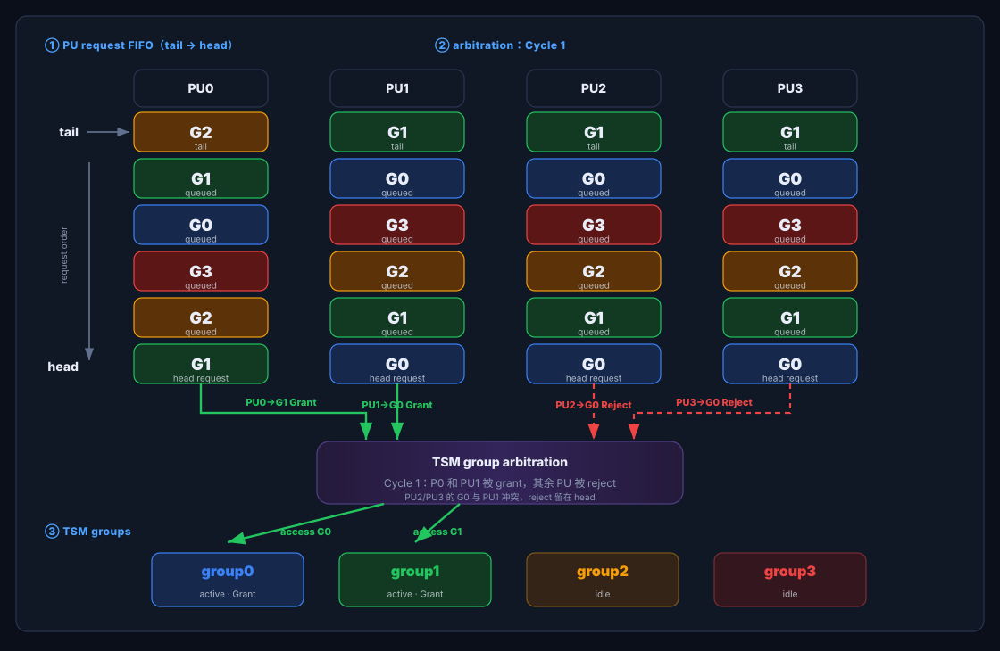

Cycle 2

**PU0→G2 Grant，PU1→G1 Grant，PU2→G0 Grant**；PU3 Reject

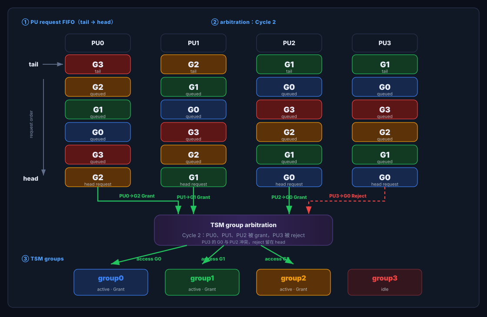

Cycle 3

**PU0→G3 Grant，PU1→G2 Grant，PU2→G1 Grant，PU3→G0 Grant**

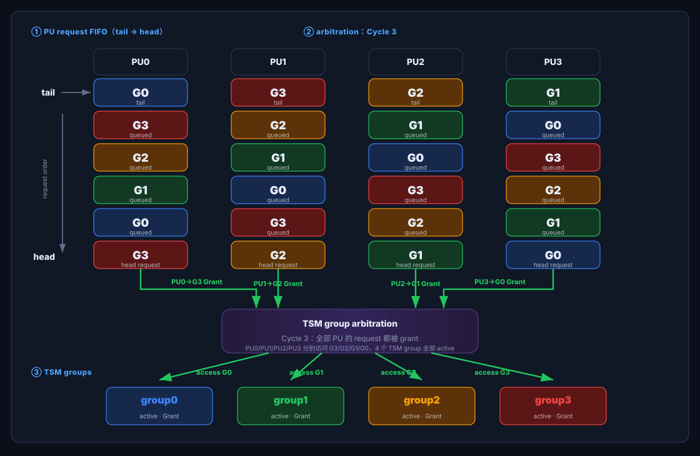

Cycle 4

**PU0→G0 Grant，PU1→G3 Grant，PU2→G2 Grant，PU3→G1 Grant**

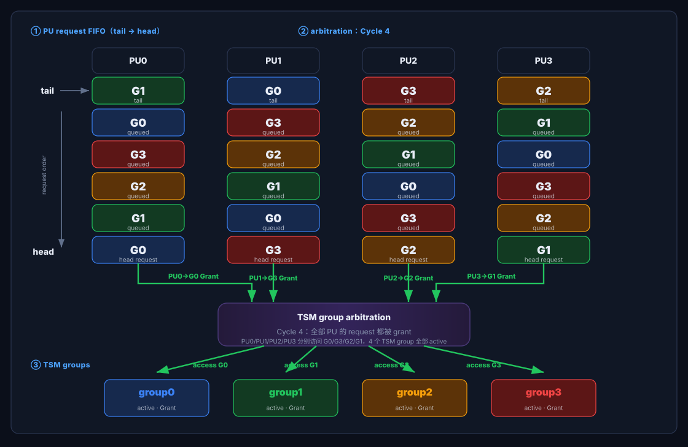

### 五拍语义

Cycle 0：`PU0:G0` grant，其余 PU reject。

Cycle 1：`PU0:G1`、`PU1:G0` grant，PU2/PU3 reject。

Cycle 2：`PU0:G2`、`PU1:G1`、`PU2:G0` grant，PU3 reject。

Cycle 3：`PU0:G3`、`PU1:G2`、`PU2:G1`、`PU3:G0` 全部 grant。

Cycle 4：`PU0:G0`、`PU1:G3`、`PU2:G2`、`PU3:G1` 全部 grant。

### 队列顺序与操作说明

Cycle 0～2 中，PU3 的 head→tail 顺序为 `G0,G1,G2,G3,G0,G1...`，图中 tail→head 因此显示为 `G1,G0,G3,G2,G1,G0`。

点击顶部 Cycle 0～4 按钮，可查看各拍的队头请求、grant/reject 结果及 active group。

### 3.4 GEMM 的一个解法：相邻 tile 的 MMA 交错执行

先考虑一个简单的 bf16 GEMM：`A(16×128) × B(16×128)^T`。如果 A、B 以 `CUBE_H=16, CUBE_W=64` 存入 TSM，A、B 每次 `tsm.ld.swzl` 访问的 group 如左图所示：

图3-4：相邻 tile 的 MMA 交错执行

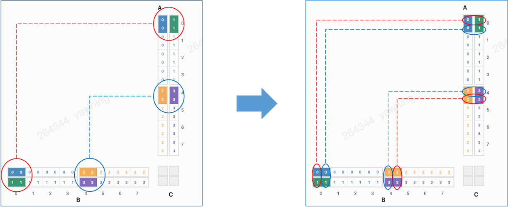

第 0 次 MMA 对应红色虚线，第 4 次 MMA 对应蓝色虚线。第 0 次 MMA 的 `tsm.ld.swzl` 访问 G0、G1，第 4 次 MMA 的 `tsm.ld.swzl` 访问 G2、G3，存在 group conflict。

如果不按原始顺序连续访问，而是把相邻 tile 的 MMA load 交错起来，如右图所示，第 0 次和第 4 次 MMA 交错执行，则两次 MMA 的 `tsm.ld.swzl` 可以访问 G0～G3。

## 4\. TSM group conflict 是否值得优化

不是所有 case 都值得做 TSM group conflict 优化。优化前先确认 kernel 是否真的被 TSM 访问限制：

1.  当前 warp tile 是否是 **TSM bandwidth bound**；
2.  stall reason 是否指向 TSM；
3.  ACU（Asight Compute，kernel 性能分析工具）中的 tsm group conflict ratio 是否显著。

## 5\. FlashMLA 优化实例

### 5.1 背景与问题

本节以 T-Head SAIL 软件栈的 [FlashMLA](https://github.com/t-head/FlashMLA-for-sail/) 的 cross\_cut 算法为例，讨论 `kBlockM=64、kBlockN=64、kWarps=16` 配置下的 group conflict 优化。其他配置的优化方法与此类似。

#### 5.1.1 cross\_cut 算法的 warp 切分

在 `kBlockM=64, kBlockN=64`（kWarps=16）的 FlashMLA kernel 中：

-   **gemm0**：Q(64×576) × K(64×576)T
-   **gemm1**：P(64×64) × V(64×512)

图5-1：FlashMLA Warp Tiling：kBlockM=64, kBlockN=64, kWarps=16

576

64

w0,4,8,12

w1,5,9,13

w2,6,10,14

w3,7,11,15

Q

64

576

w

0,1

2,3

w

4,5

6,7

w

8,9

10,11

w

12,13

14,15

K

64

64

0

1

2

3

4

5

6

7

8

9

10

11

12

13

14

15

S

softmax
tsm.st/tsm.ld

64

64

P

512

64

warp0→warp15

V

512

64

warp0→warp15

O

Q、K 均以 CUBE\_H=64, CUBE\_W=64 存入 TSM。下图展示了这种配置下的 group 分布：

每小块 = 8×8 bf16 (128B) | 每个 group interleave block（图中的 group-row）= 1KB（1024B） | TSM 共 4 个 group，每个 group 容量为 64KB
左侧数字 = 起始行号 | 上方数字 = 起始列号 | 虚线 = 16×16 MMA 边界

Group:

G0

G1

G2

G3

图5-2：Q、K (64×576) 在 TSM 中的原始排布（CUBE\_H=64, CUBE\_W=64）

AIU（DataMovement Accelerator Unit）每次拷贝 1 个 64×64 tile | 每个 tile 占 8 个 group-row | 存储顺序：t0, t1, ..., t8 依次存入 TSM

0

8

16

24

32

40

48

56

64

72

80

88

96

104

112

120

128

136

144

152

160

168

176

184

192

200

208

216

224

232

240

248

256

264

272

280

288

296

304

312

320

328

336

344

352

360

368

376

384

392

400

408

416

424

432

440

448

456

464

472

480

488

496

504

512

520

528

536

544

552

560

568

0

0

0

0

0

0

0

0

0

0

0

0

0

0

0

0

0

0

0

0

0

0

0

0

0

0

0

0

0

0

0

0

0

0

0

0

0

0

0

0

0

0

0

0

0

0

0

0

0

0

0

0

0

0

0

0

0

0

0

0

0

0

0

0

0

0

0

0

0

0

0

0

0

8

1

1

1

1

1

1

1

1

1

1

1

1

1

1

1

1

1

1

1

1

1

1

1

1

1

1

1

1

1

1

1

1

1

1

1

1

1

1

1

1

1

1

1

1

1

1

1

1

1

1

1

1

1

1

1

1

1

1

1

1

1

1

1

1

1

1

1

1

1

1

1

1

16

2

2

2

2

2

2

2

2

2

2

2

2

2

2

2

2

2

2

2

2

2

2

2

2

2

2

2

2

2

2

2

2

2

2

2

2

2

2

2

2

2

2

2

2

2

2

2

2

2

2

2

2

2

2

2

2

2

2

2

2

2

2

2

2

2

2

2

2

2

2

2

2

24

3

3

3

3

3

3

3

3

3

3

3

3

3

3

3

3

3

3

3

3

3

3

3

3

3

3

3

3

3

3

3

3

3

3

3

3

3

3

3

3

3

3

3

3

3

3

3

3

3

3

3

3

3

3

3

3

3

3

3

3

3

3

3

3

3

3

3

3

3

3

3

3

32

0

0

0

0

0

0

0

0

0

0

0

0

0

0

0

0

0

0

0

0

0

0

0

0

0

0

0

0

0

0

0

0

0

0

0

0

0

0

0

0

0

0

0

0

0

0

0

0

0

0

0

0

0

0

0

0

0

0

0

0

0

0

0

0

0

0

0

0

0

0

0

0

40

1

1

1

1

1

1

1

1

1

1

1

1

1

1

1

1

1

1

1

1

1

1

1

1

1

1

1

1

1

1

1

1

1

1

1

1

1

1

1

1

1

1

1

1

1

1

1

1

1

1

1

1

1

1

1

1

1

1

1

1

1

1

1

1

1

1

1

1

1

1

1

1

48

2

2

2

2

2

2

2

2

2

2

2

2

2

2

2

2

2

2

2

2

2

2

2

2

2

2

2

2

2

2

2

2

2

2

2

2

2

2

2

2

2

2

2

2

2

2

2

2

2

2

2

2

2

2

2

2

2

2

2

2

2

2

2

2

2

2

2

2

2

2

2

2

56

3

3

3

3

3

3

3

3

3

3

3

3

3

3

3

3

3

3

3

3

3

3

3

3

3

3

3

3

3

3

3

3

3

3

3

3

3

3

3

3

3

3

3

3

3

3

3

3

3

3

3

3

3

3

3

3

3

3

3

3

3

3

3

3

3

3

3

3

3

3

3

3

t0
64×64

t1
64×64

t2
64×64

t3
64×64

t4
64×64

t5
64×64

t6
64×64

t7
64×64

t8
64×64

#### 5.1.2 tsm.ld.swzl 产生 tsm group conflict

对于 FlashMLA 的 gemm0，每个 warp 计算 16×16×576，需要将 16×576 的 Q、K 分别从 TSM load 到 vreg（寄存器）中。

在真武 M890 上，每条 mma.m16n16k16 指令需要 K 进行一次 tsm.ld.swzl 来加载 16×16 的数据。由图5-2可知，一次 tsm.ld.swzl 加载 4 个 8×8 块（即一个 16×16 MMA 操作数），分别属于 group 0/1 或 2/3。

| 参数 | 值 |
| :--- | :--- |
| group interleave block 大小（地址交错粒度） | 1KB（1024B） |
| 每个 group 容量 | 64KB（64×1KB） |
| TSM group 数 | 4 (G0, G1, G2, G3) |
| 每小块 | 8×8 bf16 = 128B |
| Swizzle 作用范围 | 8×64 atom 内部 |
| Swizzle 方法 | 与 actlize 的 Swizzle<B,M,S> 一致 |

**ld pattern 分析**（按 warp 分组）：

| 矩阵 | warp 组 | ld pattern | 冲突情况 |
| :--- | :--- | :--- | :--- |
| Q | warp\_idx={0,2,4,6,8,10,12,14} | {0,1,0,1} | G0/G1 各访问 2 次 |
| Q | warp\_idx={1,3,5,7,9,11,13,15} | {2,3,2,3} | G2/G3 各访问 2 次 |
| K | warp\_idx={0,1,2,3,8,9,10,11} | {0,0,1,1} | G0 连续 2 次 ⚠️ |
| K | warp\_idx={4,5,6,7,12,13,14,15} | {2,2,3,3} | G2 连续 2 次 ⚠️ |

**问题**：K 的 pattern {0,0,1,1} 中，前两次访问落在同一 group，产生 1 拍 stall。Q 的 {0,1,0,1} 虽然无连续冲突，但仅使用了 2 个 group，未充分利用 4-way 并行。
**目标**：将所有 ld pattern 改为 {0,1,2,3} 或 {0,2,1,3}，使 4 次访问分布在 4 个不同 group 上。

* * *

### 5.2 gemm0 改进后的 Tile 配置与 Group 分布

#### 5.2.1 每个 warp 的 ld pattern 落在 group 0～3 四个值上

将 Q、K 改为 CUBE\_H=16, CUBE\_W=64 存储。

代价：aiu copy 指令翻 4 倍（分摊到 4 个 warp 执行来抵消）。

图5-3：CUBE\_H=16, CUBE\_W=64

AIU 每次拷贝 1 个 16×64 tile | 每个 tile 仅占 2 个 group-row | 存储顺序：先排完一个 tile-row 的 9 列，再到下一个 tile-row

0

8

16

24

32

40

48

56

64

72

80

88

96

104

112

120

128

136

144

152

160

168

176

184

192

200

208

216

224

232

240

248

256

264

272

280

288

296

304

312

320

328

336

344

352

360

368

376

384

392

400

408

416

424

432

440

448

456

464

472

480

488

496

504

512

520

528

536

544

552

560

568

0

0

0

0

0

0

0

0

0

2

2

2

2

2

2

2

2

0

0

0

0

0

0

0

0

2

2

2

2

2

2

2

2

0

0

0

0

0

0

0

0

2

2

2

2

2

2

2

2

0

0

0

0

0

0

0

0

2

2

2

2

2

2

2

2

0

0

0

0

0

0

0

0

8

1

1

1

1

1

1

1

1

3

3

3

3

3

3

3

3

1

1

1

1

1

1

1

1

3

3

3

3

3

3

3

3

1

1

1

1

1

1

1

1

3

3

3

3

3

3

3

3

1

1

1

1

1

1

1

1

3

3

3

3

3

3

3

3

1

1

1

1

1

1

1

1

16

2

2

2

2

2

2

2

2

0

0

0

0

0

0

0

0

2

2

2

2

2

2

2

2

0

0

0

0

0

0

0

0

2

2

2

2

2

2

2

2

0

0

0

0

0

0

0

0

2

2

2

2

2

2

2

2

0

0

0

0

0

0

0

0

2

2

2

2

2

2

2

2

24

3

3

3

3

3

3

3

3

1

1

1

1

1

1

1

1

3

3

3

3

3

3

3

3

1

1

1

1

1

1

1

1

3

3

3

3

3

3

3

3

1

1

1

1

1

1

1

1

3

3

3

3

3

3

3

3

1

1

1

1

1

1

1

1

3

3

3

3

3

3

3

3

32

0

0

0

0

0

0

0

0

2

2

2

2

2

2

2

2

0

0

0

0

0

0

0

0

2

2

2

2

2

2

2

2

0

0

0

0

0

0

0

0

2

2

2

2

2

2

2

2

0

0

0

0

0

0

0

0

2

2

2

2

2

2

2

2

0

0

0

0

0

0

0

0

40

1

1

1

1

1

1

1

1

3

3

3

3

3

3

3

3

1

1

1

1

1

1

1

1

3

3

3

3

3

3

3

3

1

1

1

1

1

1

1

1

3

3

3

3

3

3

3

3

1

1

1

1

1

1

1

1

3

3

3

3

3

3

3

3

1

1

1

1

1

1

1

1

48

2

2

2

2

2

2

2

2

0

0

0

0

0

0

0

0

2

2

2

2

2

2

2

2

0

0

0

0

0

0

0

0

2

2

2

2

2

2

2

2

0

0

0

0

0

0

0

0

2

2

2

2

2

2

2

2

0

0

0

0

0

0

0

0

2

2

2

2

2

2

2

2

56

3

3

3

3

3

3

3

3

1

1

1

1

1

1

1

1

3

3

3

3

3

3

3

3

1

1

1

1

1

1

1

1

3

3

3

3

3

3

3

3

1

1

1

1

1

1

1

1

3

3

3

3

3

3

3

3

1

1

1

1

1

1

1

1

3

3

3

3

3

3

3

3

t0
16×64

t1
16×64

t2
16×64

t3
16×64

t4
16×64

t5
16×64

t6
16×64

t7
16×64

t8
16×64

t0 和 t1、t2 和 t3、t4 和 t5、t6 和 t7 的 mma 交错执行。t8 的 mma 执行顺序不变。

**问题**：一个 tile-row 有 9 个 tile，每个 tile 占 2 个 1KB group interleave block，共 18 个 block；18 mod 4 = 2 ≠ 0，不同 warp 的 ld pattern 不一致：

| 矩阵 | warp 组 | t0～t7 的 ld pattern | t8 的 ld pattern |
| :--- | :--- | :--- | :--- |
| K | warp\_idx={0,1,2,3,8,9,10,11} | {0,2,1,3} | {0,0,1,1} |
| K | warp\_idx={4,5,6,7,12,13,14,15} | {2,0,3,1} | {2,2,3,3} |
| Q | warp\_idx={0,2,4,6,8,10,12,14} | {0,1,2,3} | {0,1,0,1} |
| Q | warp\_idx={1,3,5,7,9,11,13,15} | {2,3,0,1} | {2,3,2,3} |

#### 5.2.2 统一不同 warp 上的 ld pattern（Padding）

在 TSM 中为每个 tile-row 增加 2 个 1KB group interleave block 作为 padding，使每个 tile-row 的 block 数从 18 增至 20，为 4 的倍数。

代价：额外 TSM 开销 `2048 × (64/16) × 3 = 24576B`（当前 TSM 用量 230656B，230656B + 24576B = 255232B < 262144B，放得下）。

图5-4：CUBE\_H=16, CUBE\_W=64 + Padding（各 tile-row 起始 group 对齐）

每个 tile-row 补 2 个 1KB group interleave block（18→20 个 block） | 各 tile-row 起始 group 对齐到 G0 | t0～t7 中，K 为 {0,2,1,3}，Q 为 {0,1,2,3}；t8 尚未统一。

0

8

16

24

32

40

48

56

64

72

80

88

96

104

112

120

128

136

144

152

160

168

176

184

192

200

208

216

224

232

240

248

256

264

272

280

288

296

304

312

320

328

336

344

352

360

368

376

384

392

400

408

416

424

432

440

448

456

464

472

480

488

496

504

512

520

528

536

544

552

560

568

576

584

592

600

608

616

624

632

0

0

0

0

0

0

0

0

0

2

2

2

2

2

2

2

2

0

0

0

0

0

0

0

0

2

2

2

2

2

2

2

2

0

0

0

0

0

0

0

0

2

2

2

2

2

2

2

2

0

0

0

0

0

0

0

0

2

2

2

2

2

2

2

2

0

0

0

0

0

0

0

0

2

2

2

2

2

2

2

2

8

1

1

1

1

1

1

1

1

3

3

3

3

3

3

3

3

1

1

1

1

1

1

1

1

3

3

3

3

3

3

3

3

1

1

1

1

1

1

1

1

3

3

3

3

3

3

3

3

1

1

1

1

1

1

1

1

3

3

3

3

3

3

3

3

1

1

1

1

1

1

1

1

3

3

3

3

3

3

3

3

16

0

0

0

0

0

0

0

0

2

2

2

2

2

2

2

2

0

0

0

0

0

0

0

0

2

2

2

2

2

2

2

2

0

0

0

0

0

0

0

0

2

2

2

2

2

2

2

2

0

0

0

0

0

0

0

0

2

2

2

2

2

2

2

2

0

0

0

0

0

0

0

0

2

2

2

2

2

2

2

2

24

1

1

1

1

1

1

1

1

3

3

3

3

3

3

3

3

1

1

1

1

1

1

1

1

3

3

3

3

3

3

3

3

1

1

1

1

1

1

1

1

3

3

3

3

3

3

3

3

1

1

1

1

1

1

1

1

3

3

3

3

3

3

3

3

1

1

1

1

1

1

1

1

3

3

3

3

3

3

3

3

32

0

0

0

0

0

0

0

0

2

2

2

2

2

2

2

2

0

0

0

0

0

0

0

0

2

2

2

2

2

2

2

2

0

0

0

0

0

0

0

0

2

2

2

2

2

2

2

2

0

0

0

0

0

0

0

0

2

2

2

2

2

2

2

2

0

0

0

0

0

0

0

0

2

2

2

2

2

2

2

2

40

1

1

1

1

1

1

1

1

3

3

3

3

3

3

3

3

1

1

1

1

1

1

1

1

3

3

3

3

3

3

3

3

1

1

1

1

1

1

1

1

3

3

3

3

3

3

3

3

1

1

1

1

1

1

1

1

3

3

3

3

3

3

3

3

1

1

1

1

1

1

1

1

3

3

3

3

3

3

3

3

48

0

0

0

0

0

0

0

0

2

2

2

2

2

2

2

2

0

0

0

0

0

0

0

0

2

2

2

2

2

2

2

2

0

0

0

0

0

0

0

0

2

2

2

2

2

2

2

2

0

0

0

0

0

0

0

0

2

2

2

2

2

2

2

2

0

0

0

0

0

0

0

0

2

2

2

2

2

2

2

2

56

1

1

1

1

1

1

1

1

3

3

3

3

3

3

3

3

1

1

1

1

1

1

1

1

3

3

3

3

3

3

3

3

1

1

1

1

1

1

1

1

3

3

3

3

3

3

3

3

1

1

1

1

1

1

1

1

3

3

3

3

3

3

3

3

1

1

1

1

1

1

1

1

3

3

3

3

3

3

3

3

t0
16×64

t1
16×64

t2
16×64

t3
16×64

t4
16×64

t5
16×64

t6
16×64

t7
16×64

t8
16×64

pad
16×64

| 矩阵 | warp 组 | t0～t7 的 ld pattern | t8 的 ld pattern |
| :--- | :--- | :--- | :--- |
| K | warp\_idx={0~15} | {0,2,1,3} | {0,0,1,1} |
| Q | warp\_idx={0~15} | {0,1,2,3} | {0,1,0,1} |

#### 5.2.3 统一 t8 的 ld pattern

Padding 部分也执行 aiu copy，即把 t8 的数据再做一次 copy 到 padding 里。t8 的 mma 就可以使用交错执行了。

代价：aiu copy 数据量多 1/9，HBM load 压力增大（对 compute bound 场景的影响不大）。

| 矩阵 | warp 组 | t0～t7 的 ld pattern | t8 的 ld pattern |
| :--- | :--- | :--- | :--- |
| K | warp\_idx={0~15} | {0,2,1,3} | {0,2,1,3} |
| Q | warp\_idx={0~15} | {0,1,2,3} | {0,1,2,3} |

#### 5.2.4 统一 Q、K 的 ld pattern

将 Q 的 ld pattern 从 {0,1,2,3} 改为 {0,2,1,3}：在 TSM 中交换 Q 的 group1 和 group2 中存储的数据，一块 16×128 的 Q 分 4 个 8×64 来 load。

下图展示了 mma 需要的 16×16 数据在 TSM 中的位置。

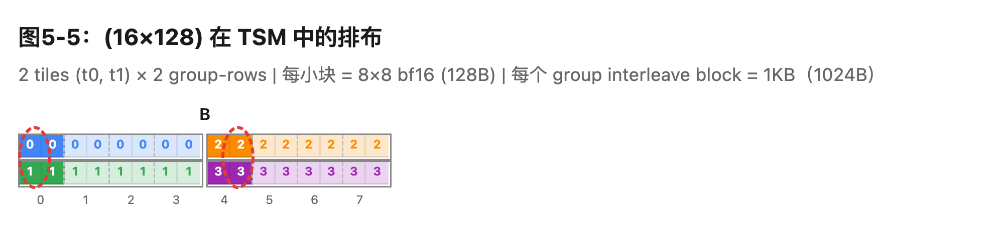

对于 Q，用 LBO=128、SBO=64 的 tsm.ld.swzl（ld pattern: {0,1,2,3}）存入 vreg 如下：

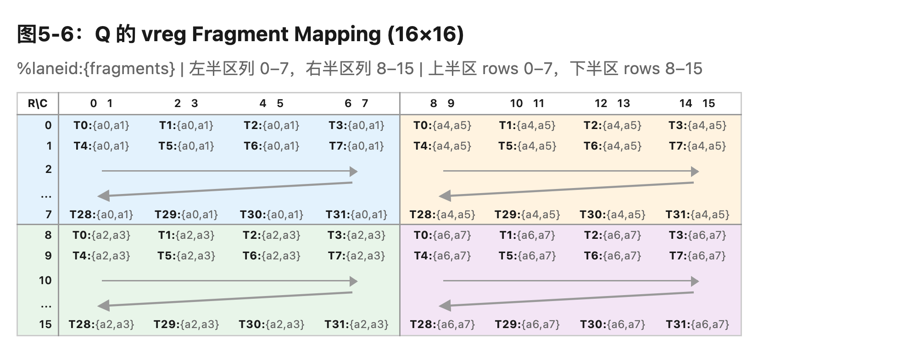

而对于 K，用 LBO=64、SBO=128 的 tsm.ld.swzl（ld pattern：{0,2,1,3}）存入 vreg 如下：

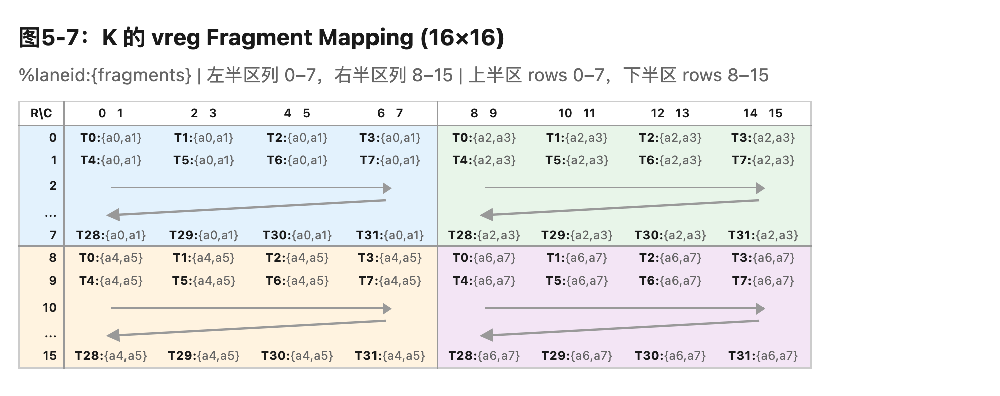

因此，如果要把 Q 的 ld pattern 改成与 K 一致，可以选择更改 Q 在 TSM 中的存储位置：将 TSM 中 group1 与 group2 存储的数据进行互换。

图5-8：Q 使用 CUBE\_H=8, CUBE\_W=64 + Padding（统一 ld pattern）

每个 tile-row 补 2 个 1KB group interleave block（18→20 个 block） | 每个 tile-row 从 group 0 对齐 | 所有 warp 的 ld pattern 统一为 {0,2,1,3}

0

8

16

24

32

40

48

56

64

72

80

88

96

104

112

120

128

136

144

152

160

168

176

184

192

200

208

216

224

232

240

248

256

264

272

280

288

296

304

312

320

328

336

344

352

360

368

376

384

392

400

408

416

424

432

440

448

456

464

472

480

488

496

504

512

520

528

536

544

552

560

568

576

584

592

600

608

616

624

632

0

0

0

0

0

0

0

0

0

1

1

1

1

1

1

1

1

0

0

0

0

0

0

0

0

1

1

1

1

1

1

1

1

0

0

0

0

0

0

0

0

1

1

1

1

1

1

1

1

0

0

0

0

0

0

0

0

1

1

1

1

1

1

1

1

0

0

0

0

0

0

0

0

1

1

1

1

1

1

1

1

8

2

2

2

2

2

2

2

2

3

3

3

3

3

3

3

3

2

2

2

2

2

2

2

2

3

3

3

3

3

3

3

3

2

2

2

2

2

2

2

2

3

3

3

3

3

3

3

3

2

2

2

2

2

2

2

2

3

3

3

3

3

3

3

3

2

2

2

2

2

2

2

2

3

3

3

3

3

3

3

3

16

0

0

0

0

0

0

0

0

1

1

1

1

1

1

1

1

0

0

0

0

0

0

0

0

1

1

1

1

1

1

1

1

0

0

0

0

0

0

0

0

1

1

1

1

1

1

1

1

0

0

0

0

0

0

0

0

1

1

1

1

1

1

1

1

0

0

0

0

0

0

0

0

1

1

1

1

1

1

1

1

24

2

2

2

2

2

2

2

2

3

3

3

3

3

3

3

3

2

2

2

2

2

2

2

2

3

3

3

3

3

3

3

3

2

2

2

2

2

2

2

2

3

3

3

3

3

3

3

3

2

2

2

2

2

2

2

2

3

3

3

3

3

3

3

3

2

2

2

2

2

2

2

2

3

3

3

3

3

3

3

3

32

0

0

0

0

0

0

0

0

1

1

1

1

1

1

1

1

0

0

0

0

0

0

0

0

1

1

1

1

1

1

1

1

0

0

0

0

0

0

0

0

1

1

1

1

1

1

1

1

0

0

0

0

0

0

0

0

1

1

1

1

1

1

1

1

0

0

0

0

0

0

0

0

1

1

1

1

1

1

1

1

40

2

2

2

2

2

2

2

2

3

3

3

3

3

3

3

3

2

2

2

2

2

2

2

2

3

3

3

3

3

3

3

3

2

2

2

2

2

2

2

2

3

3

3

3

3

3

3

3

2

2

2

2

2

2

2

2

3

3

3

3

3

3

3

3

2

2

2

2

2

2

2

2

3

3

3

3

3

3

3

3

48

0

0

0

0

0

0

0

0

1

1

1

1

1

1

1

1

0

0

0

0

0

0

0

0

1

1

1

1

1

1

1

1

0

0

0

0

0

0

0

0

1

1

1

1

1

1

1

1

0

0

0

0

0

0

0

0

1

1

1

1

1

1

1

1

0

0

0

0

0

0

0

0

1

1

1

1

1

1

1

1

56

2

2

2

2

2

2

2

2

3

3

3

3

3

3

3

3

2

2

2

2

2

2

2

2

3

3

3

3

3

3

3

3

2

2

2

2

2

2

2

2

3

3

3

3

3

3

3

3

2

2

2

2

2

2

2

2

3

3

3

3

3

3

3

3

2

2

2

2

2

2

2

2

3

3

3

3

3

3

3

3

t0
16×64

t1
16×64

t2
16×64

t3
16×64

t4
16×64

t5
16×64

t6
16×64

t7
16×64

t8
16×64

pad
16×64

此时，Q 用 LBO=64、SBO=128 的 tsm.ld.swzl（ld pattern: {0,2,1,3}）得到的就是图5-6的 vreg。

| 矩阵 | warp 组 | t0～t7 的 ld pattern | t8 的 ld pattern |
| :--- | :--- | :--- | :--- |
| Q、K | warp\_idx={0~15} | {0,2,1,3} | {0,2,1,3} |

* * *

### 5.3 gemm1 的 Group Conflict（结论：收益不大）

| 改动 | 结果 |
| :--- | :--- |
| V 在 N 方向交错 load → {0,1,2,3} | conflict 无变化，gemm1 的性能变差 2.5% |
| P 改用 tsm.ld.swzl | 精度 pass，无性能变化 |
| P + V 同时消除 conflict | conflict 0.21→0.01，gemm1 的性能仅变好 2.6% |

gemm1 消除 conflict 仅缩短 4ms（整个 FlashMLA ~500ms 中 <1%）。**gemm0 是主要优化方向**。

* * *

### 5.4 遇到的问题与修复

| 问题 | 根因 | 修复 |
| :--- | :--- | :--- |
| 7000 条多余指令 | cute::clear TSM 展开 | 注释掉 |
| vreg 256, stack 66 | 36+1 条 tsm.ld.swzl 后才 s.wait | K/Q load 穿插执行 |
| modify\_tile conflict 加重 | 仅调 tile 不交错，地址对齐到同 group | 必须配合交错 load |
| smem.ld.b32/sldcnt 距离太近 | 编译器排布 | 增大定义和使用距离，545→532ms |
| gemm1 pipe busy 暴涨 | tsm.ld.swzl 密集，tsmcnt(26) 过大 | gemm1 不做 conflict 消除 |

### 5.5 性能提升

TFU（Theory FLOPs Utilization）的计算公式为 `TFU = F_alg / (t × P_peak) × 100%`。其中，`F_alg` 为算法理论浮点运算量（FLOPs），`t` 为实测耗时（秒），`P_peak` 为设备峰值算力（FLOP/s）。峰值采用测试设备相应频率下的 BF16 峰值算力；分子采用算法理论 FLOPs。

| 用例 | 场景 | TFU 变化 | group conflict ratio 变化 |
| :--- | :--- | :--- | :--- |
| cross\_cut，KBlockM=16、32 | memory-bound | —（未优化） | —（未优化） |
| cross\_cut，KBlockM=48 | 接近 compute-bound | 27.8% → 30.9% | 0.33 → 0.12 |
| cross\_cut，KBlockM=64 | 接近 compute-bound | 33% → 36% | 0.44 → 0.10 |
| warp-iterative，KBlockM=128 | compute-bound | 42% → 49.5% | 0.42 → 0.12 |

前文5.1～5.4详细展开的是 cross\_cut、KBlockM=64 的优化过程；上述结论同时覆盖 KBlockM=48 及 warp-iterative、KBlockM=128 的用例。

上述各组的 TFU 与 tsm group conflict ratio 均为消除 group conflict 前后的对比值；整体加速比例仍需结合原始数据和对应耗时计算。
