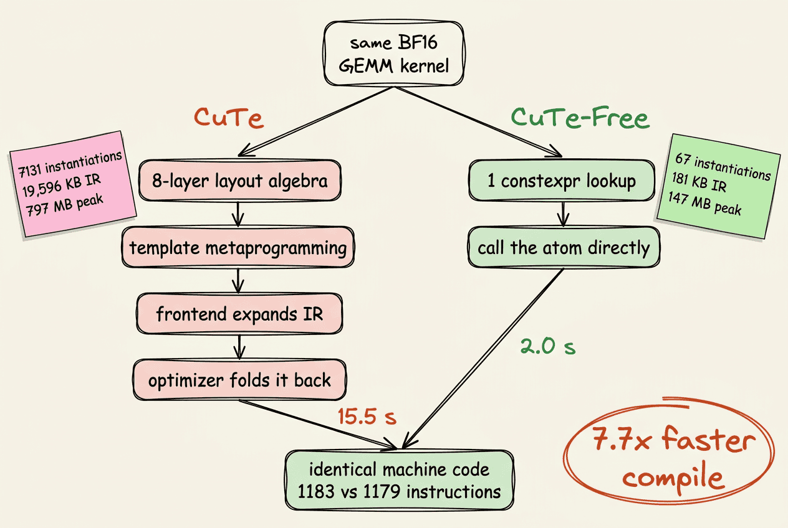
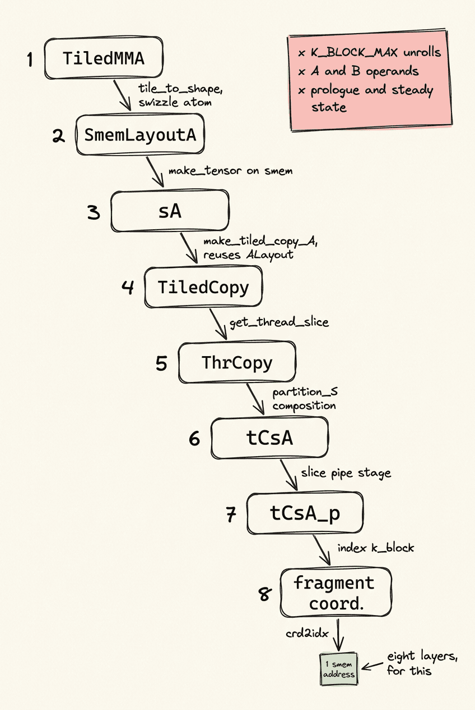
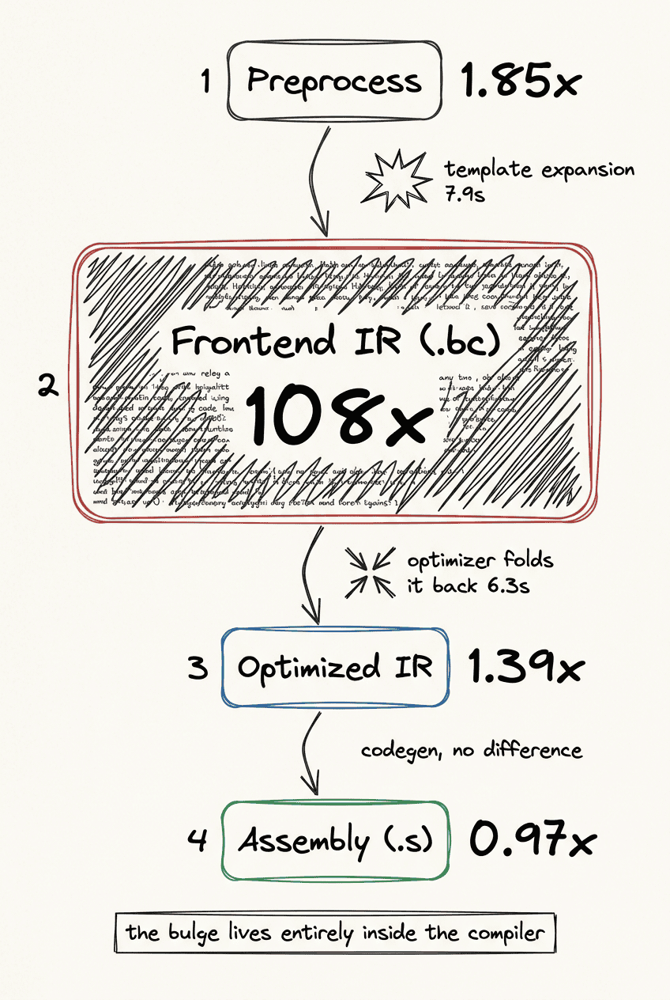
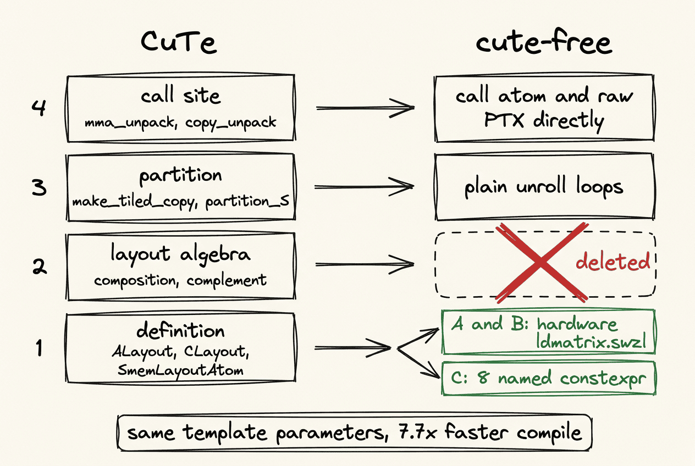
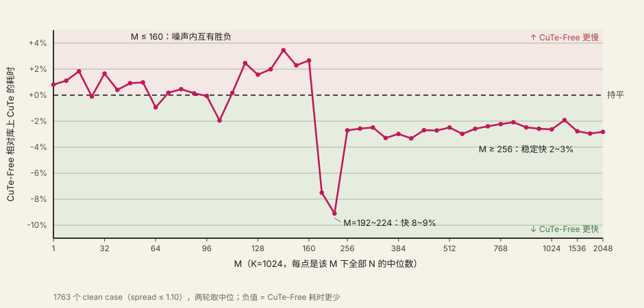

# 性能持平，编译提速 7.7×：从 CuTe 到 CuTe-Free 的一次编译时间优化



同一个 BF16 GEMM kernel 的两条到达路径：CuTe 侧要走八层 Layout 代数 → 模板元编程 → 前端展开 IR → 中端折回四步（7131 次实例化 / 19,596 KB IR / 797 MB 峰值，15.5s）；CuTe-Free 侧只剩一次 constexpr 查表和直接调 atom 两步（67 次 / 181 KB / 147 MB，2.0s）。两条路径汇聚到同一份机器码（1183 vs 1179 条指令）——编译快了 7.7×，跑得一样快

* * *

## 摘要[#](#摘要)

真武 M890 上凡是用 CuTe / actlize 写的 kernel，都有一个共同的体质问题：**表达力和泛化性都很好，但编译很慢**。根源在于 CuTe 把 Layout 当成编译期可运算的代数对象——这份表达力的账最终由编译器来付：前端把 Layout 代数展开成上百万行 IR，中端优化器再花几秒把它折回几千行。对 DeepGEMM 这样一个 JIT + autotune 的算子库来说，这笔开销直接压在冷启动延迟和调优搜索空间两条关键路径上，单 kernel 动辄十几秒的编译时间已经成了工程瓶颈。

我们以 BF16 Dense GEMM 为切入点做了这件事：把它从 CuTe 完全剥离，重写成一份不依赖任何 CuTe 设施的实现（下称 **CuTe-Free** 版），再与原版逐项对照编译时间、生成代码和运行性能。选它作为切入点，是因为它的数据流（G2S → S2R → MMA）和抽象层次在 actlize kernel 里最典型，而且有一个成熟的 CuTe 版本可以逐行对照，任何差异都能归因到具体某一层。

做法是以 CuTe 版为语义基线**逐层降级**：能交给硬件的交给硬件（A/B 排布由 `ldmatrix.swzl` 指令语义保证），硬件兜不住的写成具名 `constexpr`，组合切分退化成普通循环，代数引擎整层删除。**单 kernel 冷编译从 15.5s 降到 2.0s（7.7×）**，模板函数实例化从 7131 次降到 67 次，这份成本约 55% 落在前端实例化、45% 落在中端优化器，后端 codegen 两侧无差异。这不是靠固定 shape 换来的——模板参数化能力一个都没少。性能没有付出代价：两侧最终汇编的指令总量几乎相同（1183 vs 1179 条）；2200 个 shape 的全量扫描里，`M ≥ 192` 的主力区间 CuTe-Free 反而稳定快 2~3%，小 M 区间两侧在噪声内互有胜负。

代价同样真实：泛化性从“模板自动组合”降级为“人工组装 atom”，编译期契约从代数系统的自动推导变成人工维护的 `static_assert`。说到底，我们没有改变最终生成的代码，只是换了一条到达它的路径——从“编译期符号求解”换成“常量查表 + 编译期分支”。**而这条路径与 BF16 无关**：文中提炼的四条降级判据（[§5.2](#52-四条降级判据)）对任何用 CuTe 写的 kernel 都成立，BF16 Dense GEMM 只是第一个完整走完这条路的 kernel。

> 不熟悉 actlize / PPU 术语的读者，可以先翻一下文末的 [附录 A：术语表](#附录-a术语表)。

* * *

## 1\. 背景：为什么编译时间成了工程瓶颈[#](#1-背景为什么编译时间成了工程瓶颈)

先说一个容易被忽略的前提：**DeepGEMM 不是一个 AOT 编译的算子库，而是一个 JIT + autotune 的算子库。**

看 JIT 路径就明白（`csrc/jit/compiler.hpp`）：每遇到一个新的 `(dtype, tile config, layout, 对齐性)` 组合，就现场拼一段 `.cu`、调 `hgcc` 编出 `.hgbin` 设备二进制并缓存起来。命令大致是：

```
hgcc kernel.cu -o kernel.hgbin -std=c++17 -arch=ppu_15 \
     -hgbin -ftemplate-depth=8192 -O3 -DNDEBUG -x hg -I...
```

注意 `-ftemplate-depth=8192`——这个数字本身就是一条线索。

在这个架构下，编译时间不是“构建阶段的事”，它出现在三条路径上：

**① 用户可感知的冷启动延迟。** 缓存未命中时，编译时间直接串在推理请求里。单 kernel 15s，对在线服务不可接受。

**② autotune 的搜索空间被编译时间挤压——这条最要命。** DeepGEMM 的性能来自对 tile config 的搜索：`BLOCK_M/N/K` × `WARP_M/N/K` × `STAGES` 的组合空间，乘数据类型，再乘要覆盖的 shape 集合（`deep_gemm/deep_gemm_tuner/` 下那批 `*_configs.json` 就是搜索产物）。当单点编译要 15s：

-   一轮几百候选的调优，从几分钟拖到数小时；
-   于是人会本能地缩小搜索空间、减少候选、跳过边角 shape；
-   **最终结果是：编译时间在损害这个库的运行时性能。**

**③ 开发期的 time-to-kernel（改一行代码到能跑起来的反馈周期）与 CI。** 算子开发是高频迭代的活：改一行流水顺序、跑一次精度、看一眼 SASS。15s 的编译把这个循环拉长到让人不愿意做小实验的程度；回归测试要覆盖多变体时，成本同样线性放大。

所以这个问题的完整形态不是“编译慢有点烦”，而是**编译时间是这个库性能上限和迭代速度的一个隐性约束**。它值得一次彻底的重写。

* * *

## 2\. 基线：CuTe 版的结构与价值[#](#2-基线cute-版的结构与价值)

在讨论“为什么要改”之前，先讲清楚被改的东西。CuTe 版不是一个失败的设计——它要解决的问题真实存在，而且解得很好。

### 2.1 分层结构与数据流[#](#21-分层结构与数据流)

BF16 DenseGemm 原版实现是一个标准的 actlize 风格 persistent GEMM，分四层：

```
BF16DenseGemm::run()                 ← host：装配类型、算 occupancy、launch
  └─ BF16DenseGemmKernel::operator() ← kernel：persistent 循环
       ├─ DenseGemmScheduler         ← 取下一个输出 tile 的 (m, n)
       ├─ CollectiveMma<MainloopPPUAiuOpt<Stages, ..., DenseS2Opt, OverlapPrologue>>
       │    ├─ prologue：灌满 Stages 个 tile（AIU bulk-tensor G2S）
       │    └─ 稳态：for_each K 拍 { S2R 载下一拍 → MMA 算当前拍 → 插 G2S }
       ├─ warp_on_k_reduce           ← WarpOnK > 1 时的跨 warp 部分和归约
       └─ DefaultEpilogueNoTsm       ← 累加器 f32 → bf16，写回 global
```

数据流是教科书式的 `global → shared → register → tensor cell`：AIU 引擎把 A/B 的 tile 异步搬进 shared memory（多级流水），`ldmatrix` 把 fragment 载入寄存器，`16×16×16` 的 MMA 指令做累加，最后 epilogue 转换精度写回。线程划分由 `TiledMMA` 描述：`WarpOnM × WarpOnN × WarpOnK` 个 warp，其中 K 方向切分的 warp 组各算一份部分和，再归约。

### 2.2 CuTe 的核心优势[#](#22-cute-的核心优势)

这些优点是真实的，也是我们一开始选择 CuTe 的原因：

-   **组合性**：`TiledMMA` = `MMA_Atom` × warp 布局 × tile 形状。换 MMA 指令、换 warp 划分，只改模板参数，切分逻辑自动重新推导。
-   **声明式的排布表达**：数据在 shared memory 里怎么 swizzle、每个线程拿哪些元素，写成 `Layout` 对象，而不是散落在各处的地址算术。改排布是改一个声明，不是改十处偏移公式。
-   **编译期正确性保障**：`make_tiled_copy_A(SmemCopyAtomA{}, tiled_mma)` 会用 MMA 的操作数布局**反推** copy 的线程切分，并用 `CUTE_STATIC_ASSERT_V` 校验两者形状一致。形状对不上是编译错误，不是运行时算错。
-   **零运行时抽象开销**：这是 CuTe 的核心承诺，而且它确实做到了——见 [§7.4](#74-为什么性能没掉先看原理再看数据) 的 SASS 对比。

概括来说，**CuTe 用模板系统当作一台编译期的符号计算引擎，换来了“换任何组合都自动成立”。** 本文要讨论的，是这台引擎的运行成本，以及在什么条件下这个成本不划算。

* * *

## 3\. 测量方法与口径[#](#3-测量方法与口径)

下面把环境、编译口径和对比基准逐项列清，后文所有数字都在这个口径下产生。

### 3.1 环境[#](#31-环境)

| 项 | 值 |
| :--- | :--- |
| 加速卡 | 真武 M890（编译目标 `ppu0015`），多卡，单卡 HBM 98304 MiB |
| 编译工具链 | `hgcc` Release 2.2.0-7e7eb7（Built Sep 5 2026），内部依次调用 g++ / clang++-13 / opt-13 / llc-13 / lld-13 |
| 驱动 / 固件 | Driver 2.3.0-rb5f7f，PPU-SMI 1.31，HGGC 13.3 |
| 宿主机 | 192 核 / 2015 GB 内存（编译在宿主 CPU 上完成，与卡无关） |

编译器后端的选择对本文口径很关键：`csrc/jit/compiler.hpp:481` 里 `default_use_hgrtc = 0`，即**默认走 `hgcc` 子进程编译**（而非 HGRTC 运行时编译，也不默认启用 PCH）。所以本文测的就是生产路径上真实发生的那次编译。

### 3.2 编译时间的测量方式[#](#32-编译时间的测量方式)

-   用 `DG_JIT_PRINT_COMPILER_COMMAND=1` 抓出 JIT 实际下发的完整 `hgcc` 命令行，把它固化成一个 shell 命令文件，之后**所有测量都直接跑这条命令**，不再经过 Python——这样才能保证除 kernel 实现外的编译条件一致（唯一一处 flag 差异见 [§3.4](#34-两侧唯一的变量就是-kernel-实现本身)），并能自由往命令上加诊断选项；
-   用 `DG_JIT_CACHE_DIR=<空临时目录>` 强制 cold build（不动用户默认的 `~/.deep_gemm` 缓存），测的都是冷编译；
-   **单 TU 编译**：JIT 的编译单元就是一个 `.cu` → 一个二进制，不存在全工程构建的干扰；
-   每个数据点跑 3 次取中位数，wall time 用 `time.perf_counter`；峰值 RSS 用 `os.fork()` 让每侧在**独立子进程**里各测一次 `getrusage`（`RUSAGE_CHILDREN` 的 `ru_maxrss` 是历史累计最大值，同进程内先测的会污染后测的）。

### 3.3 性能的测量方式[#](#33-性能的测量方式)

-   被测 problem shape：[§7.2](#72-性能) 那次全量扫描的 2200 个 shape（M 1~2048 × N 512~40960，K=1024）；
-   计时：每臂跑两轮，取 `ce__cycles_elapsed.max` 的中位数；同一 session 内三臂在一张卡上交错执行，所以 per-case 的相对差异是可比的；
-   抖动控制：两轮极差超过 1.10 的 case 全部剔除，统计只用剩下的 1763 个 clean case；
-   精度：每个 session 每臂都跑精度门禁，全部 `Passed`（见 [§7.3](#73-精度)）。

### 3.4 两侧唯一的变量就是 kernel 实现本身[#](#34-两侧唯一的变量就是-kernel-实现本身)

这一点由基础设施保证（`csrc/jit_kernels/impls/bf16_gemm.hpp`）：

```cpp
bool use_cute_free = true;
if (const char* env_ct = std::getenv("DG_USE_CUTE")) {
    if (std::string(env_ct) == "0") use_cute_free = false;
}
```

而且 occupancy / overlap 的启发式（`blocks_per_cu`、`waves`、`overlap_on`）是在这个分支**之前**算好的，两条路径共用；`DenseS2Opt` / `OverlapPrologue` 这些流水开关由 host 同时传给两侧。所以两条路径的 grid/block/smem 配置与流水策略完全一致，差异主要来自 kernel 实现。

**但有一处 flag 差异必须如实声明（这里先摆事实，机理在 [§6.6](#66-一个意外的代价编译器优化启发式的历史包袱)）。** CuTe-Free 侧比 CuTe 侧多一个 LLVM pass 开关（`csrc/jit/compiler.hpp`）：

```cpp
const bool is_bf16_cute_free = name.find("bf16_deep_gemm_cute_free") != std::string::npos;
if (is_bf16_cute_free) per_kernel_flags += " -Xllvm -ppu-pref-mma-reuse=true";
```

两个需要澄清的口径问题：

-   **对编译时间的影响可忽略**：这个开关只作用于后端 LLVM pass，而后端阶段两侧只差 8ms（[§4.3](#43-证据二前端吐-ir中端折回一次昂贵的往返)），对 15.5s→2.0s 的结论毫无影响；
-   **它补的是形态差，不是额外加速**：这个开关只对 CuTe-Free 侧有意义，CuTe 侧带上它没有变化——因为后端的 MMA 优化启发式本来就是照着 CuTe 生成的 IR 形态调的，手写版需要显式打开才能被识别。

这个开关本身是一个有意思的技术点（编译器优化启发式有历史包袱），放到 [§6.6](#66-一个意外的代价编译器优化启发式的历史包袱) 展开。

* * *

## 4\. 问题定位：编译时间到底花在哪[#](#4-问题定位编译时间到底花在哪)

### 4.1 一个最小可解释的例子[#](#41-一个最小可解释的例子)

先用一个脱离本项目的示意例子说明机制。假设要从一块 swizzle 过的 shared memory 里，取出本线程在第 `k` 拍要用的 fragment：

**CuTe 风格**（示意代码，非本项目实现）：

```cpp
auto layout = tile_to_shape(SwizzleAtom{}, Shape<_128, _64>{});      // ① 排布声明
auto thr    = make_tiled_copy_A(CopyAtom{}, tiled_mma)               // ② 用 MMA 布局反推 copy 切分
                  .get_thread_slice(tid);                            // ③ 取本线程那一份
auto src    = thr.partition_S(make_tensor(smem_ptr, layout));        // ④ 切分
auto addr   = src(_, _, k);                                          // ⑤ 取第 k 拍
```

关键在于：第 ⑤ 行的地址**不是一次乘加**，而是“①②③④ 这一串 Layout 复合函数在编译期被求值”的结果。每多一层组合，编译器前端就要多解一层。

**显式风格**：

```cpp
int addr = base + (k * kMmaK / kSwzlW) * kSubTileStride16B
                + (k * kMmaK % kSwzlW) * kElemBytes / 16;
```

两者**运行时完全等价**（优化后生成的指令几乎一样，见 [§7.4](#74-为什么性能没掉先看原理再看数据)），但编译期成本差一个数量级：前者要求解一个函数复合链，后者是三次整数运算加几个已知常量。

这就是本文全部内容的缩影。下面三节是把这个例子放到真实 kernel 上量化。

### 4.2 证据一：编译耗时随 tile 规模膨胀，而不是常数[#](#42-证据一编译耗时随-tile-规模膨胀而不是常数)

第一个值得看的不是单点数字，而是**曲线形状**。

扫 `BLOCK_K`（固定 `STAGES=2`），两侧编译耗时：

| `BLOCK_K` | CuTe | CuTe-Free |
| :--- | :--- | :--- |
| 32 | 14.26 s | 1.94 s |
| 64 | 15.13 s | 2.07 s |
| 128 | 20.51 s | 2.31 s |

**CuTe 随 `BLOCK_K` 显著上翘（32→128 时 +44%），CuTe-Free 几乎水平。** 这个形状比单点的 7.7× 更能说明问题——**它把 [§1](#1-背景为什么编译时间成了工程瓶颈) 里“编译时间挤压调优空间”从论断变成了可测量的事实。**

有一个值得记录的反直觉点：换成扫 `STAGES`（固定 `BLOCK_K=64`）时，CuTe 侧 `STAGES = 2/3/4` 的编译耗时是 15.13 / 15.16 / 15.28 s——**几乎零影响**。这恰好印证了机制：膨胀源不是“多开几级流水”，而是 **K 方向 MMA 拍数决定的循环体实例化次数**（`BLOCK_K` 直接决定拍数，`STAGES` 只是多几份 smem 缓冲，不改变循环体）。

为什么会有这个形状？因为 `BLOCK_K` 增大意味着 K 方向 MMA 拍数增多，而 CuTe 版的 K 循环是这样写的（原版实现第 443 行）：

```cpp
for_each(make_int_sequence<K_BLOCK_MAX>{}, [&] (auto k_block) {
  ...
  auto k_block_next = (k_block + Int<1>{}) % K_BLOCK_MAX;   // 编译期取模
  copy(smem_tiled_copy_A, tCsA_p(_,_,k_block_next), tCrA_copy_view(_,_,k_block_next));
  ...
});
```

`for_each` + `make_int_sequence` 的作用是让 `k_block` 成为 `Int<x>` 类型（**编译期**常量），这是 CuTe 的标准手法，也是流水调度正确性的基础。但它的另一面是：**lambda 体被实例化 `K_BLOCK_MAX` 次，每次都是独立模板实例，每次都要把体内所有 Layout 代数从头求解一遍。** `BLOCK_K` 翻倍，这个乘数就翻倍。

### 4.3 证据二：前端吐 IR、中端折回——一次昂贵的往返[#](#43-证据二前端吐-ir中端折回一次昂贵的往返)

`hgcc` 把编译拆成四个阶段，`--time <csv>` 会把每阶段耗时列成一张表（注意：`-ftime-report` / `-ftime-trace` 直接加会被 hgcc 拒绝，`-Xcompiler` 只透传给宿主 g++）：

```bash
hgcc <命令行> --time phase.csv
```

四阶段耗时（ms）：

| 阶段 | CuTe-Free | CuTe | delta | 倍数 |
| :--- | :--- | :--- | :--- | :--- |
| DevicePreprocess（g++ 预处理） | 204 | 319 | +115 | 1.6× |
| **DeviceFrontend（clang++-13 前端）** | 800 | **7925** | **+7125** | 9.9× |
| **DeviceOptimize（opt-13 中端）** | 440 | **6255** | **+5815** | 14.2× |
| DeviceBackendObj（llc/gen-file/lld 后端） | 363 | 371 | +8 | 1.0× |

这张表修正了一个很容易有的直觉：“时间全花在前端”只对了一半。delta 大约 **55% 落在前端实例化、45% 落在中端优化器**，而**后端 codegen 几乎零差异**（363 vs 371ms）。真实机制比“前端慢”更有意思：**前端把模板代数展开成巨量 IR，中端优化器再把它折回去——两边都花钱，而产物与手写版几乎等大。**

把前端再细分一层（`-Xhggcfe` 把参数直传给设备端 clang，于是标准 clang 诊断都能用）：

```bash
hgcc <命令行> -Xhggcfe -ftime-report      # 前端各阶段耗时
hgcc <命令行> -Xhggcfe -ftime-trace       # 产出 Chrome trace JSON
```

`-ftime-report` 给出：CuTe 侧 Clang front-end 共 **7.95s**（其中 LLVM IR Generation 1.77s + Code Generation 0.83s）；CuTe-Free 侧仅 **0.766s**（IR Generation 仅 0.025s、codegen 0.007s）。换句话说，**CuTe-Free 剩下的 0.73s 前端时间几乎全是头文件 / STL 解析的固定开销**——已经接近“不可能更快”的下限。

`-ftime-trace` 的 JSON（CuTe 3.0MB vs CuTe-Free 36KB）里两类事件最有价值。先看 clang 自己的分类汇总（`Total *`，带 count 与总 dur）：

| 分类汇总 | CuTe-Free | CuTe | 倍数 |
| :--- | :--- | :--- | :--- |
| Total ExecuteCompiler | 781.8 ms | 8070.8 ms | 10.3× |
| Total Frontend | 741.0 ms | 7033.0 ms | 9.5× |
| Total InstantiateClass | 40.5 ms | 821.2 ms | 20.3× |
| **Total InstantiateFunction** | 60.0 ms | **4536.7 ms** | **75.6×** |
| Total PerformPendingInstantiations | 49.7 ms | 4164.2 ms | 83.9× |
| Total CodeGen Function | 4.0 ms | 1320.6 ms | 329× |

事件**次数**更直观：`InstantiateFunction` 从 **67 次涨到 7131 次（106×）**，`InstantiateClass` 25→83，`ParseClass` 57→157。再看最贵的单次实例化（按 `args.detail` 聚合），CuTe 侧 top 条目与 [§4.4](#44-证据三一次-s2r-载入背后的八层推导链) 那条八层链逐个对得上：

| 模板实例（CuTe 侧 top） | 耗时 |
| :--- | :--- |
| `BF16DenseGemmKernel<...>` | 4115.7 ms |
| `CollectiveMma<...>` | 2909.9 ms |
| `ThrCopy<TiledCopy<Copy_Atom<PPU0015_TSM_LD_SWZL...>>>` | 606.8 / 310.9 / 252.1 ms |
| `DefaultEpilogueNoTsm<...>` | 598.8 ms |
| `TiledCopy<Copy_Atom<PPU0015_TSM_LD_SWZL...>>` | 558.3 / 435.7 / 309.0 ms |
| `partition_fragment_C<MMA_Atom<PPU0015_16x16x16...>>` | 323.0 ms |
| `make_tiled_copy_A<...>` | 284.0 ms |

而 CuTe-Free 侧 top 条目全是 STL（`std::chrono::system_clock` 6.7ms、`unordered_map<int,int>` 5.2ms、`basic_string`…），**自己的 kernel 本体只占 ~14ms**（`GemmKernel` 6.8ms + `Mainloop` 4.0+2.9ms）。一句话：**CuTe-Free 的编译时间已经不由自己的代码决定，而 CuTe 侧完全被自己的模板实例化占满。**

这个区分决定了方案方向：前端实例化 + 中端折叠都贵，且两者同源（都是那堆 IR），那就只能**从源头减少实例化本身**——调 pass pipeline 治标不治本。

### 4.4 证据三：一次 S2R 载入背后的八层推导链[#](#44-证据三一次-s2r-载入背后的八层推导链)

现在把 [§4.1](#41-一个最小可解释的例子) 的示意例子换成真实代码。取 mainloop 里最热的一行——载入一个 A 操作数 fragment：

```cpp
copy(smem_tiled_copy_A, tCsA_p(_,_,k_block_next), tCrA_copy_view(_,_,k_block_next));
```

`tCsA_p(_,_,k_block_next)` 语义上只是“算出本线程这一拍要读的 smem 地址”。但它背后是八层逐层推导：



八层 Layout 推导链：从 TiledMMA 一路 composition 到一个 smem 地址

每一层的真实代码与行号（对应 BF16 DenseGemm 原版实现）：

```
① TiledMma = TiledMMA<MMA_Atom<MmaInst>,                              (:943)
                      Layout<Shape<WarpOnM, WarpOnN, WarpOnK>>,
                      Tile<WarpOnM*16, WarpOnN*16, WarpOnK*16>>
     ↓  MMA_Traits 提供 ALayout / BLayout / CLayout
② SmemLayoutA = tile_to_shape(SmemLayoutAtomA{},                      (:135)
                    make_shape(BLK_M, BLK_K, Int<Stages>))
     ↓  swizzle atom 铺成整个 stage 化的 smem layout
③ sA = make_tensor(make_smem_ptr(...), SmemLayoutA{})                 (:326)
     ↓
④ smem_tiled_copy_A = make_tiled_copy_A(SmemCopyAtomA{}, tiled_mma)   (:394)
     ↓  用 ① 的 ALayout 反推 copy 的 (thread, value) 切分
⑤ smem_thr_copy_A = smem_tiled_copy_A.get_thread_slice(warp_idx*32)   (:395)
     ↓
⑥ tCsA = smem_thr_copy_A.partition_S(make_mix_tensor_like(sA))        (:396)
     ↓  ②③ 的 layout 与 ④⑤ 的线程切分做 composition
⑦ tCsA_p = tCsA(_,_,_,smem_pipe_read)                                 (:420)
     ↓
⑧ tCsA_p(_,_,k_block_next)                                           (:456)
```

八层，每层都是一次 Layout 代数运算（`composition` / `complement` / `logical_divide` / `crd2idx`）在模板系统里的求解。而 [§4.2](#42-证据一编译耗时随-tile-规模膨胀而不是常数) 说过，第 ⑧ 步所在的 lambda 会被实例化 `K_BLOCK_MAX` 次。

**再乘上：A 和 B 两个操作数、prologue 与稳态两处、`kMmasPerWarpM × kMmasPerWarpN` 的 tile 组合。这就是 15s 的来源。**

对照 CuTe-Free 版做同一件事（`cute_free/copy/tsm_s2r_atom.cuh:49`）：

```cpp
static __device__ __forceinline__ void load(
    int tsm_add_base, int k_step, uint32_t (&frag)[4]) {
  int k_global      = k_step * kMmaK;        // 该拍在 tile K 向的位置
  int cube_in_stage = k_global / kSwzlW;     // 落在第几个 swizzle 子 tile
  int within        = k_global % kSwzlW;     // 子 tile 内偏移
  int tsm_add = tsm_add_base
              + cube_in_stage * kSubTileStride16B
              + within * kElemBytes / 16;
  arch::tsm_ldmatrix_swzl_bf16<kSwzlW, SwapLboSbo>(tsm_add, frag);
}
```

三次整数运算，一条内联汇编。所有 `k*` 常量都是 `static constexpr int`，在头文件常量区一次算完。

把这条八层链在源码体量上量化（C-1，两侧同口径冷编译，`--keep` + `llvm-dis` 采集）：

| 量 | CuTe-Free | CuTe | 倍数 |
| :--- | :--- | :--- | :--- |
| 预处理后源码行数（`.hggci`） | 150,426 | 278,094 | 1.85× |
| **前端 IR 行数**（`llvm-dis` 后） | 11,578 | **1,027,850** | **89×** |
| **前端 IR 里 `define` 函数数** | 131 | **19,671** | **150×** |
| 最长 mangled 符号长度（字符） | 350 | 1,331 | 3.8× |

**看这两行的反差：预处理后的输入体量仅差 1.85×，但前端吐出的 IR 差了 89×、函数个数差了 150×。** 膨胀不在“代码写得多”，而在“每行代码触发的模板实例化多”——正是那条八层链 × K 拍数的乘积。取一段本次 S2R 地址计算的未优化 IR，CuTe 侧能看到一长串 `cute::composition` / `crd2idx` 的调用帧与常量折叠中间值，CuTe-Free 侧就是几条 `add` / `shl`（完整 IR dump 太长，此处不贴）。

### 4.5 归因：CuTe 的成本模型，以及那张“漏斗图”[#](#45-归因cute-的成本模型以及那张漏斗图)

把中间产物的体积从预处理一路跟到最终汇编，会得到一张很直观的证据图——一个**先膨胀、再回落的漏斗**（两侧同口径，`--keep` 采集）：

| 阶段产物 | CuTe-Free | CuTe | CuTe / CuTe-Free |
| :--- | :--- | :--- | :--- |
| 预处理 `.hggci` | — | — | **1.85×** |
| **前端 IR `.bc`** | 181 KB | 19,596 KB | **108×** |
| 优化后 IR | 127 KB | 177 KB | **1.39×** |
| **最终汇编 `.s`** | 57,558 B | 55,911 B | **0.97×** |
| 目标文件 `.o` | 14,128 B | 13,888 B | 0.98× |

画成图就是这个「先膨胀、再回落」的过程（箭头旁为该阶段的 CuTe 侧耗时）：



中间产物漏斗：前端把模板代数炸成 108× 的 IR，中端再把它坍缩回来，最终汇编与手写版等大

可以看出：四个阶段里只有第 2 格（前端 IR）异常突出（108×），它两边的第 1、3、4 格都贴在 1× 附近——**这个膨胀完全发生在编译器内部，没有任何一部分流到最终产物里**。

**CuTe 让前端生成了 100 万行 IR / 19671 个函数，中端优化器再花 6 秒把它折叠回 8796 行 / 17 个函数——这 12 秒买到的，是一份和手写版几乎逐字节等大的汇编。** 把 C-1（未优化 IR 差 89×）和这张表（优化后汇编 0.97×）放在一起，结论已经很清楚：

> **CuTe 的开销不在运行时，而在“前端把一大坨模板代数展开成 IR、再让中端把它折叠回几条整数加法”这个往返过程。**

所以这里没有“CuTe 生成的代码烂”这回事。恰恰相反：正因为优化后的产物几乎一样，才说明要省的是纯粹的**编译期计算成本**。完整的成本模型放在 [§8](#8-原理小结编译期计算的成本模型)。

* * *

## 5\. 解决方案：不是重写，是逐层降级[#](#5-解决方案不是重写是逐层降级)

### 5.1 先把 CuTe 拆成四层[#](#51-先把-cute-拆成四层)

要减少实例化，得先知道实例化发生在哪。把 CuTe 在这个 kernel 里承担的职责拆开，是清晰的四层：

| 层 | 职责 | 本 kernel 中的体现 |
| :--- | :--- | :--- |
| ④ 调用层 | 把 Tensor 拆成寄存器数组、发射指令 | `mma_unpack` / `copy_unpack` |
| ③ 组合切分 | 用 MMA 的线程布局反推 copy 的线程切分 | `make_tiled_copy_A` / `partition_S` / `retile_D` |
| ② 代数引擎 | Layout 的复合、求补、划分 | `composition` / `complement` / `logical_divide` |
| ① 定义层 | 描述元素级 (thread,value)→(M,N,K) 映射 | `ALayout` / `BLayout` / `CLayout` / `SmemLayoutAtom` |

编译时间主要由 ①②③ 的**互相嵌套**产生：③ 调用 ② 来求解 ① 描述的映射，而 ④ 每次调用都触发一遍。

### 5.2 四条降级判据[#](#52-四条降级判据)

方案的核心不是“手写一遍”，而是**逐层判断这一层的信息能否用更便宜的方式表达**：



逐层降级总览：调用层直接调 atom、组合切分退化成循环、代数引擎整层删除、定义层一半交给硬件一半塌成 constexpr

| 层 | 降级判据 | 结果 |
| :--- | :--- | :--- |
| ① 定义层 | **能交给硬件的交给硬件**；硬件兜不住的写成具名 `constexpr` | A/B 排布交给 `ldmatrix.swzl` 指令语义；C 排布（累加器）无对应硬件，人工翻译成 8 个常量 |
| ② 代数引擎 | 不需要通用代数，整层**删除** | 无对应物 |
| ③ 组合切分 | 退化成**普通循环** | `warp_row/warp_col` + `mma_m/mma_n` 的 `#pragma unroll` 循环 |
| ④ 调用层 | **直接调** atom / 裸 PTX | `MmaAtom::mma()` / `arch::tsm_ldmatrix_swzl_bf16()` |

> **一个必须澄清的误解：这不是“固定 shape / 缩小模板参数空间”换来的编译加速。**
>
> 两侧的模板参数化能力几乎逐项对应：
>
> | CuTe 版 | CuTe-Free 版 |
> | :--- | :--- |
> | `BLOCK_M/N/K, WARP_M/N/K, kNumStages, kDenseS2Opt, IsAlignedN_` | `BLOCK_M/N/K, WARP_M/N/K, STAGES, DenseS2Opt, OverlapPrologue, IsAlignedN` |
>
> 一个都没少。
>
> 更能说明态度的是一个**被主动否决**的优化：`mma_tile()` 的 `issue_g2s` 是运行期 `bool`，剥离成编译期常量就能消掉一个分支——但那会把整个 mainloop 实例化两份，**正是本文要消灭的东西**。为省一个分支把编译时间翻倍，方向是错的。
>
> 所以这次的成果是：**在参数化能力不变的前提下，冷编译提速 7.7×。**

要强调的是：**这是有纪律的等价降级，不是“手写汇编莽一把”。** 每一步都保留 actlize 的分层结构与流水语义，目标是“编译期少算，运行时产物不变”。这个纪律直接决定了性能能不能追平——见 [§6](#6-代价编译器不再替你做的那些事)。

### 5.3 保留项 vs 替换项：运行时策略一处都没改[#](#53-保留项-vs-替换项运行时策略一处都没改)

这张表值得重点看。第三列全是“否”——**这是性能持平的结构性原因，比单看 benchmark 更能说明问题。**

| 组件 | CuTe 版 | CuTe-Free 版 | 运行时策略是否改变 |
| :--- | :--- | :--- | :--- |
| Tile / warp 划分 | `TileShape` + `TiledMMA` 的 `ThrLayoutVMNK` | 模板参数 + `warp_row/warp_col` 循环 | 否 |
| MMA 指令形态 | `MMA_Atom` + `mma_unpack` | `MmaAtom::mma()` 内联 PTX（与 CuTe 的 `fma()` 逐字相同） | 否 |
| A/B shared memory 排布 | `SmemLayoutAtom` + `tile_to_shape` swizzled layout | 平铺数组 + 硬件 swizzle（AIU 写入 / ldmatrix 读出） | 否 |
| S2R fragment 映射 | `ALayout`/`BLayout` + `make_tiled_copy` + `partition_S` | `ldmatrix.swzl` 硬件语义 + 3 个寻址常量 | 否 |
| 累加器 (C) 映射 | `CLayout`（`PPU0015_16x16_Row`） | 人工翻译成 8 个 `constexpr` + epilogue 下标 | 否 |
| G2S 搬运 | `GmemTiledCopy` + `partition_S/D` + `copy_aiu()` | `AiuG2SAtom::load()`，warp 0 发射 `kInstNum` 条 | 否 |
| K 流水（stage / wait / fence） | `Stages` + `cp_async_wait`/`fence` 调度 | 同一套调度，逐条复刻（[§6.1](#61-流水三原则正确性与性能的地基)） | 否 |
| K 循环展开 | `for_each(make_int_sequence<...>)` | `run_k_pairs<KPair>` 模板递归 | 否（展开形状等价） |
| 寄存器双缓冲 | `tCrA_copy_view` 环形轮转 | `a_reg[2][..]` + 调用点拆引用 | 否 |
| WarpOnK 归约 | Layout 代数推导 K 片偏移 + 策略 A | 显式 `kWarpKOffsetA/B` + `static_assert` + 策略 A | 否 |
| 向量化写回 | `LinearCombination` 逐元素转换 | `ppu.cvt.rtte.bf16x2.f32` 一条转两个 | 否（指令更省，见 [§6.5](#65-其余写法点)） |
| 边界谓词 | `elem_less` + `kIsAlignedN` 分路 | `IsAlignedN` 模板 bool + 谓词提升 | 否（非对齐路径**更优**） |
| Tile scheduler | `DenseGemmScheduler` | **直接共用，未重写** | 否 |

只有最后两行有“改进”而非“照搬”：epilogue 用硬件打包指令替代了逐元素转换，以及把 CuTe 只在对齐路径做的行谓词提升推广到了非对齐路径。**这两处都是纯增益，不涉及策略变更。**

### 5.4 分层与文件对应[#](#54-分层与文件对应)

手写版完整沿用 actlize 的分层（kernel → mainloop → atom → arch），每个文件都有明确的 CuTe 对应物：

| CuTe-Free 文件 | 行数 | 对应的 CuTe / actlize 组件 |
| :--- | :--- | :--- |
| `impls/bf16_gemm_cute_free.cuh` | 52 | `BF16DenseGemm::run()` 里的 `using` 类型装配链 |
| `kernel/gemm.cuh` | 206 | `kernel::BF16DenseGemmKernel::operator()` |
| `mainloop/mainloop.cuh` | 542 | `collective::CollectiveMma<MainloopPPUAiuOpt>::operator()` |
| `copy/aiu_g2s_atom.cuh` | 57 | `GmemTiledCopyA/B` + `copy_aiu()` |
| `copy/tsm_s2r_atom.cuh` | 64 | `SmemCopyAtomA/B` + `make_tiled_copy_A/B` + `partition_S/retile_D` |
| `copy/copy_traits.cuh` | 26 | `Copy_Traits<PPU0015_*>` 的元素类型元数据 |
| `mma/mma_atom.cuh` | 105 | `MMA_Atom<PPU0015_16x16x16_...>` + `MMA_Traits` |
| `epilogue/epilogue.cuh` | 182 | `DefaultEpilogueNoTsm` + `LinearCombination` + `elem_less` 谓词 |
| `epilogue/epilogue_traits.cuh` | 39 | `LinearCombination` 的 f32→bf16 转换 |
| `epilogue/warp_k_reduce.cuh` | 94 | `warp_on_k_reduction.cuh` 的策略 A |
| `arch/ppu_tc02_copy.cuh` | 75 | `cute/arch/copy_ppu0015_aiu.hpp`（裸 PTX） |
| `arch/ppu_common.cuh` | 34 | `cute/ppu_util.hpp` 的 cvta 辅助 |
| **合计** | **1476** |  |

这张表本身是一个结论：**分层保住了，所以“失去的泛化性”是可控的**。换数据类型不需要碰 `kernel/` 和 `mainloop/`，只要加一组 atom 再写一个 52 行的薄实例头：

```cpp
template <int BLOCK_M, int BLOCK_N, int BLOCK_K,
          int WARP_M, int WARP_N, int WARP_K, int STAGES,
          bool DenseS2Opt, bool OverlapPrologue, bool IsAlignedN,
          typename GemmTypeTag>
using BF16GemmCuteFreeKernel = kernel::GemmKernel<
    bfloat16_t,
    copy::AiuG2SAtom<bfloat16_t, BLOCK_M, BLOCK_K>,                       // G2S A
    copy::AiuG2SAtom<bfloat16_t, BLOCK_N, BLOCK_K>,                       // G2S B
    copy::TsmS2RAtom<bfloat16_t, BLOCK_M, BLOCK_K, /*SwapLboSbo=*/false>, // S2R A
    copy::TsmS2RAtom<bfloat16_t, BLOCK_N, BLOCK_K, /*SwapLboSbo=*/true>,  // S2R B
    mma::Bf16MmaAtom,                                                              // MMA
    epilogue::Epilogue<bfloat16_t, mma::Bf16MmaAtom::CLayout,
                       WARP_M, WARP_N, IsAlignedN>,                                // Epilogue
    BLOCK_M, BLOCK_N, BLOCK_K, WARP_M, WARP_N, WARP_K, STAGES,
    DenseS2Opt, OverlapPrologue, GemmTypeTag>;
```

对比 actlize 原版对应位置那条 `TileShape → TiledMma → DefaultGemm_AIU_Operand → CollectiveMma → CollectiveEpilogue` 的 `using` 链（约 60 行类型装配），差别一目了然：**从“模板类型装配”变成了“模板参数注入 atom”。**

### 5.5 三个关键取舍[#](#55-三个关键取舍)

#### 取舍一：A/B 的元素排布，交给硬件[#](#取舍一ab-的元素排布交给硬件)

这是省掉 ① 定义层最大的一块，也是整个方案能成立的物理前提。

`ppu.tc02.ldmatrix.swzl...m8n8.x4.b16` 这条指令，配上 `lbo`/`sbo`/`swzl_mode` 参数，**本身就保证了 32 个线程 × 4 个寄存器恰好取回一个 16×16 的 MMA fragment**。“哪个 lane 拿到哪个元素”是硬件语义的一部分，软件不需要描述它。

CuTe 侧仍然用 `ALayout`/`BLayout` 把这个映射显式写出来，并从 MMA 的线程布局反推 copy 切分、加编译期断言校验。这套机制的价值在于**通用**。但在“只用这一条 ldmatrix 指令”的场景下，它是在用编译期代数重新推导一个硬件已经保证了的事实。

所以 CuTe-Free 版对 shared memory 的处理可以简化到极致（`kernel/gemm.cuh:118`）：

```cpp
struct SharedStorage {
  alignas(128) Element smem[STAGES * (BLOCK_M + BLOCK_N) * BLOCK_K];
};
```

**就是一个平铺数组**，没有 swizzle layout 对象。swizzle 由 AIU 引擎在写入时完成、由 ldmatrix 在读出时解开，**软件只需要知道子 tile 的寻址常量**（`kSwzlBytes` / `kSwzlW` / `kSubTileStride16B` 三个 `constexpr`，对应 actlize 里 `AiuContByteSize` 的推导）。排布知识从“一个 layout 类型”收敛成了“三个常量”。

值得注意的是这里的分工变化：**CuTe 是“软件描述排布”，CuTe-Free 是“硬件保证排布 + 软件只记子 tile 寻址”。** 这不是“把 layout 展开成手写地址算术”——真那样做，代码量和出错面都会爆炸。

#### 取舍二：C 的排布，一条都省不掉[#](#取舍二c-的排布一条都省不掉)

累加器在寄存器里，**没有任何硬件指令能告诉 epilogue `d[0..7]` 各自落在哪行哪列**。这是 ① 定义层唯一必须人工保留的部分（`mma/mma_atom.cuh:32`）：

```cpp
struct Tc02Mma16x16x16CLayout {          // ← 对应 MMA_Traits 的 CLayout = PPU0015_16x16_Row
  static constexpr int kMmaM = 16, kMmaN = 16, kMmaK = 16;
  static constexpr int kAccumPerThread = 8;         // ← 对应 DRegisters = float[8]
  static constexpr int kThreadsRow    = 8;          // lane / 4
  static constexpr int kThreadsCol    = 4;          // lane % 4
  static constexpr int kColsPerThread = 2;
  static constexpr int kHalfMmaM      = kMmaM / 2;
  static constexpr int kHalfMmaN      = kMmaN / 2;
};
```

加上 epilogue 里那段把映射写死的注释（`epilogue/epilogue.cuh:64`）：

```
d[0] -> C[t_row           ][t_col*kColsPerThread                ]
d[2] -> C[t_row+kHalfMmaM ][t_col*kColsPerThread                ]
d[4] -> C[t_row           ][t_col*kColsPerThread + kHalfMmaN    ]
d[6] -> C[t_row+kHalfMmaM ][t_col*kColsPerThread + kHalfMmaN    ]   ...
```

这里有一个可复用的设计点：**`CLayout` 是指令形状的属性，与操作数数据类型无关。** 一个发射同样 `16×16×16` 指令的 fp16 / fp8 MMA，累加器排布完全一样。所以 `Tc02Mma16x16x16CLayout` 被刻意从 `Bf16MmaAtom` 里拆出来，新数据类型可以原样复用——对应 CuTe 里 bf16 traits 继承 f16 traits 的做法。这是“人工保留”不退化成“人工复制粘贴”的关键。

#### 取舍三：能让硬件干的软件动作，也删掉[#](#取舍三能让硬件干的软件动作也删掉)

B 操作数的 fragment 需要交换两个寄存器。CuTe 侧以 `Swap=true` 在**软件层**交换 `frag[1]<->frag[2]`。CuTe-Free 版做成 atom 的模板参数 `TsmS2RAtom<..., SwapLboSbo=true>`，**直接交换硬件的 `lbo`/`sbo`，让 ldmatrix 出数即正确**——省掉两条软件交换指令。

同理，G2S 侧的 AIU 引擎是“一条指令搬一个 `CUBE_H × kSwzlW` 子 tile”的整 tile 语义，**不存在“按线程切分”这件事**。所以 CuTe 的 `TiledCopy` 切分层在 G2S 路径上整体不需要——只要 `warp_id == 0` 一个 warp 发射即可（两侧行为相同）。

* * *

## 6\. 代价：编译器不再替你做的那些事[#](#6-代价编译器不再替你做的那些事)

[§5.3](#53-保留项-vs-替换项运行时策略一处都没改) 那张表说明“运行时策略一处没改”，所以性能**应该**持平。但“应该”和“真的”之间，隔着这一节的全部内容。

**放弃 CuTe 之后，那些原本由 Layout 代数 + 编译期常量自动保证的性质，全部变成了你自己的责任。** 这一节的五条，每条都是“写成最自然的样子 → 实测发现劣化 → 反推原因 → 改写”的产物。它们是这次重写真正的工程量所在，也是最有参考价值的部分。

> 如果你打算在自己的项目里做类似改写，这一节比前面五节都重要：**它说明“显式重写一遍就自动等价”是不成立的。**

排序按对性能/正确性的重要度递减。

### 6.1 流水三原则：正确性与性能的地基[#](#61-流水三原则正确性与性能的地基)

CuTe 版 mainloop 的 K 流水里有三个结构性决策，藏在代码形状里、没有任何注释强调，但**写错任何一条都会立刻劣化或算错**。

actlize 原版中的 CuTe 侧骨架（第 476–505 行，为可读性做了删减）：

```cpp
if (k_block == K_BLOCK_MAX - 2) {
  cp_async_wait<DispatchPolicy::Stages-2>();   // ① 先 wait
  __syncthreads();
  if (k_tile_count > 0) {
    copy_aiu<SplitAIU>(...);                   // ② 再发下一 tile 的 G2S
  }
  cp_async_fence();                            // ③ fence 在 if 之外
  --k_tile_count; ++k_tile_iter;
  ++smem_pipe_read;
  smem_pipe_read  = (smem_pipe_read == Stages) ? 0 : smem_pipe_read;
  smem_pipe_write = smem_pipe_read;            // ④ write == read
}
```

手写侧的对应物是 `Mainloop::issue_g2s_and_wait()`（`mainloop/mainloop.cuh:149`）：

| 决策 | 手写版写法 | 写错的后果（实测） |
| :--- | :--- | :--- |
| **wait-before-issue** | `issue_g2s_and_wait()` 内**先** `cp_async_wait<STAGES-2>()` + `__syncthreads()`，**再**发 G2S | 顺序颠倒会把刚发出的 G2S 一并 drain → G2S 与计算**零重叠**，慢约 22~37% |
| **overwrite-after-read** | 下一 tile 的 G2S 写回本 tile 刚读完的 stage（即 CuTe 的 `smem_pipe_write == smem_pipe_read`） | 跨 tile 预取会读到尚未落地的数据 → **立刻 nan** |
| **fence 无条件** | `cp_async_fence()` 放在 `if (issue_g2s)` **之外** | drain 阶段 pending 计数不再衰减，`wait<STAGES-2>` 退化成 no-op → 竞争 |

第三条最反直觉，代码注释已经把机理写清楚（`mainloop.cuh:173`）：

> Fence stays UNCONDITIONAL: it creates an empty async group in the drain phase so the pending count keeps decaying in FIFO order and `wait<STAGES-2>` still pops the oldest real group, exactly as actlize does.

`cp_async_fence()` 在这里不只是“提交刚发的那组拷贝”，它还承担**在 drain 阶段制造空组、维持 FIFO 计数衰减**的职责。把它挪进 `if` 里是一个“看起来更干净”的改动，但会静默破坏 `wait<N>` 的语义。

顺带一个语义陷阱：`cp_async_wait<N>` 的 `N` 是**允许仍在飞的组数**，所以 `N=0` 才是全 drain，`N` 越大越宽松。直觉容易反过来（见 [附录 B](#附录-b正确性陷阱速查)）。

### 6.2 编译期步号：模板递归替代运行期 for[#](#62-编译期步号模板递归替代运行期-for)

CuTe 用 `for_each(make_int_sequence<N>{}, ...)` 保证 `k_block` 是 `Int<x>`。手写版的等价物是模板递归（`mainloop.cuh:284`）：

```cpp
template <int KPair>
static __device__ __forceinline__ void run_k_pairs(/* ... */) {
  if constexpr (KPair < kKPairs) {
    do_k_pair<KPair>(/* ... */);
    run_k_pairs<KPair + 1>(/* ... */);   // 编译期递归，由 if constexpr 终止
  }
}
```

**为什么不能直接写运行期循环？** 这是本节最值得记住的一条。写成 `for (int k = 0; k < kKSteps; ++k)`，即使加 `#pragma unroll` 完全展开，编译器**在展开之前**看到的仍然是“循环 + 运行期下标”，会同时引发两个劣化：

1.  **指令排布变成粗粒度突发**：编译器倾向于排出“连续 12 条 S2R，再连续 9/7/12 条 MMA”这样的形状，tensor 单元出现空泡。而 S2R 与 MMA 本该逐拍交替。
2.  **寄存器分配变浅**：运行期下标让编译器无法按 k\_step 粒度判断 fragment 的生命周期。

改成模板递归后，每一步的 buffer 选择、跨 tile 预取分支、G2S 插入点**全部变成 `if constexpr` 编译期决策**，S2R 与 MMA 在源码层面就是交替的（`mainloop.cuh:200`）：

```cpp
if constexpr (KStep < kKStepsPerWarp - 1) {
  issue_s2r_pair<KStep + 1>(...);          // 常规：载下一拍
} else {
  // 跨 tile 预取：从 NEXT stage 的 k_step 0 载入
  // ——对应 CuTe 在最后一个 k_block 时 (k_block+1) % K_BLOCK_MAX 的环形轮转
  ...
}
```

CuTe 那句 `k_block_next = (k_block + Int<1>{}) % K_BLOCK_MAX` 的模运算轮转，在手写版里就是这个 `if constexpr` 分叉。语义等价，但表达方式从“编译期代数求值”变成了“编译期分支选择”——后者对前端便宜得多。

> 实测收益：80 case 平均 +1.44%（57 提升 / 15 持平，回归都在噪声内）。

### 6.3 寄存器双缓冲：为什么不能写 `buf[k & 1]`[#](#63-寄存器双缓冲为什么不能写-bufk-1)

对应 CuTe 里 `tCrA_copy_view` 的环形轮转，手写版用 2 级 ping-pong。存储是一个统一数组（`mainloop.cuh:502`）：

```cpp
uint32_t a_reg[2][kMmasPerWarpM][4];
uint32_t b_reg[2][kMmasPerWarpN][4];
```

但**调用点把它拆成四个独立引用**传下去（`mainloop.cuh:451`）：

```cpp
run_k_pairs<0>(/* ... */, a_reg[0], b_reg[0], a_reg[1], b_reg[1]);
```

于是在 `do_k_pair<KPair>` 内部，“step S0 用 buf0 算、往 buf1 载；step S1 反过来”是**编译期固定**的，没有运行期下标。

这个写法是两次踩坑收敛的结果，两个方向都不能走极端：

-   **不能用运行期下标 `buf[k_step & 1]`**：会强制编译器同时为所有元素分配物理寄存器（无法按 k\_step 粒度释放），并让别名分析变保守。
-   **也不能用两个完全独立的数组 `buf0` / `buf1`**：注释记录了这个教训（`mainloop.cuh:414`）——独立数组让编译器看不出两个槽位可以复用同一批寄存器，于是插入大量 `s.mov` 搬运。

统一存储 + 调用点拆引用同时满足两边：编译器既看到“两个槽位是同一对象的不同偏移”（可复用寄存器），又在每一步看到“确定的、无下标的引用”（def-use 链清晰）。这个形状与 CuTe 的 tuple fragment 同构。

### 6.4 地址计算拆分：`asm volatile` 的两面性[#](#64-地址计算拆分asm-volatile-的两面性)

smem 指针到 tsm 地址的转换用内联汇编实现（`arch/ppu_common.cuh:21`）：

```cpp
__device__ __forceinline__ int smem_ptr_to_tsm_base(void const* ptr, int coord_offset) {
  int tsm_base;
  asm volatile(
      "{ .reg .u64 sp; .reg .u32 u;
"
      "  ppu.cvta.to.shared.u64 sp, %1;
"
      "  ppu.cvt.u32.u64 u, sp;
"
      "  ppu.shr.u32 u, u, 4;
"
      "  ppu.add.u32 %0, u, %2;
"
      "}
"
      : "=s"(tsm_base) : "l"(ptr), "s"(coord_offset));
  return tsm_base;
}
```

两个细节：

-   **`"=s"` / `"s"` 约束**是刻意的：强制整条地址计算链进标量寄存器，走 SALU 而不是 VALU。SALU 更便宜，且不抢 tensor 单元的发射口。
-   **`volatile` 阻断了 CSE 和 LICM**。这是双刃剑：好处是编译器不会乱动这段；坏处是**如果把编译期偏移也折进去，循环不变量会每轮重算**。

所以正确用法是把运行时部分和编译期部分分开（`mainloop.cuh:429`）：

```cpp
// 只有运行时部分进 asm，每个 warp 只调用一次
const int warp_coord_a = warp_row * WARP_M * kCoordScale + warp_k * kWarpKOffsetA;
const int warp_base_a  = arch::smem_ptr_to_tsm_base(stage_a, warp_coord_a);

// 编译期偏移留在外面，可以被折成立即数
#pragma unroll
for (int mma_m = 0; mma_m < kMmasPerWarpM; ++mma_m) {
  tsm_add_base_a[mma_m] = warp_base_a + mma_m * kMmaM * kCoordScale;
}
```

代数上这与“把偏移折进 asm”精确等价（该函数就是 `(uint32(cvta(p)) >> 4) + c`，加法回绕两侧一致）。但生成的代码完全不同：拆开之后 `mma_m * kMmaM * kCoordScale` 是立即数，折进去则整体退化成寄存器加法。CuTe 侧这类偏移本来就是 `tsm.ld` 指令前的立即数——这里是在手工恢复那个形态。

### 6.5 其余写法点[#](#65-其余写法点)

| 写法 | 对应的 CuTe 机制 | 为什么 |
| :--- | :--- | :--- |
| `__shfl_sync(0xFFFFFFFFU, threadIdx.x / 32, 0)` 取 warp\_id | `canonical_warp_idx_sync()` | 不加 shuffle，`threadIdx.x/32` 会落在向量寄存器，后续所有基于 warp\_id 的地址计算都退化成向量运算 |
| epilogue 指针增量 `mma_n_ptr += kMmaN` / `mma_m_base += mma_m_stride` | `LinearCombination` 的逐元素地址计算 | 整个 store 只保留一次乘法（`base_ptr`），IALU −约 30% |
| `ppu.cvt.rtte.bf16x2.f32` 硬件打包 | 逐元素 f32→bf16 转换 | 一条指令转 2 个 float，FALU −约 20% |
| `IsAlignedN` 作为模板 bool（host 算 `n % block_n == 0`） | `kIsAlignedN` 路径分支 | `N` 是运行期参数，编译期无法判定对齐，靠这个 bool 把边界分支消掉 |
| 行谓词提升到 `mma_m` 层（`row0_valid \|\| rowHalf_valid` 不成立则整行跳过） | 对齐路径的 M-hoist | CuTe 只在对齐路径做了提升，手写版推广到了非对齐路径 |
| WarpKReduce 的 lane 交错布局 `addr = elem*32 + lane` | `warp_on_k_reduce` 策略 A | 连续 lane 写连续地址 → 零 bank 冲突；若按 lane 连续块布局则 32 路冲突 |
| `static_assert(kFloatsNeeded <= kSmemFloatCapacity)` | Layout 代数的容量自动推导 | 放不下就编译失败，**不静默降级**到更慢的分块策略 |

最后一条体现的是贯穿全文的态度：**手写版丢掉的编译期保证，要用 `static_assert` 显式补回来，而不是靠运行期兜底或静默降级。** 这是 [§9.1](#91-真正失去了什么) 的话题。

### 6.6 一个意外的代价：编译器优化启发式的历史包袱[#](#66-一个意外的代价编译器优化启发式的历史包袱)

前面六条都是“手写时你要自己对齐某个行为”。还有一条代价更隐蔽，是在调优时才浮出水面的：**换了代码形态之后，编译器的某些优化 pass 认不出新的模式了。**

具体到本项目：CuTe-Free 侧多带了一个 `-Xllvm -ppu-pref-mma-reuse=true`（[§3.4](#34-两侧唯一的变量就是-kernel-实现本身) 提过），CuTe 侧没有。原因是：**编译器的 MMA 相关优化启发式此前主要面向 CuTe 生成的 IR 形态调教过**；手写 kernel 的代码形态不同，某些 MMA 复用优化需要显式打开才能被识别。CuTe 带上这个开关无变化（它本来就在该形态下），所以只加在 CuTe-Free 侧——它是个对新代码形态“锦上添花”的选项。

这件事恰好呼应全文主线：**抽象层不只影响编译时间，也影响下游 pass 能不能认出优化模式。** 你换掉一种代码生成方式，不只是前端实例化变少，后端优化器看到的 IR 形态也变了；而优化器是被过往的主流代码形态训出来的。这不是缺陷，而是一个真实的工程观察：做去抽象化重写时，除了对齐运行时行为，还需要验证现有优化 pass 在新形态上是否仍然生效，必要时用 flag 显式补回。

* * *

## 7\. 实测结果[#](#7-实测结果)

### 7.1 编译时间[#](#71-编译时间)

两侧 tile config 已核对完全一致（`BLOCK 256,256,64 / WARP 64,64,64 / STAGES=4 / DenseS2Opt=true / OverlapPrologue=false`），编译对比同口径：

| Kernel | 实现 | 编译 wall time（3 次中位） | 峰值 RSS | 相对基线 |
| :--- | :--- | :--- | :--- | :--- |
| bf16 dense gemm | CuTe | 15.53 s（15.23–16.11） | 797 MB | 1.0× |
| bf16 dense gemm | CuTe-Free | **2.02 s（2.01–2.03）** | **147 MB** | **7.7× / 5.4×** |

两个数字同时下降：wall time 7.7×，峰值内存 5.4×。后者在 autotune 并发编译多个候选时同样重要——内存峰值决定了能并行多少个编译进程。

编译耗时 vs `BLOCK_K`（以及 `STAGES` 几乎无影响）的曲线见 [§4.2](#42-证据一编译耗时随-tile-规模膨胀而不是常数)。

### 7.2 性能[#](#72-性能)

性能数据来自一次三臂全量扫描：**2200 个 shape**（M 1~2048 × N 512~40960，K=1024），每臂跑两轮、取 `ce__cycles_elapsed.max` 的中位数，三臂在同一张卡上交错执行以排除机器漂移。剔掉两轮极差超过 1.10 的抖动 case，剩 **1763 个 clean case**。下面这组是最有参考价值的对比：**CuTe-Free 版 vs 库上正在用的 CuTe 版**。



CuTe-Free 相对库上 CuTe 的耗时随 M 变化：M ≤ 160 在零线附近震荡、互有胜负；M=192 起骤降，192~224 这一带快 8~9%；M ≥ 256 稳定快 2~3%。1763 个 clean case，每点是该 M 下全部 N 的中位数

按 M 分档汇总（**负值 = CuTe-Free 耗时更少，即更快**）：

| M 区间 | case 数 | 相对耗时（中位） | 相对耗时（均值） | CuTe-Free 更快的占比 |
| :--- | :--- | :--- | :--- | :--- |
| ≤ 160 | 717 | +0.96% | +0.08% | 39% |
| 192 ~ 224 | 76 | **−7.87%** | −9.02% | 99% |
| 256 ~ 512 | 402 | −2.88% | −3.50% | 93% |
| ≥ 576 | 568 | −2.61% | −2.79% | 97% |
| **全部** | **1763** | **−2.20%** | **−2.05%** | **72%** |

分两段读：

-   **M ≥ 192：CuTe-Free 稳定更快，中位 2.8%，超过 95% 的 case 占优。** 其中 `M=192~224` 这一带优势最大（8~9%）。这是生产上的主力区间。
-   **M ≤ 160：两侧在噪声内互有胜负**，中位约 1% 偏向 CuTe 侧。这个区间单个 kernel 只有几十微秒，per-case 差异本身就落在测量抖动的量级（四分位跨度约 ±4%），谈不上有意义的差距。

所以性能这一栏的结论很直接：**去掉 CuTe 之后没有变慢，主力区间还略快一点。**

### 7.3 精度[#](#73-精度)

三臂扫描的每个 session 都带精度门禁，每臂 **24/24 全部通过**，精度上没有回归。唯一要单独提防的是一个与流水结构无关的底层竞争（`STAGES ≥ 3` + `BLOCK_M ≤ 32` 会出现非确定性误差），已列入 [附录 B](#附录-b正确性陷阱速查)。

### 7.4 为什么性能没掉：先看原理，再看数据[#](#74-为什么性能没掉先看原理再看数据)

接下来要回答的是：**是不是只是拿性能换了编译时间？**

原理层面的回答在 [§5.3](#53-保留项-vs-替换项运行时策略一处都没改) 那张表里：**运行时策略一处都没改**——tile 划分、warp 分工、MMA 指令形态、shared memory 多级流水、向量化访存方式、边界谓词逻辑全部照搬。也就是说：

> **我们优化的是“生成代码的方式”，不是“运行时的执行策略”。**

数据层面给三层证据：

**第一层：指令总量与体积持平（最直接的证据）**

取稳态汇编做完整指令直方图对比（真实助记符，CuTe-Free / CuTe）：

| 指令 | CuTe-Free | CuTe |
| :--- | :--- | :--- |
| 总指令数 | 1183 | 1179 |
| 最终汇编体积 | 57.6 KB | 55.9 KB |
| `v.mma.f32.bf16.m16n16k16` | 112 | 64 |
| `v.mm.f32.bf16.m16n16k16`（免累加首拍） | 16 | 0 |
| `tsm.ld.swzl.b32x4.trans0`（S2R） | 72 | 40 |
| `v.pcnvt.bf16x2`（精度转换） | 64 | 64 |
| `vmem.st.*`（写回，合计） | 64 | 64 |
| `v.mov.b32` | 266 | 390 |

这一层的结论是：**两侧最终汇编的指令总量与体积基本持平（1183 vs 1179 条，57.6 vs 55.9 KB），MMA / S2R / 精度转换 / 写回各类指令的比例一致；差别只在展开粒度——CuTe-Free 版在汇编层多展开了一个 K-tile（因而 MMA / tsm.ld 条数翻倍，但 `v.mov.b32` 更少）。这说明抽象层的成本确实全部落在编译期，没有泄漏到运行时。** 不是“我调到一模一样”，而是“两条独立路径收敛到同一个量级”。

> MMA 指令本体的 PTX 与 CuTe 的 `fma()` 逐字相同（`mma/mma_atom.cuh:90`），寄存器约束用 `"=f"/"f"`（曾 A/B 测试 `"=r"`，SASS 完全一致）。

**第二层：资源占用**

两侧寄存器与 smem 占用（`hggcFuncGetAttributes`，CuTe-Free / CuTe）：

| 指标 | CuTe-Free | CuTe |
| :--- | :--- | :--- |
| 向量寄存器 vreg | 224 | 232 |
| 标量寄存器 sreg | 192 | 160 |
| 寄存器 spill | 无 | 无 |
| 静态 shared memory | 0（`.r.shared_memory_size 0`，均为动态 smem） | 0 |

两侧占用同一量级、均无 spill，occupancy 不受影响——这与第一层“指令总量持平”相互印证。

**第三层：全 shape 回归**——见 [§7.2](#72-性能)。

* * *

## 8\. 原理小结：编译期计算的成本模型[#](#8-原理小结编译期计算的成本模型)

把前面的观察抽象一下，可以得到一个相当通用的成本模型。

CuTe 的核心承诺是**零运行时抽象开销**：你用 Layout 代数描述数据排布与线程切分，编译器在编译期把它全部求解掉，运行时只剩最终的地址算术。这个承诺是真的——[§7.4](#74-为什么性能没掉先看原理再看数据) 的 SASS 对比就是证明。

但“编译期求解”不免费，成本大致是：

```
编译成本 ≈ Σ (每个实例的代数求解深度 × 该实例的实例化次数)
```

而这两个因子在 GEMM 场景下**都很大，并且相乘**：

-   **求解深度大**：[§4.4](#44-证据三一次-s2r-载入背后的八层推导链) 那条八层推导链，是 `TiledMMA → SmemLayout → TiledCopy → partition → 下标` 的层层复合，每层都是 `composition` / `complement` / `logical_divide` 的模板求值。
-   **实例化次数多**：`for_each(make_int_sequence<K_BLOCK_MAX>)` 把整个循环体按 K 拍数复制；再乘 A/B 两个操作数、prologue 与稳态两处、`kMmasPerWarpM × kMmasPerWarpN` 的 tile 组合。

于是就有了 [§4.2](#42-证据一编译耗时随-tile-规模膨胀而不是常数) 那条随 `BLOCK_K` 上翘的曲线：**tile 越大 → 展开越多 → 实例化次数越多 → 编译越慢**，而每次实例化的求解深度是固定的高。

CuTe-Free 版把两个因子同时压下来：

-   **求解深度 → 常数**：所有排布知识变成 `static constexpr int`，在头文件常量区一次算完（`kSwzlW` / `kSubTileStride16B` / `kWarpKOffsetA` / `kCoordScale`）。没有代数引擎，就没有递归求值。
-   **实例化次数 → 保留，但每次极便宜**：`run_k_pairs<KPair>` 的模板递归仍按 K 拍数展开（流水正确性必需，见 [§6.2](#62-编译期步号模板递归替代运行期-for)），但每层体内只有几条整数加法和 `if constexpr` 分支，与前者不在一个量级。

**这就是“编译快 7.7×、SASS 却一样”的完整解释：我们没有改变最终代码，只是换了一条到达它的路径——从“符号计算求解”换成“常量查表 + 编译期分支”。**

这个模型也解释了 CuTe 的代价何时**值得**：当 kernel 的组合空间很大（多数据类型 × 多指令形状 × 多排布），你需要的正是“换任何组合都自动成立”，人工写 atom 的成本会超过编译时间的成本。

* * *

## 9\. Trade-off 与决策原则[#](#9-trade-off-与决策原则)

### 9.1 真正失去了什么[#](#91-真正失去了什么)

比“失去 CuTe 的通用性”更准确的说法是三条：

**（1）泛化性从“declarative 的自动组合”降级为“imperative 的人工组装”。**

具体化一下这个代价：

| 场景 | CuTe 版 | CuTe-Free 版 |
| :--- | :--- | :--- |
| 换 tile 尺寸 | 改模板参数，切分自动重推 | 改模板参数即可（`BLOCK_*`/`WARP_*` 保留），但需确认 `static_assert` 约束仍满足 |
| 换数据类型 | 换 `Element` + traits，其余自动组合 | **新增一组 atom + 一个 52 行实例头** |
| 换 MMA 指令形状 | 换 `MMA_Atom`，`TiledMMA` 自动重推 | 新增 atom **且**新写 epilogue 的 CLayout 映射 |
| 换 shared memory 排布 | 换 `SmemLayoutAtom`，一处声明 | 改 S2R atom 的寻址常量 + 确认硬件 swizzle 模式匹配 |

好消息是 [§5.4](#54-分层与文件对应) 那张分层表：`kernel/` 和 `mainloop/` 是数据类型无关的，扩展面收敛到“加 atom + 薄实例头”；`CLayout` 与数据类型解耦，复用同一条 `16×16×16` 指令的新类型可原样继承累加器排布。**代价真实存在，但不是“每换一次就重写一遍”。**

**（2）编译期契约变成人工维护的 `static_assert`——最容易被低估的一条。**

CuTe 侧有一整套自动断言，比如：

```cpp
CUTE_STATIC_ASSERT_V(size<1>(tCsA) == size<1>(tCrA_copy_view));   // copy 视图与 MMA fragment 形状必须一致
```

这类不变量在手写版里没有代数系统帮你推导，只能靠人识别、手工写死。目前显式补回来的关键不变量：

```cpp
static_assert(WARP_K % kSwzlW == 0,          // K 片必须落在 swizzle 子 tile 边界，否则 tsm 寻址跨子 tile 出错
              "WARP_K must be a multiple of the swizzle-tile width");
static_assert(kKStepsPerWarp % 2 == 0,       // 奇数拍数会让 k_pair 展开静默丢掉最后一拍
              "WARP_K / kMmaK must be EVEN ...");
static_assert(kKStepsPerWarp >= 2,           // G2S 插入点在 kKStepsPerWarp-2，少于 2 拍无法交错
              "WARP_K / kMmaK must be >= 2 for G2S interleaving");
static_assert(kFloatsNeeded <= kSmemFloatCapacity,   // 归约 scratch 放不下就编译失败，不静默降级
              "WarpKReduce: mainloop SMEM cannot hold all K partials at once ...");
```

**真正的风险不是“断言少了”，而是“你不知道自己漏了哪条”。** `kKStepsPerWarp % 2 == 0` 尤其典型——违反它的症状是**静默算错、无任何报警**，这条断言是踩过之后补的，不是设计时想到的。这就是放弃代数系统的真实代价：正确性保障从“结构上不可能出错”退化为“测试覆盖 + 事后补断言”。

**（3）心智负担转移给后续维护者。**

[附录 B](#附录-b正确性陷阱速查) 那张表就是证据。CuTe 版里“wait 该放哪、fence 能不能进 if、预取该读哪个 stage”这些决策**编码在代码形状里**，改动时代数系统和断言会拦住你。手写版里它们是普通语句顺序，删掉一行 `__syncthreads()` 编译器不会有任何意见。

对新同学而言，可读性也未必更好：显式常量看着简单，但“为什么是这个常量”的知识散落在注释里，而 CuTe 的 `Layout` 至少是自描述的。

### 9.2 决策原则：什么时候用 CuTe，什么时候去抽象化[#](#92-决策原则什么时候用-cute什么时候去抽象化)

这次的结论**不是**“CuTe 不行、手写更好”。更准确的表述是：**两者处在工程生命周期的不同阶段。**

**优先用 CuTe / 高抽象模板方案：**

-   处于探索期，算法形态、流水结构还在变；
-   shape / layout / tile 组合空间大，需要靠自动组合覆盖；
-   要同时支持多数据类型、多架构、多配置；
-   团队规模化协作，需要编译期断言兜住正确性；
-   编译时间不在关键路径上（AOT 构建、kernel 数量有限）。

**可以考虑 CuTe-Free / 低抽象专用实现：**

-   编译成本已成为**实际**瓶颈（JIT 冷启动、autotune 搜索、CI 时长）；
-   指令组合已收敛——本项目只用一条 ldmatrix + 一条 AIU bulk-tensor + 一条 tc02 MMA；
-   **硬件能兜住排布语义**——这是物理前提，否则 ① 定义层一条都省不掉，收益大幅缩水；
-   有可靠的等价性验证手段（SASS 逐条对比 + 精度回归 + 双路径 A/B 开关），否则改写就是赌博；
-   kernel 变体数量可控（本项目目前只做了 BF16 DenseGemm，全数据类型铺开的成本需另评估）。

最后归纳成一条原则：

> **高抽象模板方案适合探索与泛化，低抽象专用实现适合收敛与交付。** 当 kernel 设计已经稳定、参数空间可控、而编译成本进入关键路径时，适度“去抽象化”可以显著改善工程效率，而不必牺牲运行时性能。

### 9.3 一条没走但值得考虑的中间路线[#](#93-一条没走但值得考虑的中间路线)

本文做的是“整体降级”。但从 [§8](#8-原理小结编译期计算的成本模型) 的成本模型看，**降级可以按层部分执行**：

-   只降级 ③④ 层（手写 partition 与调用），保留 ① 的 Layout 定义与 ② 的代数——收益小，但泛化性几乎不损失；
-   只降级 mainloop（编译时间的大头），epilogue 继续用 CuTe——epilogue 的实例化次数远小于 mainloop；
-   保留 CuTe 但收缩 `for_each` 的展开粒度，用运行期循环换编译时间——会损失流水质量（[§6.2](#62-编译期步号模板递归替代运行期-for)），需实测权衡。

这次选择整体降级，是因为分层重写让“顺手把 ①② 也删掉”的边际成本很低。**但如果你的场景里泛化性权重更高，部分降级可能是更好的性价比点。** 这条路我们没走，也没有数据支撑。

### 9.4 跳出 CuTe：这个成本模型的普适性[#](#94-跳出-cute这个成本模型的普适性)

前面三节都在讲“用 CuTe 写的 kernel”，但 [§8](#8-原理小结编译期计算的成本模型) 的成本模型（`编译成本 ≈ Σ 求解深度 × 实例化次数`）里没有任何 CuTe 特有的东西。只要一个库把计算搬到编译期用模板表达——Eigen 的表达式模板、xtensor 的惰求值、重度使用 variadic template 的序列化 / 反射 / 算子注册框架——它就落在同一个模型里，症状也雷同：单个 TU 编译几十秒、多加一层封装耗时非线性上涨、而产物汇编几乎不变。

模型的价值在于它只有两个可动的乘数：**压求解深度**（把递归的编译期求值换成常量表 + `if constexpr` 查表，本文做的就是这件事），或**压实例化次数**（收缩展开粒度、把类型参数降级为运行期参数、显式实例化 + 外联）。两者代价不同，但方向是可枚举的，不必靠碰运气。

另一件可以直接搬走的是验证顺序：**先确认产物等价，再谈编译提速。** 三层证据都不依赖特定硬件：`-ftime-report` / `-ftime-trace` 先证明瓶颈真在模板实例化，而不是头文件解析或链接（`InstantiateFunction` 67 次 vs 7131 次，[§4.3](#43-证据二前端吐-ir中端折回一次昂贵的往返)）；汇编逐条对比证明改写没有改变产物（1183 vs 1179 条指令，[§7.4](#74-为什么性能没掉先看原理再看数据)）；精度回归加双路径 A/B 开关保证可对照、可回退。缺了产物那一层，“编译快了 7.7×”就无从判断到底是优化，还是换掉了一个东西。

* * *

## [附录 A](#附录-a术语表)：术语表[#](#附录-a术语表)

本文用到的高频术语与缩写，供随时回查。

| 术语 | 含义 |
| :--- | :--- |
| **CTA / tile** | 一个线程块（Cooperative Thread Array）负责计算的输出子块，尺寸即 `BLOCK_M × BLOCK_N` |
| **warp** | 32 个线程的调度单位；本文的 MMA 指令以 warp 为粒度协作 |
| **MMA** | Matrix-Multiply-Accumulate，硬件矩阵乘加指令。本文用的是 `16×16×16` 形状 |
| **fragment** | 一条 MMA 指令的操作数在寄存器里的那一份切片（本文：每线程 4 个 `uint32`） |
| **G2S / S2R** | Global→Shared / Shared→Register 两段搬运。GEMM 的数据流是 G2S → S2R → MMA |
| **AIU** | PPU 上的整 tile 异步搬运引擎，一条指令搬一个二维子块，用于 G2S |
| **tsm / ldmatrix** | PPU 的 shared memory 寻址单元与 fragment 载入指令，用于 S2R；带硬件 de-swizzle |
| **swizzle** | 为避免 shared memory bank 冲突而对数据做的地址置换。本文中由硬件在写入/读出时自动完成 |
| **stage / 流水级** | shared memory 里的多重缓冲份数，让 G2S 搬运与 MMA 计算重叠 |
| **atom** | CUTLASS 3 的概念：对单条硬件指令的最小封装（`MMA_Atom` / `Copy_Atom`），是组合出高层操作的原子 |
| **Layout（CuTe）** | 描述“逻辑坐标 → 内存偏移”映射的对象，支持复合、求补、划分等代数运算，全部在编译期求值 |
| **time-to-kernel** | 改一行代码到能跑起来的反馈周期 |

* * *

## [附录 B](#附录-b正确性陷阱速查)：正确性陷阱速查[#](#附录-b正确性陷阱速查)

改写过程中实际踩到的坑。手写流水时可当 checklist 用。

| 陷阱 | 症状 | 处置 |
| :--- | :--- | :--- |
| `cp_async_wait<N>` 语义误解 | 以为 N 越小越安全 | `N` 是**允许在飞的组数**：`N=0` 才是全 drain。`STAGES=2` 时 `wait<STAGES-2>` = `wait<0>` 天然安全，`STAGES≥3` 才是部分 wait |
| `STAGES ≥ 3` + `BLOCK_M ≤ 32` | 精度误差 0.012~0.016，**且每次运行不同** | tsmcnt 记分板竞争，与流水结构无关。小 `BLOCK_M` 强制 `STAGES=2` |
| 跨 tile 预取与 wait-before-issue 组合错 | 立刻 nan | 必须 overwrite-after-read：保证被读 stage 的 G2S 已 drain |
| `cp_async_fence()` 放进 `if` 里 | drain 阶段竞争，偶发错误 | fence 必须无条件（[§6.1](#61-流水三原则正确性与性能的地基)） |
| 流水参数写成运行期变量 | 编译失败 / 行为异常 | stage 相关参数必须是编译期常量；需要变化时用循环剥离 |
| `asm volatile` 包住整段地址计算 | 循环不变量每轮重算 | `volatile` 阻断 CSE/LICM，必须手工把运行时部分搬出循环（[§6.4](#64-地址计算拆分asm-volatile-的两面性)） |
| WarpOnK 的 K 片未对齐 swizzle 子 tile | tsm 寻址跨子 tile，结果错 | `static_assert(WARP_K % kSwzlW == 0)` |
| `kKStepsPerWarp` 为奇数 | **静默算错，无任何报警** | `static_assert(kKStepsPerWarp % 2 == 0)` |
| 用运行期下标 `buf[k & 1]` 做 ping-pong | 寄存器分配变浅、别名分析保守 | 统一存储 + 调用点拆独立引用（[§6.3](#63-寄存器双缓冲为什么不能写-bufk-1)） |
| 用两个完全独立的数组做 ping-pong | 编译器插入大量 `s.mov` | 同上：统一存储对象让编译器看出可复用 |
| 直接用 `threadIdx.x / 32` 当 warp\_id | 后续地址计算全变向量运算 | `__shfl_sync` 强制进标量寄存器 |
