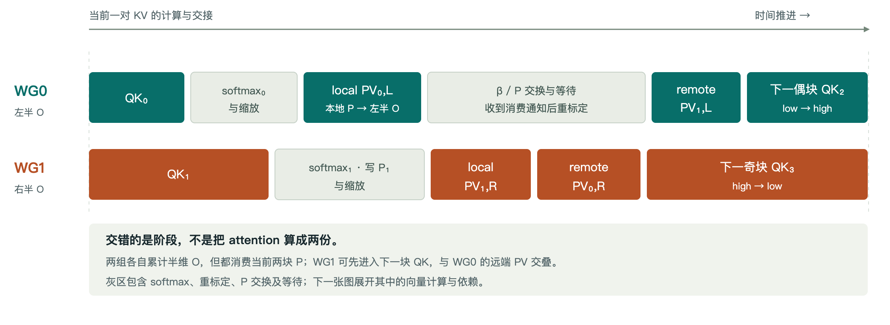
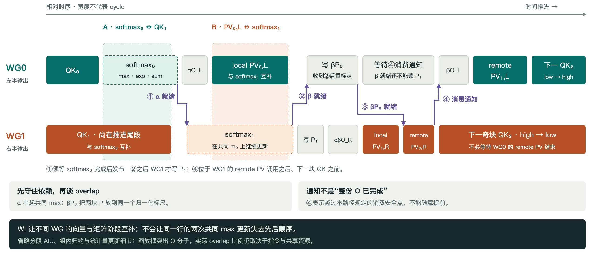
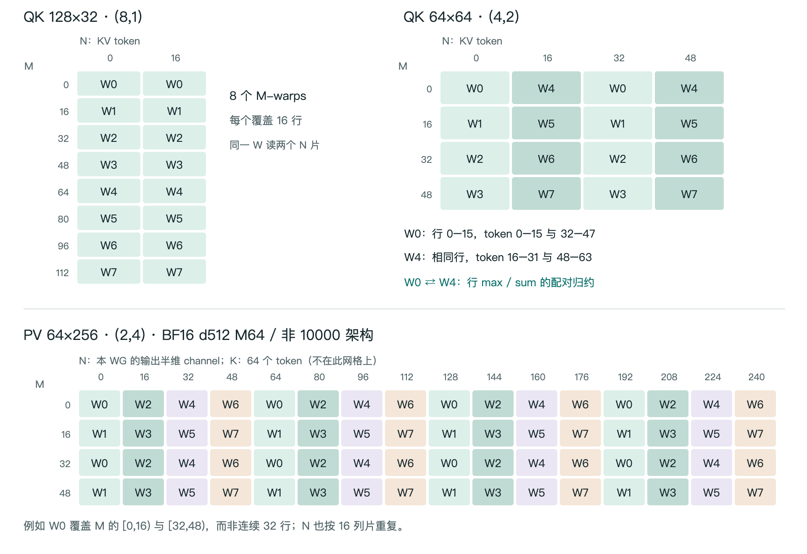
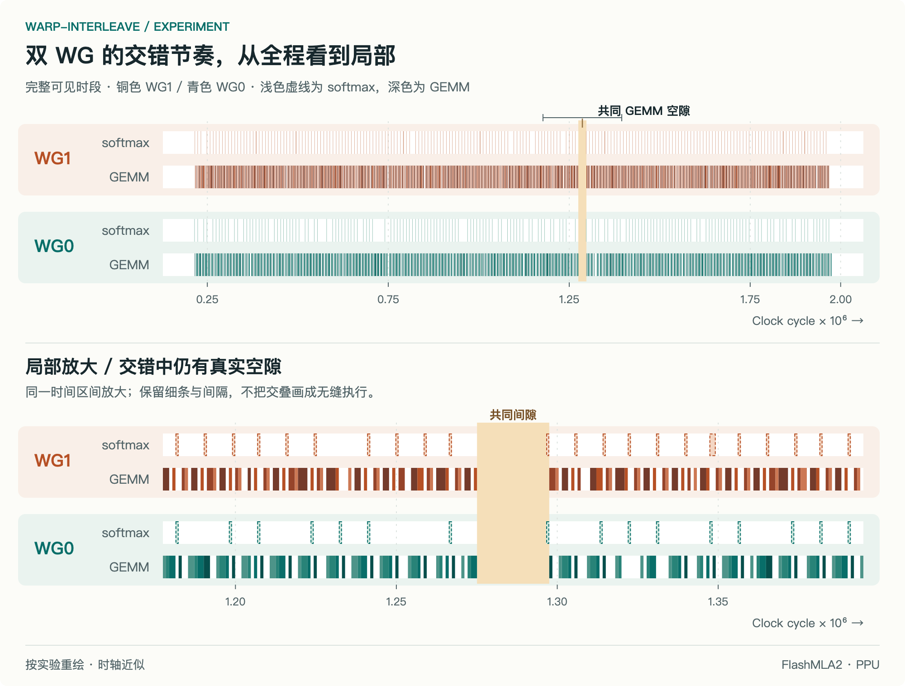
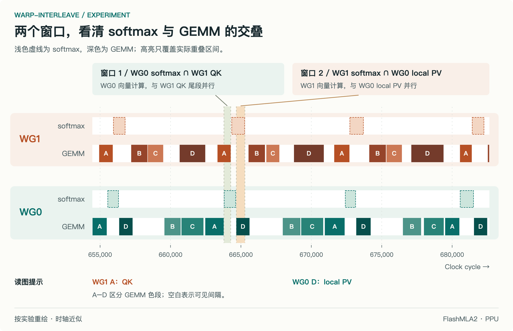
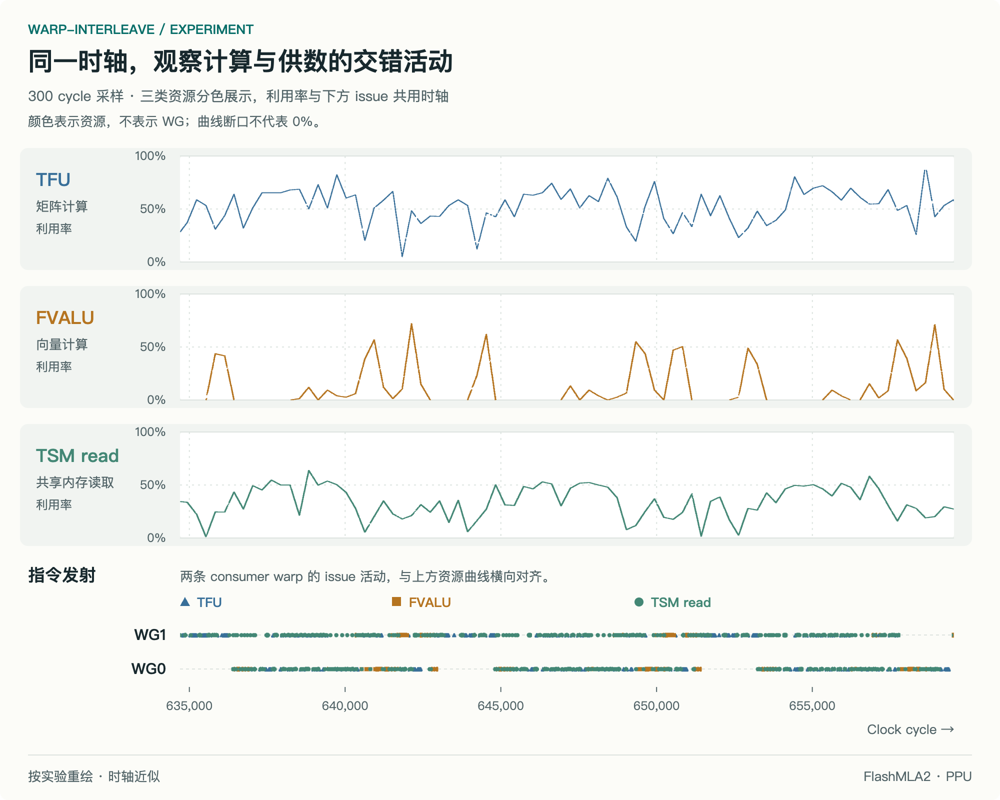

# FlashMLA2 的 Warp-Interleave：从双 Warpgroup 到 WI + Cross-cut

目录

目录

-   [1**背景**](#background)
    -   [1.1**从 MLA 说起：KV 压缩了，片上计算并没有变少**](#mla-workload)

    -   [1.2**PPU 上的矩阵乘：操作数要一步步“喂”给 Tensor Cell**](#ppu-matrix-path)

    -   [1.3**难点一：维度大，片上既“放不下”也“喂不饱”**](#onchip-pressure)

    -   [1.4**难点二：softmax 卡在两次矩阵乘中间**](#attention-overlap)

    -   [1.5**为什么选 Warp-Interleave + Cross-cut？**](#section-1-5)›

        -   [1.5.1**做了 WI，为什么还要 cross-cut？**](#section-1-5-1)
        -   [1.5.2**cross-cut 为什么要把 QK 和 PV 分开考虑？**](#section-1-5-2)
        -   [1.5.3**和 split-KV 的关系：不在同一层，不能互相替代**](#section-1-5-3)
-   [2**计算方案**](#computation)
    -   [2.1**双 WG 正交分工**](#section-2-1)›

        -   [2.1.1**为什么不让两个 WG 各算一半 KV，最后相加？**](#section-2-1-1)
        -   [2.1.2**为什么用 16 个 warp，而不是 8 个？**](#section-2-1-2)
        -   [2.1.3**怎样让向量计算和矩阵计算真正重叠？**](#section-2-1-3)
        -   [2.1.4**把整个算法串起来**](#section-2-1-4)
    -   [2.2**共同 softmax**](#section-2-2)›

        -   [2.2.1**先回顾单路在线 softmax**](#section-2-2-1)
        -   [2.2.2**两个 WG 轮流更新同一个行最大值**](#section-2-2-2)
        -   [2.2.3**两份半维输出怎么更新**](#section-2-2-3)
    -   [2.3**流水与 WG 同步**](#section-2-3)›

        -   [2.3.1**WI 时序图：两组计算怎样错开**](#wi-timing)
        -   [2.3.2**WI + softmax 时序图：把向量计算塞进矩阵乘的窗口**](#wi-softmax-timing)
        -   [2.3.3**四个跨组交接点**](#section-2-3-3)
        -   [2.3.4**QK 拆成 9 个 K64 小段**](#section-2-3-4)
        -   [2.3.5**三种等待，别混在一起**](#section-2-3-5)
    -   [2.4**awbar / test\_wait：搬运与计算的接力**](#section-2-4)›

        -   [2.4.1**两个 WG 都做计算，没有专门的搬运组**](#section-2-4-1)
        -   [2.4.2**awbar 只回答“数据到了没有”**](#section-2-4-2)
        -   [2.4.3**“数据能读”和“buffer 能覆盖”是两回事**](#section-2-4-3)
        -   [2.4.4**等待并不免费**](#section-2-4-4)
    -   [2.5**交叉三缓冲与 TSM 供数**](#section-2-5)›

        -   [2.5.1**一轮之内，半段 buffer 的生命周期**](#section-2-5-1)
        -   [2.5.2**Q 的最后 64 维挪进寄存器，腾出位置放 P**](#section-2-5-2)
        -   [2.5.3**资源账本：算出来的大小不等于编译结果**](#section-2-5-3)
        -   [2.5.4**降低 TSM 压力：先分清是哪种问题**](#section-2-5-4)
    -   [2.6**WI + Cross-cut**](#section-2-6)›

        -   [2.6.1**画准 cross-cut：N 方向按 16 列交错**](#section-2-6-1)
        -   [2.6.2**QK 的输出不能直接当 PV 的输入**](#section-2-6-2)
        -   [2.6.3**PV 为什么用 (2,4)：多读一点 P，少读很多 V**](#section-2-6-3)
        -   [2.6.4**缓冲生命周期**](#section-2-6-4)
-   [3**结果**](#results)
    -   [3.1**整体效果：Tensor Cell 利用率从 30% 多提升到 50% 多**](#section-3-1)

    -   [3.2**WI 效果：softmax 与矩阵乘确实重叠了**](#trace-overlap)›

        -   [3.2.1**全程 timeline：双 WG 的交错节奏**](#trace-overview)
        -   [3.2.2**局部放大：两类重叠窗口**](#trace-local-overlap)
        -   [3.2.3**资源 timeline：TFU、FVALU 与 TSM 读取**](#trace-resources)
    -   [3.3**Cross-cut 效果：适配小 M，减少重复读取**](#crosscut-result)

BACKGROUND

## 1 背景

想把 softmax 藏到矩阵乘（GEMM）后面，光多开几个 warp 是不够的。本文从 MLA 的计算特点讲起，依次拆解 FlashMLA2 在 PPU 上的算法流程、两个 warpgroup（WG）怎样协作、交叉三缓冲和 cross-cut 布局，最后用实测的 profiler 图看看它改善了什么、还剩下哪些空隙。

同一个 CTA 内两个 warpgroup 的正交分工WG0 负责偶数 KV 块的 QK，以及所有 KV 块的左半输出；WG1 负责奇数块的 QK，以及右半输出。两组交换 P 和缩放因子，共用一个 softmax。 ONE CTA / 512 THREADS同样的 Q 行 · 不同的 KV 块 · 不同的输出半维 WG0 · 8 WARPSQ × K₀ᵀ WG1 · 8 WARPSQ × K₁ᵀ 共同 softmaxsM → α → βP₀ × β ⇄ P₁统一 max；分母 l₀ + l₁ WG0 · OUTPUT \[0, 256)P₀V₀,L + P₁V₁,L WG1 · OUTPUT \[256, 512)P₀V₀,R + P₁V₁,R 分工概念图；旧 O 和已有 P 的重新缩放见 2.2 节。

QK 按 KV 块分给两组，PV 按输出维分给两组。两组共用一个 softmax：既不是两路独立的 attention，也不是最后把两半结果相加。

**128 × 32**dense 路径每个 WG 的 QK tile

**2 × 256**两个 WG，各 256 个线程

**576 → 512**QK 点积维 → V / 输出维

**3 buffers**KV 缓冲按低 / 高半段交叉轮转

先认识几个名词

| 名词 | 在本文里指什么 |
| :--- | :--- |
| Tensor Cell | PPU 上负责矩阵乘的计算单元；文中的 tc 利用率就是它的利用率。 |
| TSM | PPU 的片上共享内存。矩阵乘的操作数先放在这里，再由各个 warp 读进寄存器。 |
| AIU | 异步搬运：把数据从显存（HBM）搬进 TSM，发起之后不用原地等待。 |
| awbar / test\_wait | awbar 记录一段数据是否已经搬完；计算方用 test\_wait 查询，数据到齐了才开始读。 |
| CTA / WG | CTA 即线程块。本文的一个 CTA 分成 WG0、WG1 两组（warpgroup），每组 8 个 warp、256 个线程。 |
| WI | Warp-Interleave：让两个 WG 错开节奏，一组做 softmax 时，另一组做矩阵乘。 |
| cross-cut | 在一个 WG 内部，把 8 个 warp 从“只按行切”改成“行、列两个方向一起切”。 |

**核心矛盾：MLA 把 KV cache 压小了，片上的 attention 计算却一点也没有变窄。**在 PPU 上，QK 和 PV 这两次大维度矩阵乘的操作数，都要由 warp 显式地从 TSM 读进寄存器，再交给 Tensor Cell；而 softmax 又正好卡在两次矩阵乘中间。所以优化不能只盯着“把数据从 HBM 搬得更快”，还要让有限的 TSM 和寄存器撑住流水线，并让向量单元和 Tensor Cell 尽量同时有活干。

### 1.1 从 MLA 说起：KV 压缩了，片上计算并没有变少

MLA 把 KV 压缩到一个共享的低维潜空间，KV cache 的存储量和读取量都因此大幅下降；FlashMLA kernel 要做的，是在这种压缩表示上高效地完成 attention。以本文的 dense 路径为例：Q 和 KV 做点积的维度是 **576 = 512 + 64**，输出只用 KV 的前 **512** 维；最后 64 维只参与 QK，不参与 PV。kernel 的输入是已经准备好的 Q 和压缩后的 KV，投影层、KV 压缩和输出投影都不在这个 kernel 里。

S = scale · Q Kᵀ + mask P = softmax(S) 对每个 query / head 的一行做归一化 O = P · K\[:, 0:512\] V 直接复用 K 的前 512 维

decode 只有一个 token，也能凑出 M=128 的矩阵

`Q: [B, s_q, h_q, 576]`
`KV: [pages, page_size, h_kv, 576]`

记 `g = h_q / h_kv`。实现中把 query token 和同组的 head 合并成矩阵的行，一个 KV head 对应 `M = s_q × g` 行。所以 `s_q=1` 并不意味着 GEMM 的 M=1：比如 `h_q=128, h_kv=1` 时，M 就是 128。同一份 KV 被很多行 Q 共用，这正是能做成矩阵乘、能在片上复用的原因。

S / P 不落 HBM，片上的开销还在

FlashAttention 式的分块加在线 softmax，让一个 Q tile 在扫描 KV 时只需要保留局部 logits、每行的 max / sum 和输出分子，不必把整张注意力矩阵写回 HBM。但 576 维的 Q/K、512 维的 V/O，加上当前块和预取块，仍然都要在片上读取、交换和保存。

所以性能问题有两面：batch 小、KV 长的时候，瓶颈可能仍在显存带宽或并行度上；而一旦 KV 被多行 Q 复用、矩阵计算组织起来之后，**softmax 的串行依赖、TSM 供数和寄存器占用**就会冒出来。decode 不能只看 HBM；用上了 Tensor Cell，也不代表已经接近矩阵算力的峰值。

### 1.2 PPU 上的矩阵乘：操作数要一步步“喂”给 Tensor Cell

先看 PPU 上的一次矩阵乘是怎么完成的。PPU 的矩阵指令以 **warp（32 个线程）**为单位发射，每条指令算一个 16×16×16 的小块（本文 kernel 用的是 `ppu.tc02.mma.sync.aligned.m16n16k16`）。A、B 两个操作数都要事先放进各线程的寄存器，累加结果也留在寄存器里。

于是，一块数据要走完两段路，才能进到 Tensor Cell：

-   **第一段：显存 → TSM。**由 AIU 异步搬运，搬完后记在 awbar 上；计算方用 `test_wait` 查 awbar，就知道数据到了没有。
-   **第二段：TSM → 寄存器 → Tensor Cell。**每个 warp 要自己发 TSM 读取指令，把本 warp 需要的片段读进寄存器，然后再发矩阵指令。

第一段可以异步、可以提前发起；第二段却要占用 warp 的指令发射和 TSM 的读带宽，而且每个 warp 读的是自己那一份。**只把第一段优化快了，第二段照样可能拖住 Tensor Cell。**

两段供数链：只优化第一段不够

程序视角下的操作数路径示意，不是芯片内部的连线图，也不代表延迟比例。

PPU 上矩阵乘的操作数路径数据先由 AIU 从显存异步搬进 TSM，再由各个 warp 显式读进寄存器片段，最后交给 Tensor Cell 做 warp 级矩阵乘；累加结果留在寄存器里。 PPU：warp 级显式供数显存 / KVTSMA/B 寄存器片段Tensor Cell下一块数据当前块 + 周转槽每个 warp 读自己的片warp 级矩阵乘 · 32 线程① AIU② TSM 读取② 发射① 显存 → TSM：AIU 异步搬运，用 awbar / test\_wait 确认数据到齐。② TSM → 寄存器 → Tensor Cell：每个 warp 显式读取自己的片段，要占用指令发射和 TSM 读带宽。此外：累加的 O 一直占着寄存器；softmax 的依赖始终存在；容量、供数带宽和执行时序要分别设计。

图中只画了操作数从 TSM 读取的路径；dense 路径里，本组算出的 P 可以直接留在寄存器里复用，图上没有画出。

| 问题 | PPU 上的做法 | 对本文设计的影响 |
| :--- | :--- | :--- |
| 谁来发矩阵指令 | 以 warp 为单位，每条指令算 16×16×16。 | kernel 把 8 个 warp 编成一个 WG（256 个线程）来分工，这个“组”是软件上的约定。 |
| 操作数从哪来 | 每个 warp 自己从 TSM 读片段进寄存器。 | QK 要读 Q/K 片段，PV 要读 V；另一组传来的 P 也要经 TSM 中转。 |
| 怎么知道数据到了 | AIU 异步搬运 + awbar 记录，test\_wait 查询。 | 可以先发起搬运、去做别的计算，真要用时再查；但查询本身也有开销（见 2.4 节）。 |

所以在 PPU 上，什么时候搬、谁来读、何时算、何时交换和等待，都要由 kernel 自己排好。好在矩阵指令以 warp 为单位执行，并不会拦住其他 warp：一个 warp 在做矩阵乘时，别的 warp 照样可以做 softmax 或发起搬运——这正是后面 WI 能成立的前提。

### 1.3 难点一：维度大，片上既“放不下”也“喂不饱”

片上的压力有两种：**放不放得下**，和**喂不喂得上**。Q 要在多个 KV 块之间反复使用；K 做完 QK 之后还要当 V 给 PV 用；预取的数据、组间交换的 P 和缩放因子、长期累加的 O 也都要占地方。而且，数据放进了 TSM，也不等于 Tensor Cell 就能源源不断地拿到下一步要用的操作数。

重复读取：HBM 只取一次，TSM 却要读好几次

warp 级矩阵乘要求每个 warp 自己从 TSM 读操作数。沿 M 方向切分时，各个 warp 算的是不同的 Q 行，却要用同一组 K/V：拿 PV 来说，M 方向上的每个 warp 都要为自己的 P 行再读一遍同样的 V。沿 N 方向切分，则会重复读 Q 或 P。**不同 warp 之间的复用不会自动合并成一次读取；实际读多少，取决于怎么分工、寄存器里能留住什么。**

TSM 供数瓶颈：数据跟不上算力

如果这些读取花的时间，比 Tensor Cell 算完对应计算的时间还长，TSM 通路就会先饱和，矩阵乘只能停下来等操作数。这时拖后腿的是片上供数，而不是 KV 还没从 HBM 到。**提早发起 AIU、多加 buffer，能藏住一部分延迟，但减少不了重复读取，也突破不了 TSM 的持续带宽。**

所以在这个 kernel 里，除了把搬运藏到计算后面，还要想办法**少读重复的数据**。当然，不是所有 shape 都会卡在 TSM 供数上；这里强调的是重复读取会推高供数压力。另外，这里算的是程序发出的读取请求，硬件实际读了多少还和具体实现有关，要以性能计数器为准。

| 压力 | dense 配置下的量级 | 对方案的约束 |
| :--- | :--- | :--- |
| TSM 供数：同一份数据读几次 | QK/PV 按 K 方向分片加载；M 方向的不同 warp 各自加载 K/V，Q/P 也可能在 N 方向的 warp 之间重复读取。 | 计算量不变，读取请求却随 warp 分工而变；要减少重复读取，而不只是多放几块在途数据。 |
| TSM 容量：同时要放下哪些数据 | 低精度 Q 为 128×576×2 B = 144 KiB；3 个 KV 槽共 3×32×576×2 B = 108 KiB。 | 加上统计区，主循环数组共 254.5 KiB（还没算 barrier 和对齐）；再加完整的缓冲会更满。 |
| 输出状态：长期累加值放在哪 | 每个 WG 的半维 O 有 128×256 个 FP32，分给 256 个线程，每个线程光 O 就要存 128 个 FP32。 | 这些放在寄存器里，不在 TSM；还得给 QK 累加、Q/K/V/P 片段、地址和流水留出寄存器。 |
| 延迟与同步：什么时候能继续 | AIU 搬运、片段加载、P 和缩放因子的发布、buffer 的最后一次读取，各有各的安全点。 | 加 buffer 能藏住等待，但省不掉必需的读取；awbar 显示数据已到，也不代表旧的 V 已经被所有 PV 用完。 |

除了供数，**容量和寄存器也是独立的约束**。宽的 Q/K、大 tile、多块在途数据、互相重叠的生命周期，一起推高了常驻状态。这会限制能同时驻留的 CTA 数，也限制了继续加 buffer 或放大 tile 的空间；而且少读一次，并不等于能省出同样多的 TSM 空间。

因此需要几种手段配合：用**分时复用**让同时存活的数据放得下；用 **cross-cut** 重新安排 M/N 方向的 warp 分工，在特定的 PV 路径上多读一点小的 P、少读很多大的 V；用 **WI** 把另一组已经就绪的工作填进空隙。cross-cut 缓解供数，WI 改善时序，但两者都绕不开下一节要讲的 softmax 依赖。

### 1.4 难点二：softmax 卡在两次矩阵乘中间

QK 和 PV 是适合 Tensor Cell 的矩阵乘；夹在中间的求 max、减 max、exp、求和，以及对旧 O 的重新缩放，则是标量 / 向量运算和归约，其中 exp 还要用到特殊函数单元。**softmax 没法交给 Tensor Cell 去算。**这部分的计算量占比不高，但受吞吐、归约通信和依赖链的影响，花的时间并不少。

单条计算链的依赖顺序 · 示意，非实测时间KV 搬入QK · 矩阵乘max / exp / sumPV · 矩阵乘下一个 KV 块WI 不绕过 QK → softmax → PV 的依赖，而是让另一组已经就绪的工作先做起来。

对同一个 KV 块，PV 必须等 QK 算出 logits，再等 softmax 算出 P；在线 softmax 遇到更大的 max 时，还要回头把之前累加的结果重新缩放。**硬件上向量单元和 Tensor Cell 是分开的，但这条数据依赖不会因此消失。**如果整个 CTA 的 warp 同时进入 softmax，这段时间里就没有矩阵乘可以交给 Tensor Cell。

当然，别的 CTA 或独立的 warp 也可能填补这些空隙，所以不能说硬件一定闲着。但这个 kernel 的片上容量和寄存器占用都很大，很难靠“多驻留几个 CTA”来补救。更直接的办法，是让同一个 CTA 里已经在跑的两组计算错开节奏。

单条计算链（概念）：QK、softmax / 重新缩放、PV 依次暴露 WI 的互补窗口：WG0 softmax₀ ∥ WG1 QK₁ WG1 softmax₁ ∥ WG0 local PV₀,L 搬运另走一条线：发起下一半段的 AIU 搬运 → 期间继续算旧块 → 用之前 test\_wait

这就是要让**向量计算和 Tensor Cell 并行**的原因：softmax 的计算量一点没少，只是尽量把它放进另一组矩阵乘的执行窗口里。前提是先有依赖已经满足的工作，再按 awbar、P 和缩放因子的交接依次推进。两组仍可能争抢 TSM、寄存器读写或指令发射；这些资源跟不上，逻辑上的重叠也可能只换来更长的等待。

### 1.5 为什么选 Warp-Interleave + Cross-cut？

**WI 决定“什么时候算”，cross-cut 决定“谁来算、从哪里读数据”。**前者对付阶段依赖留下的空隙，后者对付 warp 级矩阵乘的分工和片上供数，两者解决的是相邻但不同的问题。

WI：给 Tensor Cell 的空隙填上活

把两组的 QK / softmax / PV 错开：一组做 softmax 和缩放时，另一组推进已经就绪的矩阵乘，避免两组同时卡在同一个阶段。

半维 O：交错时少占寄存器

QK 按偶 / 奇 KV 块分给两组，PV 按左右各 256 维分给两组。两组交换 P 和缩放因子，每组只保存一半的 O；共同 softmax 保证两组算的是同一次 attention。

Cross-cut：让错开后的矩阵乘有数据可用

在组内重新安排 M/N 两个方向的 warp 分工，兼顾小 M 时的计算效率和操作数复用。特定的 PV 布局多读小的 P、少读大的 V，避免供数压力吃掉 WI 的收益。

#### 1.5.1 做了 WI，为什么还要 cross-cut？

WI 不减少 QK/PV 的计算量，也不减少 TSM 读取。两组从“先后读”变成“同时读”，供数压力反而可能更集中。另外，当 M 从 128 降到 64 时，原来 8 个 warp 全部沿 M 排开的 `(8,1)` 布局就不合适了；改成 `(4,2)` 后，M 方向 4 个 warp 覆盖 64 行，剩下的并行度放到 N 方向。这里改的是组内的切分形状和复用方式，warp 总数并没有减半。

#### 1.5.2 cross-cut 为什么要把 QK 和 PV 分开考虑？

QK 的 N 方向是 token，PV 的 N 方向却是输出 channel，所以 QK 算出来的结果片段（C fragment）并不能直接当 PV 的输入片段（A fragment）用。对 BF16、d512、M64 这条路径（10000 架构版本除外），PV 从 `(4,2)` 换成 `(2,4)`：沿 M 重复读 V 的次数减少了，代价是沿 N 多读几次 P。按每个 WG、每个 K16 步的逻辑读取量估算，P+V 从 **4+32=36 KiB** 降到 **8+16=24 KiB**。注意这是读取请求的估算：既不是 TSM 容量省了 12 KiB，也不是实测流量，更不代表快了 1.5 倍。

这个选择也有代价：QK 需要在 N 方向的 warp 之间归约 max / sum；P 要按正确的布局经 TSM 中转；PV 的分母还要按输出行重新对应。简单说，**WI 创造重叠的机会，cross-cut 改善计算的形状和供数，共同 softmax 和同步协议保证两者合在一起结果仍然正确**。布局细节、读取估算和适用条件见 [2.6 WI + Cross-cut](#sparse)。

#### 1.5.3 和 split-KV 的关系：不在同一层，不能互相替代

| 机制 | 作用范围 | 解决什么问题 | 代价 |
| :--- | :--- | :--- | :--- |
| Warp-Interleave | 同一个 CTA 里的两组 warp | 错开 QK / softmax / PV / 搬运，缩短暴露出来的空隙。 | 要交换 P 和缩放因子；同时存活的状态更多，资源竞争也更多。 |
| Cross-cut | 同一个 WG 内 M/N 两个方向的 warp 布局 | 匹配 tile 形状，改变操作数的复用方式，减少重复读取。 | 要在 N 方向归约，P 要重排，同步更多。 |
| Split-KV | 多个 CTA | 沿 KV 方向增加并行度，分摊长序列。 | 部分结果（O / LSE）要写回显存再合并。 |

后文以 **WI 和共同 softmax** 为主线，依次讲 awbar / test\_wait、组间交错、buffer 按半段回收，以及组内的 cross-cut。文中的 warpgroup（WG）指实现里由 8 个 warp、256 个线程组成的软件协作组；用 16 个 warp 是当前 tile 和状态分配下的选择，不是 WI 的硬性要求。

文中的算法时序图和动画用来说明依赖关系，不按 cycle 比例绘制；第三章的结果来自实测，利用率的提升不能直接换算成时延的加速比。

COMPUTATION

## 2 计算方案

先讲两个 WG 怎样分工、共同 softmax 为什么算得对；再沿着流水线讲两组怎样同步、awbar / test\_wait 怎么用；然后讲 buffer 的生命周期和 TSM 供数；最后讲组内的 cross-cut。

### 2.1 双 WG 正交分工

**正交分工：QK 按 token 分，PV 按 channel 分。**

dense 路径下，一个 CTA 有 512 个线程，WG0 和 WG1 各 256 个线程，也就是各 8 个 warp。两组处理同样的 128 行 Q，每轮处理相邻的两个 KV 块，记为 `K₀` 和 `K₁`，每块 32 个 token。

| 工作 | WG0 | WG1 |
| :--- | :--- | :--- |
| Q 行 | 同样的 128 行，不沿 M 一分为二 |
| QK | Q × K₀ᵀ，得到 128×32 的 logits | Q × K₁ᵀ，得到 128×32 的 logits |
| softmax 权重 | 生成 P₀，把共同 max 更新到 m₀ | 生成 P₁，接着把共同 max 更新到 m₁ |
| PV | 两块的 V\[:,0:256\] → O\_L | 两块的 V\[:,256:512\] → O\_R |
| 长期保存 | 半维 O\_L + 偶数块的指数和 l₀ | 半维 O\_R + 奇数块的指数和 l₁ |
| 传给另一组 | α，以及重新缩放后的 βP₀ | β、P₁，以及“已读完”的通知 |

一次迭代中的四个 PV 子乘积

P 跟着 KV 块走，O 跟着输出 channel 走。

分工图

WG0 · 左 256 维WG1 · 右 256 维偶数 KV 块奇数 KV 块P₀ × V₀,L(βP₀) × V₀,RP₁ × V₁,LP₁ × V₁,Rlocal P · 先按 m₀ 基准累加remote P · 已换到 m₁ 基准remote P · 按 m₁ 基准累加local P · 按 m₁ 基准累加共同分母 l₀ + l₁ · 拼接 (O\_L, O\_R)

local / remote 指 P 来自本组的寄存器，还是另一组放在 TSM 共享槽里的数据。完整的更新式还包括对旧 O 的 α、β 缩放，见 2.2 节。

#### 2.1.1 为什么不让两个 WG 各算一半 KV，最后相加？

两组各做各的 softmax，会得到不同的最大值和分母，归一化之后的结果不能直接相加。现在的做法是：max 在两组之间依次推进，P 在两组之间交换，保证两组最后用的是同一把“尺子”；同时每组只保留一半的 O，不用各自维护完整的 512 维输出。四个 PV 子乘积一个都没少算，只是重新安排了由谁算、什么时候算。

#### 2.1.2 为什么用 16 个 warp，而不是 8 个？

**16 不是 WI 的硬性要求，而是当前 2×8 分组和 tile 大小下的选择。**先不管寄存器上限，只算长期占用的 FP32 输出累加值：每个 WG 负责全部 M 行和 256 个输出 channel，平均下来，每个线程要保存 `M×256 / (32×每组 warp 数)` 个 FP32。

| 每个 WG 固定负责半个输出 | 每组 8 个 warp 每个 CTA 16 个 warp | 每组 4 个 warp 每个 CTA 8 个 warp（假设） | 说明 |
| :--- | :--- | :--- | :--- |
| Dense M128 × 256 | 每线程 128 个 FP32 | 每线程 256 个 FP32 | 光 O 就翻倍了，还没算 QK 累加、Q/K/V/P 片段、地址和预取。 |
| Sparse M64 × 256 | 每线程 64 个 FP32 | 每线程 128 个 FP32 | 设计空间不同，不能照搬 M128 的结论。 |

这只是**按逻辑状态算的账，不是编译器实际分配的寄存器数**。warp 减半而 tile 不变，每个线程要背的状态就翻倍；把 M 也减半可以缓解，但每个 CTA 处理的行数、QK 对 KV 的复用、调度和尾部比例都会跟着变。所以“改成 8 个 warp”不是改一下线程数那么简单：快不快、行不行，都要编译和实测之后才知道。

当前 dense 路径每个 WG 的矩阵乘布局是 `(8,1)`：8 个 warp 沿 M 方向覆盖 128 行。M64 的 cross-cut 把这 8 个 warp 重新排成 `(4,2)`，线程数不变。两组各自保留 logits 和半维 O，才有可以交错的工作；warp 多了，也不会自动带来更多的有效重叠。

#### 2.1.3 怎样让向量计算和矩阵计算真正重叠？

关键是**把另一组已经就绪、又互不依赖的工作，填进依赖留下的空隙**：WG0 拿到 logits 后做 softmax，这时 WG1 可以继续算另一块的 QK；WG1 收到 α 后做 softmax，这时 WG0 用本组的 P₀ 做 PV。两个 WG 都既跑向量指令、也跑矩阵指令，角色随阶段轮换，并不是固定一组做向量、一组做矩阵。

可以重叠的工作配对 · 矩形宽度不代表 cycle窗口 A：先算完 QK 的一组进入 softmax窗口 B：α 交接之后的互补计算WG0WG1softmax₀ · max / exp / sumQK₁ · 矩阵乘 + 读操作数local PV₀,L · 矩阵乘 + 读操作数softmax₁ · max / exp / sum能互补不等于互不影响：还要看 TSM、寄存器读写、指令发射，以及缩放因子和 P 的真实依赖。

算法只提供可以重叠的窗口；硬件上实际重叠多少，要看指令时序和 profiler，不能把两张逻辑时间表叠在一起就当作加速的证明。

真正安排时要满足三个条件：**依赖允许**（先有本块的 max，等共同的尺子定下来，再算最终的 exp）；**工作够长**（足够盖住另一组的阶段，而不是被预热和收尾占满）；**资源互补**（Tensor Cell 少等一点，不能换来更严重的 TSM 或寄存器争抢）。O 的缩放和 PV 交错、缩短交接之后的等待，都要在这三个条件下进行。单纯把 AIU 提前，只会让数据更早到 TSM，并不能让 TSM → 寄存器 → Tensor Cell 这一段变快。

#### 2.1.4 把整个算法串起来

沿着同一个 Q tile 扫描 KV 的过程来看主循环：先预热、算完第一对 QK，然后反复做这几件事——更新共同 softmax、累加半维 O、回收旧的半段 buffer、预取下一对 KV。**这不是两个 WG 各跑一遍完整的 attention，而是两条互相接力的计算链。**

预热：装入 Q 和第一对 K，初始化 m、l 与半维 OQ 的尾 tile 存进寄存器 rQ8；用 awbar 确认半段到齐；算完第一对 QK 后进入交错的稳态。稳态 · 每轮两个 KV 块 · 逻辑依赖图（不是时间轴）QK₀ / QK₁共同 max → α → βlocal / remote PVWG0 算偶数块，WG1 算奇数块low / high 各自 test\_wait统一 P、O 分子和分母的基准cross-cut 先完成组内 N 方向归约WG0 左半 O；WG1 右半 O释放半段 → 预取下一对 KV扫完这段 KV：合并 l₀ + l₁ → 用同一个分母归一化 → 按输出维拼接 O\_L / O\_R

QK → softmax → PV 表示数据依赖，不代表两组按图整齐地同步前进。实际代码把下一轮的 QK 放在本组流程的末尾，半段搬运穿插在 softmax / PV 前后发起。

### 2.2 共同 softmax

**共同 softmax：所有累加量都要用同一把尺子。**

下面的公式都针对**单独一行**，为了好读用自然指数 exp；实际实现先把 logits 乘上 `scale × log₂e`，再用 `exp2f`，两者在数学上等价。这里的 P 是还没除以总分母的指数权重，不是最终的概率。推导中忽略 BF16/FP16 的舍入误差。

#### 2.2.1 先回顾单路在线 softmax

m′ = max(m, max(S\_new)) ρ = exp(m − m′) P\_new = exp(S\_new − m′) l′ = ρl + sum(P\_new) Õ′ = ρÕ + P\_new V\_new 最终 O = Õ / l

`Õ` 是还没除分母的输出分子。一旦出现更大的 max，之前累加的分子和分母都必须乘上同一个 ρ，否则新旧数据就不在同一个基准上了。

#### 2.2.2 两个 WG 轮流更新同一个行最大值

WG0：偶数块先来，定下 m₀

m₀ = max(m, max(S₀)) α = exp(m − m₀) P₀ = exp(S₀ − m₀)

WG1：奇数块接着来，定下 m₁

m₁ = max(m₀, max(S₁)) β = exp(m₀ − m₁) P₁ = exp(S₁ − m₁)

WG0 把 m₀ 写进共享的行最大值 sM，并通过 sScale0 发布 α；随后 WG1 把 sM 更新为 m₁，并通过 sScale1 发布 β。

WG0 的 P₀ 是在 m₀ 基准下算出来的。WG0 自己可以先用它做 PV，之后再把整个左半分子乘上 β；但发给 WG1 的 P₀ 必须**先乘上 β**，否则 WG1 就会把 m₀ 和 m₁ 两个基准下的权重混进同一个 O\_R。

#### 2.2.3 两份半维输出怎么更新

Õ\_L ← β · (α · Õ\_L + P₀V₀,L) + P₁V₁,L Õ\_R ← αβ · Õ\_R + P₁V₁,R + (βP₀)V₀,R l₀ ← β · (αl₀ + sum(P₀)) l₁ ← αβ · l₁ + sum(P₁) l = l₀ + l₁ O = concat(Õ\_L / l, Õ\_R / l)

`l₀` 和 `l₁` 分别收集偶数块和奇数块的指数和，但它们始终基于同一个 max。循环结束时，先在组内把分散在各个线程里的部分和按行加起来，再把两组的结果相加。**能相加的是 l₀ 和 l₁；O\_L 和 O\_R 是不同的列，只能拼接。**

等价性证明：为什么不会漏块，也不会重复归一化？

假设进入本轮时，历史累加满足 `Õ = Σ_old exp(s−m)·v`、`l = Σ_old exp(s−m)`。因为 `αβ = exp(m−m₁)`，历史项乘上 αβ 后就换到了 m₁ 基准；同时 `βP₀ = exp(S₀−m₁)`，`P₁ = exp(S₁−m₁)`。把左右两半的分子展开，都覆盖了“历史 + 偶数块 + 奇数块”，只是分别算在 V 的不同列上；把 l₀ + l₁ 展开，覆盖的也正是同一批 token。所以最终结果等于对全部块一次性做 softmax 再乘 V。

初始化在概念上是 `m=−∞, l₀=l₁=0, Õ=0`；实现里用初始化常量，并在尾块分支里处理无效数据。这个证明不能代替对全 mask、极端值和低精度 kernel 的实际测试。

交互实验：如果漏乘 β，会发生什么？

缩小到 1 行、6 个 token、4 维 V，用 JavaScript 双精度演示；这不是 PPU 上的正确性测试。

数值模型

奇数块的最大 logit：**3.0**

正确的重新缩放漏乘 βP₀（反例）

α · 旧 → 偶数块**—**

β · 偶数块 → 奇数块**—**

l₀ + l₁**—**

与直接计算相比的最大绝对误差**—**

6 个 token 一次性做 softmax`等待脚本计算`

两组分开更新再拼接`等待脚本计算`

拖动滑块，观察重新缩放的效果。

展开输入与误差口径

历史 logits = \[0.5, −0.4\]；偶数块 = \[0.9, −1.0\]；奇数块 = \[x, x−1.7\]。两组的历史分母各持有一个旧 token 的贡献；两个半维的历史分子都覆盖全部旧 token。V 是固定的 6×4 小矩阵，重点是展示归一化的不变量，不模拟寄存器布局。

“漏乘 β”只改动 WG1 的远端 P₀ 项，分母仍然正确，所以只有右半输出会出错。如果奇数块没有推高 max，那么 β=1，这个错误在该输入下就暴露不出来。JavaScript 用的是 IEEE 754 双精度，这不是 BF16/FP16 的误差界。

### 2.3 流水与 WG 同步

**流水：同步保证数据能用，交错决定什么时候用。**

大的矩阵运算被拆成一段段小片，搬运的发起、P 的发布、O 的缩放都穿插其中。下面以一轮为单位画的是**依赖示意**，不按 cycle 比例；图上的空白不代表硬件闲着，真实的重叠情况要看 profiler。

#### 2.3.1 WI 时序图：两组计算怎样错开

先把 softmax、缩放和同步都收进灰色块，只看 QK / PV 的骨架。**这只是同一套 WI 流水的简化画法，并不是去掉了 softmax 的另一种算法。**下标 0 / 1 表示当前的偶 / 奇 KV 块，2 / 3 表示下一对。

WI：两条计算链错峰推进

从左到右是先后顺序；手机上可以左右滑动查看完整时序。

阶段示意 · 非周期比例

同一个 WG 内从左往右依次执行；两组之间上下对齐的部分只表示可以重叠，不代表指令一样长，也不是实测加速。

#### 2.3.2 WI + softmax 时序图：把向量计算塞进矩阵乘的窗口

把灰色块展开之后，核心是两个互补的窗口：**A：WG0 的 softmax₀ 与 WG1 的 QK₁；B：WG1 的 softmax₁ 与 WG0 的 local PV₀,L。**softmax₁ 必须等共同最大值和 α 交接之后才能开始，不能和 softmax₀ 随意并行。

WI + softmax：重叠窗口与四次交接

深色是 QK / PV，浅色虚线框是 softmax，灰色是缩放、发布或等待。两组都会做向量计算和矩阵计算。

dense 稳态 · 依赖示意

A、B 标出的是可以重叠的部分，并不是说 softmax 一定被矩阵乘完全盖住。图中按 dense 路径的 β / P₁ 发布顺序绘制；M64 cross-cut 的交接顺序有所不同，见 2.6 节。

dense 路径：双 WG 协作过程

逐步播放，看数据依赖怎样推进；两组都在计算，没有只负责搬运的 WG。

示意，非实测时序

01 / 入场

02 / α

03 / β

04 / P

05 / 消费

06 / 推进

WG0

偶数块 QK
logits 就绪

softmax₀
发布 α / m₀

O\_L × α
local PV₀,L

等待 β
发布 βP₀

等待消费通知
重新缩放 O\_L

remote PV₁,L
下一偶数块 QK

WG1

奇数块 QK
logits 就绪

等待 α
softmax₁ 的前置依赖

softmax₁
发布 β / m₁

写 P₁
local PV₁,R

等待 βP₀
remote PV₀,R

通知 WG0
下一奇数块 QK

播放上一步下一步重置01 / 06

**01 · 入场**两块的 logits 都算好了。预热阶段负责加载 Q/K，并把 Q 的尾 tile 存进寄存器；进入稳态后，这一对 QK 已经由上一轮提前算好。

WG0：左半输出WG1：右半输出AIU 预取穿插在各个阶段里，见 2.5 节的缓冲生命周期。

#### 2.3.3 四个跨组交接点

| 交接点（代码中的信号） | 谁通知谁 | 意味着什么 |
| :--- | :--- | :--- |
| ① α 就绪 `sScale0Ready` | WG0 → WG1 | WG0 已经更新了共享的行最大值和 α，WG1 可以在 m₀ 的基础上继续做 softmax。 |
| ② β 就绪 `sScale1Ready` | WG1 → WG0 | β / m₁ 已经发布，WG0 可以给 P₀ 重新缩放。**但这并不说明 P₁ 已经写好。** |
| ③ βP₀ 就绪 `sP0Ready` | WG0 → WG1 | βP₀ 已经写进共享槽，WG1 可以读它做远端 PV；这时也可以按生命周期回收一部分 KV 半段。 |
| ④ 消费通知 `rO1sP0sV0RIssued` | WG1 → WG0 | WG1 已经读完远端的 P₀ / V₀,R 并发出了 PV，WG0 可以接着使用 P₁。它不表示整个 O\_R 已经算完。 |

代码里没有单独的“P₁ 已就绪”信号。WG1 是在发布 β 之后才写 P₁ 的，所以 WG0 要等更晚的消费通知 ④，而不能一收到 β 就去读 P₁。另外，bar 两边的参与线程数和调用顺序必须对得上：只挪动一侧的 arrive，而不管另一侧的 wait 和数据的生命周期，就会出错。

#### 2.3.4 QK 拆成 9 个 K64 小段

576 维的点积被切成 `[0,64), …, [512,576)` 共 9 段，每段内部是 4 个 K16 的矩阵乘步。稳态下 WG0 先算第 0–3 段、再算第 4–8 段；WG1 反过来，先算高段、再算低段。低、高两段分别等各自的 K 搬运完成；最后一段用的是寄存器里的 rQ8。

-   **WG0：**先处理低 256 维（第 0–3 段），再处理高 320 维（第 4–8 段）；下一偶数块的低段、高段各由一个 awbar 跟踪。
-   **WG1：**先处理高 320 维，再处理低 256 维；下一奇数块的低段、高段同样各有一个 awbar。

预热那一轮和稳态不同：第一轮两组都按“先高段、后低段”的顺序计算，所以不能把稳态的顺序套到整个 kernel 上。

#### 2.3.5 三种等待，别混在一起

-   **等搬运完成：**用 awbar 和它的代次（phase）判断数据是否已经从显存搬进 TSM。
-   **等另一组的进度：**用 bar 串起缩放因子、P 和 buffer 回收之间的依赖。
-   **等寄存器和指令：**TSM → 寄存器的读取、矩阵指令和标量 / 向量运算之间仍可能互相等待；搬运变成异步的，并不能消除这类等待。

### 2.4 awbar / test\_wait：搬运与计算的接力

**awbar 让搬运可以“先发起、用时再查”，但流水怎么排，仍由软件决定。**

**PPU 上的这套搭配：**AIU 负责把数据异步搬进 TSM，awbar 记录搬运是否完成，各个 warp 自己把操作数读进寄存器，再发矩阵指令。本文就用这几样东西，在软件里组织两个 WG，让搬运、softmax 和矩阵乘按依赖交错进行。

#### 2.4.1 两个 WG 都做计算，没有专门的搬运组

一种常见的分工思路，是让一部分 warp 专门搬数据、另一部分专门计算。这个 kernel 没有这样做：两组都算 QK、softmax 和 PV，只是处理的块不同、负责的半维不同、所处的阶段错开；搬运则由各组在计算的间隙发起（由组内 0 号线程分支负责），完成情况记在 awbar 上。

| 方面 | 本文 WI 的做法 |
| :--- | :--- |
| 职责 | 两个 WG 都承担 QK / softmax / PV，角色随阶段轮换。 |
| 分组 | 每个 WG 是 8 个 warp、256 个线程组成的软件协作组。 |
| 搬运 | AIU 异步搬运，由各组在计算间隙发起，用 awbar 记录完成情况。 |
| 重叠从哪来 | 按 KV 块和输出半维分工，用共同 softmax 串起必要的依赖，再把互不依赖的计算交错起来。 |

#### 2.4.2 awbar 只回答“数据到了没有”

dense 路径为 Q 和两块 K 的低 / 高段各准备了 awbar。搬运一方按段发起异步拷贝，并在对应的 awbar 上登记；计算一方用 `test_wait` 查询对应半段在当前代次是否已经到齐。这样，“发起搬运”和“检查是否到齐”就被分开了，中间可以安排**和这份数据无关的计算**。

1.  发起下一半段的搬运，并在对应的 awbar 上登记。
2.  中间做不依赖这半段数据的 softmax、PV 或另一段 QK。
3.  真正要用之前，用 test\_wait 查对应 awbar 的当前代次；通过之后，才发起这一段的 TSM 读取和 QK。
4.  这一代需要的半段都用完之后，把 awbar 切换到下一代。

awbar 的初始计数是 32；QK 每轮两段都推进完之后，awbar 在 0、1 两个代次之间交替。**代次（phase）表示同一个 awbar 的“第几轮”，不是 A/B/C buffer 的编号；低段到齐也不代表高段到齐。**

谁发起、谁等待：下一对 KV 的四条路径

以 dense 稳态处理当前偶 / 奇块为例，表里的搬运对象都是**下一对** KV。low 指 `[0,256)`，high 指 `[256,576)`。每个 WG 并不只给自己搬数据：两组按半段的生命周期，交叉着替对方做准备。

| 下一轮的数据（awbar） | 谁发起、在哪儿发起 | 谁等待（test\_wait） | 发起和等待之间能做的事 |
| :--- | :--- | :--- | :--- |
| 偶数块 low `K0[0]` | WG0，本轮 softmax₀ 之前。 | WG0，下一轮 QK 开头（先算低段）。 | 本轮的 softmax₀、local PV、P / 缩放因子的交接，以及 remote PV。 |
| 奇数块 high `K1[1]` | WG1，等本轮 α 之前。 | WG1，下一轮 QK 开头（先等 high）。 | 等 α、softmax₁、写 P₁、local / remote PV。 |
| 奇数块 low `K1[0]` | WG0，做完 local PV、收到 β 之后。 | WG1，算完 high 段的 QK 之后再等 low。 | 发布 βP₀、两组后续的 PV，以及 WG1 下一块 high 段的 QK。 |
| 偶数块 high `K0[1]` | WG1，做完 local PV、收到 βP₀ 之后。 | WG0，下一轮 QK 的高段入口。 | WG1 的 remote PV 和通知，WG0 的 remote PV 和下一块 low 段的 QK。 |

K0 / K1 分别指偶数块、奇数块 K 的 awbar，\[0\] 是 low 段，\[1\] 是 high 段；每组的搬运由组内 0 号线程分支发起。“能做的事”描述的是代码里的安排，不保证一定能完全盖住搬运延迟；最后一轮没有下一块时，就不再发起搬运。

等某个半段时，计算线程会轮询当前代次的状态：没到齐就先短暂休眠，再回来检查。WG0 先等低段、再等高段，分别推进第 0–3、4–8 段 QK；WG1 先等高段、再等低段，分别推进第 4–8、0–3 段 QK。两组都是在这一代的两段都推进完之后，才把 awbar 翻到下一代。

**注意区分三种“轮次”：**QK 的计算段顺序（先低后高，还是先高后低）、awbar 的代次、物理 buffer 的轮转编号 `kv_idx`，三者各自独立，不要混为一谈。

WI 的关键不是“发出搬运就马上等”，而是**先把手头已经就绪的旧块算完，等新半段真要做 TSM 读取和 QK 时，才去查对应的 awbar**。如果这时搬运还没完成，剩下的延迟依然会暴露在 test\_wait 上；异步 barrier 不会把等待变成算力。

#### 2.4.3 “数据能读”和“buffer 能覆盖”是两回事

空闲半段发起 AIUawbar 完成QK / PV 读取可复用半段旧的读者已安全释放下一代数据在路上可以读，不能覆盖最后一个读者过了安全点才能装入下一代awbar 只管“搬完没有”；P / 缩放因子的交接和最后一个读者的顺序，由 WG 之间的同步协议来保证。

半段 buffer 的生命周期示意，不是时间轴。什么时候能回收，要看实际的读取指令和同步协议；awbar 显示数据已到，推不出所有读者都已经用完。

比如 K 的某个半段，做完 QK 之后可能还要给另一组的 remote PV 当 V 用，提前覆盖就会把 V 写坏。awbar 管“搬完没有”，bar 管 P、缩放因子和消费进度的交接，两者各管各的，不能互相替代。cross-cut 还多了组内配对 warp 之间的行归约同步，这第三层依赖同样不能省。

#### 2.4.4 等待并不免费

`test_wait` 在调用处其实是轮询。在之前版本的汇编里可以看到，一次轮询要执行 `tsm.ld → s.wait → v.mov.v2s` 这串指令：读 TSM、等结果、再把值从向量寄存器挪到标量寄存器。所以**减少多余的轮询、把等待合并成组**，可以减轻 TSM 读取和标量 / 向量转换的负担，但不能越过真正的数据依赖。改完之后要一起检查三件事：等待次数有没有减少、另一组有没有可做的计算、总时间有没有缩短。

### 2.5 交叉三缓冲与 TSM 供数

**交叉三缓冲：按半段回收，而不是按整块回收。**

每个物理 KV buffer 能放 `32×576` 个低精度元素，共 **36 KiB**，分成低 256 维（16 KiB）和高 320 维（20 KiB）两段。高段的前 256 维给右半 PV 用，最后 64 维只参与 QK。

**最容易画错的地方：**A、B、C 三个 buffer 并不是各放一整块 K₀、K₁、K₂。当前的两个逻辑块交叉地分布在两个物理 buffer 里，空闲的那个 buffer 用来接收下一对块的不同半段。

三个物理 buffer 的轮转快照

展示每一轮开始时的布局，不代表同一时刻整块被覆盖。颜色区分偶 / 奇逻辑块。

生命周期模型

Round 0Round 1Round 2Round 3

低段 \[0,256) · 16 KiB

高段 \[256,576) · 20 KiB

A

**K0 low**WG0 QK / 左半 PV

**K1 high**WG1 QK / 右半 PV

B

**K1 low**WG1 QK / 左半 PV

**K0 high**WG0 QK / 右半 PV

C

**空闲**下一偶块低段预取

**空闲**下一奇块高段预取

**Round 0 · 当前 K0 / K1**先把 K2 low 和 K3 high 搬进 C；等 A 上对应的读者用完，再分别改写成 K3 low 和 K2 high；B 留给下一轮预取。

每轮开始时的 buffer 编号是 `kv_idx = 2r mod 3`，下一轮是 `kv_idx = (kv_idx + 2) mod 3`。低段和高段的释放条件不同。

#### 2.5.1 一轮之内，半段 buffer 的生命周期

| 物理区域（Round 0） | 当前内容 / 最后的用途 | 接下来放什么 | 为什么可以提前复用 |
| :--- | :--- | :--- | :--- |
| C low / C high | 空闲 | K₂ low / K₃ high | 不碰当前的两块，WG0 / WG1 可以先各自发起半段预取。 |
| A low | K₀ low → WG0 的 local PV₀,L | K₃ low | 本组的 V 用完了才改写；代码把发起放在等到 β 之后。 |
| A high | K₁ high → WG1 的 local PV₁,R | K₂ high | 本组的 PV 做完、到了 P₀ 交接阶段，再发起下一偶数块高段的搬运。 |
| B low / B high | K₁ low → WG0 的 remote PV；K₀ high → WG1 的 remote PV | 下一轮的空闲槽 | 要等当前远端 V 的读取过了安全点，不能跟 A 一起覆盖。 |

这种交叉布局，是为了配合“一个 WG 在两段 QK 之间切换、另一个 WG 在 local / remote PV 之间切换”的生命周期。多出来的一个物理槽提供了周转空间，但这并不是给两整块 KV 做完整的双缓冲。

#### 2.5.2 Q 的最后 64 维挪进寄存器，腾出位置放 P

sQ\[:,0:512\] · 128 KiB前 8 个 Q tile 仍从 TSM 读取sQ\[:,512:576\] · 16 KiB最后 1 个 Q tilerQ8 · Q 尾 tile 的寄存器副本之后第 8 段 QK 不再读这块 TSMsP₀8 KiBsP₁8 KiB

128×64×2 B = 16 KiB；2×(128×32×2 B) = 16 KiB，正好放下两份 P。只是把 Q 的最后一个 tile 放进寄存器，并不是整个 Q 都常驻寄存器。

#### 2.5.3 资源账本：算出来的大小不等于编译结果

| 对象 | 静态数据量 | 说明 |
| :--- | :--- | :--- |
| sQ | 144 KiB | 128×576×2 B；尾部 16 KiB 和 P 共用，不另外分配 P 槽。 |
| sK 三个槽 | 108 KiB | 3×32×576×2 B；sQ 和 sK 在结构体里仍是独立成员。 |
| sM / l 工作区 / 两份缩放因子 | 2.5 KiB | (128 + 256 + 128 + 128)×4 B。 |
| 主循环数组合计 | 254.5 KiB | 不含 awbar 和结构体对齐。 |
| FP32 输出暂存区（output staging） | 256 KiB | 128×512×4 B；和主循环共用同一块动态共享内存，分阶段复用。 |
| 实际申请量 / 寄存器数 | 以 sizeof 和编译结果为准 | 启动时按两个结构体 sizeof 的较大值申请共享内存；寄存器数要查编译产物的函数属性，不能靠估算认定。 |

把 rQ8 放进寄存器，是用寄存器的占用换 TSM 的占用。如果继续给 K/V 做寄存器双缓冲，可能会导致寄存器溢出（spill），或者挤掉其他正在用的值。

#### 2.5.4 降低 TSM 压力：先分清是哪种问题

“TSM 压力大”其实可能是三种不同的问题：**放不下、读得太多、等得太久**。它们需要不同的改法；把流水加深通常只是把等待藏起来，并不会减少必须读取的字节数。

| 目标 | 本文的做法 | 改善了什么 / 代价 |
| :--- | :--- | :--- |
| 容量 / 生命周期 | Q 的尾 tile 放进寄存器；sQ 尾部和 P 共用空间；主循环和输出暂存区分时复用 | 同时存活的共享数据变少；代价是寄存器占用增加，也限制了收尾阶段和下一份 Q 的重叠。 |
| 重复读取 | cross-cut 中重新安排 PV 的 M/N warp 分工 | 多读小的 P、少读大的 V；需要跨布局重排，P 的写出和重读也要算进去。 |
| TSM → 寄存器的等待 | 提前加载下一个 K 分片，和当前的矩阵乘交错 | 藏住读取延迟，但读取量不变；流水加深可能导致 spill 或端口争抢。 |
| 同步带来的额外读取 | 减少 test\_wait 的重复 TSM 读取，合并等待 | 之前的实验中局部利用率有改善；但必要的可见性和消费完成条件不能省。 |
| 显存 → TSM 就绪 | 提前发起 AIU，按半段安全回收 KV buffer | 缩短等 KV 的时间；但不会直接降低 TSM 的读取压力，还可能改变冲突发生的时机。 |

此外，swizzle（打散地址排布以减少冲突）和正确的拷贝描述，决定了访问布局能不能和硬件指令对上。在 sparse M64 中，N 从 32 改成 64 时，P 的 swizzle 和 K/V 的拷贝描述必须一起改；这是**正确性要求**，并不说明 bank 冲突或实际流量已经下降。

### 2.6 WI + Cross-cut

**WI + Cross-cut：组与组之间错开时间，组内二维切分。**

前面讲的是两个 WG *怎么配合*，cross-cut 进一步回答一个 WG 里的 8 个 warp *怎么分工*。两者不是二选一：**WI 是组与组之间的时间安排，cross-cut 是组内 M/N 两个方向的空间切分**。在当前的稀疏（sparse）M64 路径中，两个 WG 都用 (4,2) 的 QK 布局，再通过共同 softmax 交换数据。

CTA · 512 threadsWG0 · 偶数块 QK / 左半 OWG1 · 奇数块 QK / 右半 ON-warp 0N-warp 1N-warp 0N-warp 1W0W4W1W5W2W6W3W7W0W4W1W5W2W6W3W7WIα → ββP₀ ⇄ P₁每组内部 4×2 cross-cutW0–W7 是各自 WG 内部的编号。每对 Wm / W(m+4) 负责同样的 16 行、不同的 N 列；横线表示组内的归约关系。

这是两层并行叠在一起，而不是把整个 CTA 的 16 个 warp 排成一个 (4,2)。cross-cut 里 QK 的 N 是 KV token 维；到了 PV，N 就变成了输出 channel 维。

为什么 M64 要换布局？(8,1) 布局的 8 个 warp 沿 M 覆盖 128 行；改成 (4,2) 之后，8 个 warp 覆盖 64 行，同时在 N 方向多了一倍的并行。当前配置还把 N 从 32 改成了 64：`128×32` 和 `64×64` 的 logits 元素数一样多，但 Q 的复用、KV 的访问和归约代价都不同，不能只看面积就认为性能一样。

下表对比 sparse 路径的实际配置和 dense 基线。

| 维度 | Dense WI | Sparse WI M128 | Sparse WI M64 |
| :--- | :--- | :--- | :--- |
| QK tile | 128×32 | 128×32 | 64×64 |
| QK warp 布局 | (8,1) | (8,1) | (4,2) cross-cut |
| KV buffer 数 | 3 | 3 | 2 |
| 每轮两个 KV 块 | 2×32 token | 2×32 token | 2×64 token |
| 归约的额外约束 | 同一行分布在一个 warp 内，再跨 WG 合并 | 和 dense 类似 | 同一行跨两个 N 方向的 warp；max / sum 要额外跨 N 合并 |

#### 2.6.1 画准 cross-cut：N 方向按 16 列交错

QK 的 8 个 warp 从 (8,1) 改成 (4,2)：M 方向分 4 份，N 方向分 2 份。把矩阵切成 16×16 的小块（atom），坐标记为 (m,n)，负责它的 warp 编号就是 `(m % A_M) + A_M × (n % A_N)`。同一个 warp 会在外层 tile 中重复出现，不一定负责一整块连续的矩形。

同样 8 个 warp，不同的空间复用

每格是一个 16×16 的输出小块，坐标数字是它的起始行 / 列。

单 WG 布局

图中只画了一个 WG；颜色区分的是 N 方向的 warp，不是 WG0 / WG1。图只表示每个小块归哪个 warp，不展开小块内部的线程和寄存器排布。

在 64×64 的 QK 中，`Wm` 和 `W(m+4)`（m=0…3）处理同样的 16 行：前者负责 token 列 `[0,16)∪[32,48)`，后者负责 `[16,32)∪[48,64)`，而不是各取连续的 32 列。读 Q 时，两个 N 方向的 warp 读的是同样的行，可以共用一套读取方式；读 K 时，则各读各的列片。

同一行的 logits 分在两个 N 方向的 warp 里，所以 **row max 要先在 N 方向合并**，才能进入 WG0 / WG1 的共同 max 更新。实现上，配对的两个 warp 通过共享工作区和一个 64 线程的配对 barrier 交换结果，再把行结果广播出去。指数和可以先分散累加，最后按“warp 内 → 跨 N → 跨 WG”的顺序合并；(2,4) 的 PV 输出行分布不同，分母也要按新的行分布对应。跨 N 的 max 和跨 WG 的 softmax 是两层依赖，不能合成一次“全组归约”。

#### 2.6.2 QK 的输出不能直接当 PV 的输入

QK 的 N 是 **KV token**，PV 的 N 却是**输出 channel**；token 到了 PV 里变成了累加的 K 维。在 BF16、d512、M64（10000 架构版本除外）这条路径上，QK 保持 (4,2)，PV 改用 (2,4)。虽然两次运算都用 8 个 warp，同一份 P 在两边归属的线程却不一样。

QK C(M, token) · (4,2)sP\[M, token\] · 重排中转PV A(M, K=token)跨 N max → 共同 max → exp按 QK 的行 / 列片生成 P正确的 swizzle + 写后同步local P 和 remote P 都从这里读按 (4,2) 或特定的 (2,4) 取片V 的 N 方向 = 输出 channelWI 的归一化不变量不变：βP₀ 和 P₁ 进入同一个 max 基准。变化的是线程布局和 TSM 中转：本组的 P 也不能直接沿用本线程的寄存器片段了。

这里画的是 sparse M64 cross-cut 路径；dense 路径里本组 P 留在寄存器的做法不能直接套用。P 的重排不是第二次归一化。

在 cross-cut 下，本组的 P 也要先写进 sP，同步之后再用共享的 P 读取器按 PV 的布局重新读出来；远端的 βP₀ / P₁ 则照旧通过 WI 交接。P 读取器会把 N 方向的 warp 折叠到一起读取，并配合 TSM 的 swizzle；这和 M128 路径的读法不同。如果只改了矩阵乘的布局、却沿用旧的 P 切片方式，就会把布局错误误当成数值精度问题。

| 交接点 | dense 主线（2.3 节） | sparse M64 cross-cut |
| :--- | :--- | :--- |
| WG1 发布 β 和 P₁ | 先发布 β 就绪（sScale1Ready），再写 P₁。 | 先写 P₁，再通过 barrier 发布 β。 |
| WG0 什么时候能读 P₁ | 收到 β 还不够，要等后面的消费通知（rO1sP0sV0RIssued）。 | 这个 barrier 的顺序同时保证了 β 和 P₁ 都已发布；但后续的消费 / 回收同步仍然要遵守。 |
| 归约与同步 | 主线的 bar 交接。 | 除了跨 WG 交接，还有 N 方向配对 warp 之间的归约；不能简单地替换 barrier 的名字。 |

这个顺序差异不改变数学算法，但改变了哪些数据在什么时候可读。所以 2.3 节的动画只描述 dense 主线，不能当成所有 sparse 模板实例的逐指令时间表。

#### 2.6.3 PV 为什么用 (2,4)：多读一点 P，少读很多 V

固定一个 WG 的半输出 `M=64, N=256`，看一个 `K=16` 步，操作数为 BF16。假设每个 warp 对自己负责的片只读一次：P（矩阵 A）在 N 方向的 warp 之间重复读取，V（矩阵 B）在 M 方向的 warp 之间重复读取，于是得到下面的**逻辑读取模型**：

P 读取字节数 = A\_N × M × K × 2 V 读取字节数 = A\_M × K × N × 2

| PV warp 布局 | P 逻辑读取 / K16 | V 逻辑读取 / K16 | 合计 / K16 |
| :--- | :--- | :--- | :--- |
| (4,2) | 4 KiB | 32 KiB | 36 KiB |
| (2,4) | 8 KiB | 16 KiB | 24 KiB |

V 的输出宽度（256）比 P 的 M（64）大得多，所以减少 V 在 M 方向的重复读取更划算。N64 的完整 PV 有 4 个 K16 步。代码里的双 fragment 流水是相邻两步交错进行，并不是每个片读两遍。

**这是估算模型，不是实测计数：**36→24 KiB 没有计入 P 的写出、scale / max / sum 的交换和轮询，也没有考虑 TSM 的广播、bank / 事务实现和寄存器通路。它说明了为什么选这个布局，但不能证明实际的 TSM 流量同比例下降，更不能推出 kernel 快了 1.5 倍。

cross-cut 也不是万能的“TSM 减半”开关。以普通的、从 TSM 读 Q 的 QK 为例，一个 K16 步里，(8,1) 的 128×32 和 (4,2) 的 64×64 在同样的模型下都是 Q 4 KiB + K 8 KiB（用寄存器里 Q 尾 tile 的那一步另算）。换布局能减少某一边的重复读取，但也会改变另一边的复用和归约代价，必须看整条供数路径。

#### 2.6.4 缓冲生命周期

M64 不再用 dense 的三槽交叉布局，而是两个 buffer 各放一整块逻辑 KV 块。**整块存放不等于整块一起回收**：低 / 高半段仍然各有自己的 QK、local PV 和 remote PV 读者，下一轮只能覆盖已经安全释放的部分。dense 的 256 KiB 输出暂存区也不能照搬：sparse 的 M128 用 128×256 FP32 分两次写，M64 用 64×512 一次写，两者的输出暂存区都是 128 KiB。

RESULTS

## 3 结果

### 3.1 整体效果：Tensor Cell 利用率从 30% 多提升到 50% 多

整体优化效果 · Tensor Cell 利用率（tc）

优化前**30%*多***

→

优化后**50%*多***

WI 把 softmax 和另一组的矩阵乘交错起来，cross-cut 让组内分工更贴合矩阵形状和供数需求。

整体近似值；利用率的提升不等于 kernel 时延的加速倍数。

两者解决的是不同层面的问题：**WI 减少计算阶段之间的空隙，cross-cut 改善每个阶段内部的分工和数据复用。**整体 tc 利用率从 30% 多提升到 50% 多；目前的实验没有把两者的收益单独拆开，下面分别说明它们各自起的作用。

### 3.2 WI 效果：softmax 与矩阵乘确实重叠了

在 timeline 里能看到两类重叠：**WG0 的 softmax 和 WG1 的 QK 同时进行，WG1 的 softmax 又和 WG0 的 local PV 同时进行。**向量计算不再只是两次矩阵乘之间的串行空档，而是被放进了另一组矩阵乘的执行窗口里。

#### 3.2.1 全程 timeline：双 WG 的交错节奏

先看完整的时段：两个 WG 的 softmax 和矩阵乘反复交错，而不是先集中做完所有 softmax、再做矩阵乘。局部放大后仍能看到两条 GEMM 通道同时空着的间隙：**WI 增加了重叠的机会，但并不意味着全程都没有空泡（bubble）。**

全程 timeline：双 WG 的交错节奏

整体节奏，以及同一时段的局部放大

青色是 WG0，铜色是 WG1；据实测 timeline 重绘，事件的位置、长度和间隙都保持不变。淡金色标出两条 GEMM 通道同时空闲的区间，这不等于整个设备都在空闲。

#### 3.2.2 局部放大：两类重叠窗口

局部 overlap：softmax 与另一组的矩阵乘同时进行

两类实际重叠的窗口

据实测 timeline 重绘，保留了事件的位置和间隙，时间轴为近似值。窗口 1：WG0 softmax ∩ WG1 QK；窗口 2：WG1 softmax ∩ WG0 local PV。

青色是 WG0，铜色是 WG1，浅色虚线框是 softmax；两个高亮窗口标出实际重叠的区间。两组不需要每一步都对齐：**只要依赖允许，先就绪的一组就接着算，用不同阶段的工作互相填补等待。**

#### 3.2.3 资源 timeline：TFU、FVALU 与 TSM 读取

再从硬件资源的角度看重叠：把 TFU（矩阵计算）、FVALU（向量计算）和 TSM 读取的利用率画成三张共用时间轴的小图，下方是两个 WG 的 warp 的指令发射标记。**矩阵计算、向量计算和供数在同一段时间里交错活动**，可以和前面的双 WG timeline 对照着看。

资源 timeline：TFU / FVALU / TSM read

300 cycle 采样 · 资源利用率与指令发射

曲线据实测数据重绘，没有做平滑或补点；断口处没有可辨认的读数，不代表 0%。下方的标记保留了位置和形状，只把颜色统一成对应资源的颜色，不能据此反推指令数。

采样粒度为 300 cycle，颜色区分的是资源而不是 WG。这张图展示的是各资源活动在时间上的关系，不是打开 / 关闭 WI 或 cross-cut 的单独收益对比。

### 3.3 Cross-cut 效果：适配小 M，减少重复读取

当 M 缩小到 64 时，cross-cut 把 8 个 warp 从只沿 M 排开，改成在 M、N 两个方向上分工，让同一组 warp 适配更矮、更宽的 QK tile。它保留了 WI 的双组交错，只改变了组内的计算分工和数据复用方式。

对于第二章介绍的 BF16、d512、M64 的 PV 路径，**布局从 (4,2) 调整为 (2,4) 后，较大的 V 片段在 M 方向的重复读取减少了，代价是多读几次较小的 P 片段，总的逻辑读取请求因此下降。**这减轻了 TSM 的供数压力，让 WI 创造出来的计算窗口更容易拿到数据；但这不代表共享内存占用同比例下降，也不是单独实测出来的加速倍数。

把计算交错起来，把数据供上去。

WI 改善组与组之间的时序，cross-cut 改善组内的分工和复用。
两者的目标是同一个：让向量计算和 Tensor Cell 尽量同时忙起来。

原始图像

原始分辨率 关闭 · Esc
