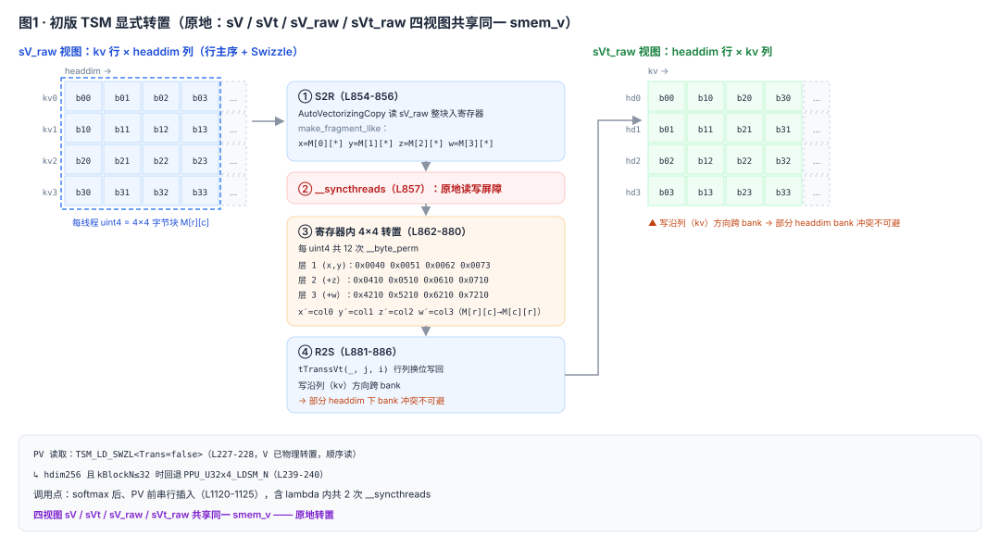
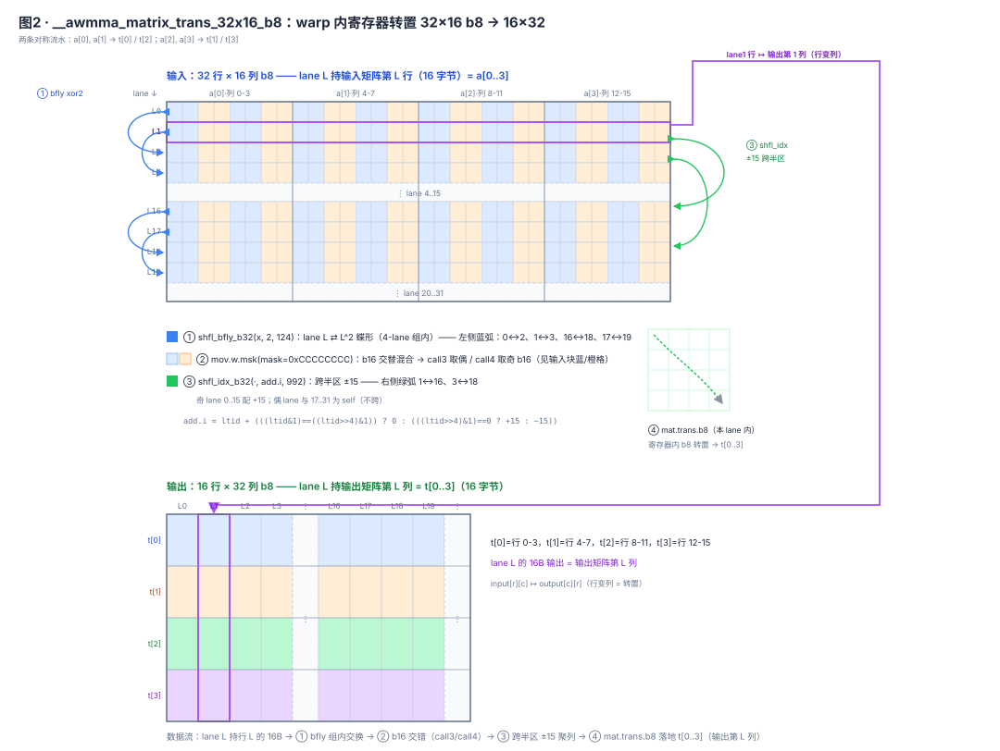
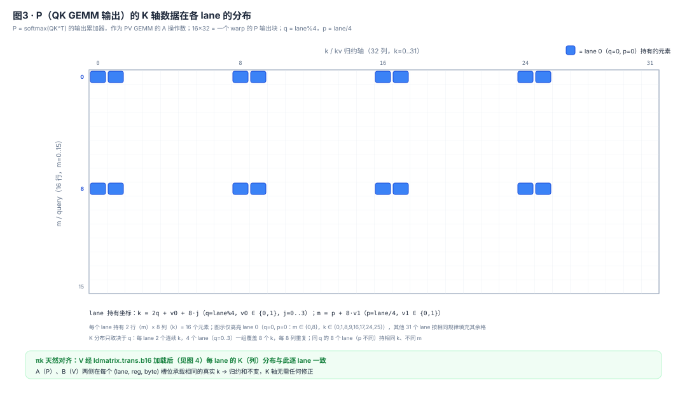
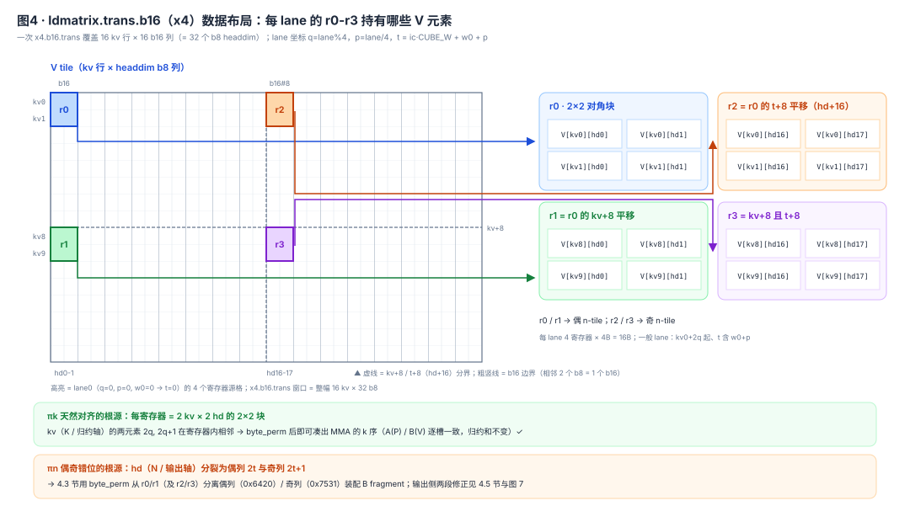
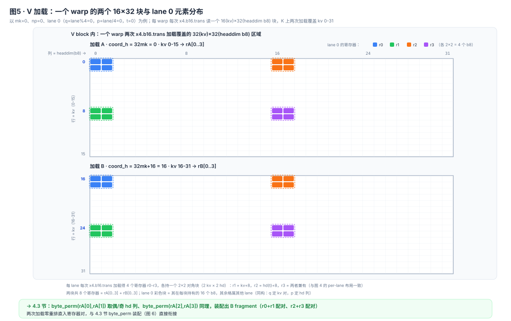
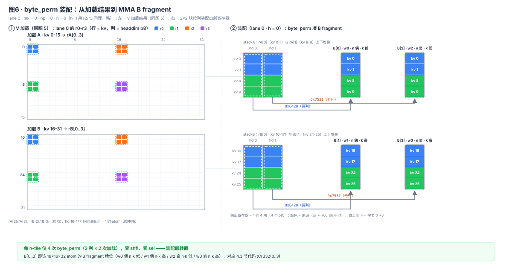
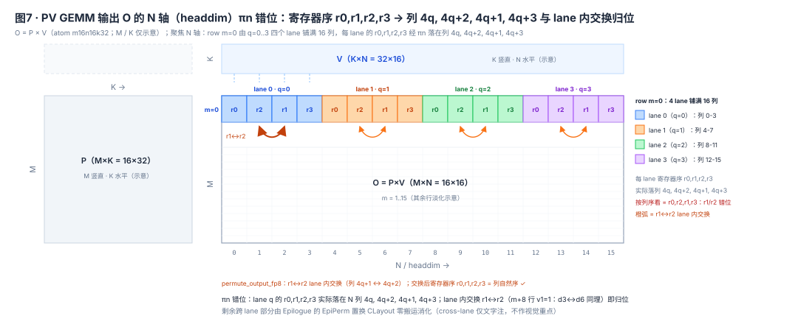

# FP8 Flash Attention 性能优化简介

> 平台：真武 M890（ppu0015，HGGC `__HGGC_ARCH__ >= 150`）/ FlashAttention-3 前向 kernel 范围：flash attention@FP8（e4m3）前向 PV GEMM 中 V 操作数的转置问题及其三种解决方案

## 摘要

我们在 真武 M890 的 flash attention 库中，增加了对 FP8 数据类型的支持。FP8 数据类型的 flash attention kernel 的难点在于：真武 M890 的 ldmatrix 转置加载指令只支持 b16/b32 粒度，FP8（b8）数据**无法以转置方式直接从 TSM 加载到寄存器**，而 PV GEMM 中 V 作为 MMA 的 B 操作数恰好需要转置。围绕这一问题，本文讨论了三种转置方案的演进：

1.  **初版（TSM 显式转置）**：读入 V block → 寄存器内 `__byte_perm` 转置 → 写回 TSM，flash attention 主流程几乎不改，但引入额外 TSM 读写。
2.  **寄存器转置版**：用 warp 内 `shfl` 在寄存器中完成 32×16 b8 转置，避免 TSM 读写，SDK 也提供了现成的 intrinsic 函数。
3.  **V 直读版**：以 `ldmatrix.trans.b16` 直接读取原始 V tile，利用"归约轴（K=kv）布局天然符合 MMA 要求、只有输出轴（N=headdim）存在偶/奇列错位"的观察，仅用 **4 次 `__byte_perm` 指令** 即完成 B fragment 构造，输出轴（N 轴）错位在主循环外分两段修正。

* * *

## 1\. 背景：FP8 的转置困境

### 1.1 ldmatrix 转置加载不支持 b8 粒度

真武 M890 的 TSM 转置加载指令 `ppu.tc02.ldmatrix` 的 `.trans` 变体以 **b16 或 b32** 为最小转置粒度。在 cute 封装层可以看到，`PPU0015_TSM_LD_SWZL` 的 `Trans=true` 特化只存在三种元素类型，**没有 `float_e4m3_t`**：

```cpp
// csrc/actlize/include/cute/arch/copy_ppu0015_aiu.hpp
template <>
struct PPU0015_TSM_LD_SWZL_IMPL<float, true> { ... };
template <>
struct PPU0015_TSM_LD_SWZL_IMPL<half_t, true> { ... };
template <>
struct PPU0015_TSM_LD_SWZL_IMPL<bfloat16_t, true> { ... };
```

普通的（非 AIU/bulk）ldmatrix 转置封装同样如此，`PPU_U16x2/4/8_LDSM_T` 三个变体全部发射 `.b16` 指令，没有任何 b8 变体：

```cpp
// csrc/actlize/include/cute/arch/copy_ppu.hpp L126-196（节选）
struct PPU_U16x2_LDSM_T { ... "ppu.tc02.ldmatrix.sync.aligned.x1.trans.m8n8.shared.b16" ... };
struct PPU_U16x4_LDSM_T { ... "ppu.tc02.ldmatrix.sync.aligned.x2.trans.m8n8.shared.b16" ... };
struct PPU_U16x8_LDSM_T { ... "ppu.tc02.ldmatrix.sync.aligned.x4.trans.m8n8.shared.b16" ... };
```

**结论：硬件层面不存在"以转置方式把 FP8 数据从 TSM 加载进寄存器"的指令。**

### 1.2 PV GEMM 为什么必须转置 V

FlashAttention 的第二个 GEMM 为 O += P × V：

-   MMA 的归约轴（K 轴）是 **kv 序列轴**，输出轴（N 轴）是 **headdim 轴**；
-   V 作为 MMA 的 **B 操作数**，fragment 布局要求 **K 轴（kv）连续**；
-   而 V 在 GMEM/TSM 中天然按**（kv 行 × headdim 列）行主序**存储，即 **headdim 方向连续、kv 方向跨行**。

也就是说，B fragment 需要的"k 连续"与 V 存储的"headdim 连续"恰好正交——**BF16/FP16 可以靠 `ldmatrix.trans.b16` 在加载时顺手完成转置，FP8 没有这条指令，PV GEMM 的 V 转置就成为必须专门解决的问题。**

### 1.3 FP8 MMA 配置与 B 操作数布局

FlashAttention-3 PPU 前向的 FP8 路径使用 m16n16k32 的 e4m3 atom（对比 BF16/FP16 的 k16），TiledMMA 的 K 维 tile 相应加倍到 32：

```cpp
// hopper/mainloop_fwd_sm80.hpp L95-129
MMA_Atom<PPU0015_16x16x32_F32E4M3E4M3F32_TN>                    // L105：FP8 atom，m16n16k32
using TiledMma = TiledMMA<
    MMA_Atom_Arch,
    Layout<Shape<Int<kNWarps>,_1,_1>>,                        // 4x1x1 或 8x1x1 warp 组
    std::conditional_t<std::is_same_v<Element, cutlass::float_e4m3_t>,
                       Tile<Int<16 * kNWarps>, _16, _32>,     // L128：FP8  → K=32
                       Tile<Int<16 * kNWarps>, _16, _16>>>;    // L129：BF16 → K=16
```

该 atom 的每 lane 的 B fragment 为 4×u32，记 lane 坐标 q = lane mod 4, p = lane / 4，则

```
B(lane u32 w, byte kq) = (k = 4q + kq + 16·(w & 1),  n = p + 8·(w >> 1))
```

即：**每个 u32 寄存器内的 4 个字节必须落在同一行 n、连续的 4 个 k 上**。不管哪种方案，都需要让每个 thread 加载的数据凑出这个布局。

* * *

## 2\. 初版支持方案：TSM 显式转置

### 2.1 设计思路

初版的目标是**以最小改动快速打通 flash attention@FP8 功能**：既然 flash attention 主流程（含 BF16 路径）已经假设"PV 读到的 V 在 TSM 中就是转置好的"，最简单的办法就是把 V block 读进寄存器、在寄存器内完成 b8 转置、再写回 TSM 的另一套视图——之后 flash attention 主流程几乎不需要修改，只需补上 FP8 的 MMA 配置（atom、K=32 tile 等）即可。

### 2.2 初版转置数据布局图



图1 初版 TSM 显式转置数据布局

如图所示，每个线程负责读取一个 4×4 的小数据块，每个线程内部通过简单的 byte permute 交换数据即可完成线程内部数据的转置，在线程外部，将线程 layout 转置即可完成整体数据的转置。整个转置方案不涉及线程间的数据交换。

### 2.3 实现

核心转置 lambda `transpose_V` 分四步：S2R 整块读入 → 屏障 → 寄存器内三层 `__byte_perm` 4×4 字节块转置 → R2S 行列换位写回：

```cpp
// [31dbcbd] L846-889：transpose_V lambda（节选核心）
auto transpose_V = [&](int%20stage) {
    Tensor tTransrV = make_fragment_like(tTranssV(_, _, _, _0{}));    // ① 整块 V block 驻留寄存器
    Tensor frag_128b = recast<uint4>(tTransrV);                       //    每线程 uint4 = 4×4 字节块
    cute::copy(s2r_tiled_copy_v, tTranssV(_, _, _, stage), tTransrV); //    S2R：AutoVectorizingCopy
    __syncthreads();                                                  // ② L857：原地读写屏障
    #pragma unroll
    for (int i = 0; i < size(frag_128b); ++i) {                       // ③ 每 uint4 共 12 次 __byte_perm
        tmp_v0 = __byte_perm(frag_128b[i].x, frag_128b[i].y, 0x0040);   // 层1：(x,y)
        tmp_v1 = __byte_perm(frag_128b[i].x, frag_128b[i].y, 0x0051);
        tmp_v2 = __byte_perm(frag_128b[i].x, frag_128b[i].y, 0x0062);
        tmp_v3 = __byte_perm(frag_128b[i].x, frag_128b[i].y, 0x0073);
        tmp_v0 = __byte_perm(tmp_v0, frag_128b[i].z, 0x0410);           // 层2：(+z)
        tmp_v1 = __byte_perm(tmp_v1, frag_128b[i].z, 0x0510);
        tmp_v2 = __byte_perm(tmp_v2, frag_128b[i].z, 0x0610);
        tmp_v3 = __byte_perm(tmp_v3, frag_128b[i].z, 0x0710);
        tmp_v0 = __byte_perm(tmp_v0, frag_128b[i].w, 0x4210);           // 层3：(+w)
        tmp_v1 = __byte_perm(tmp_v1, frag_128b[i].w, 0x5210);
        tmp_v2 = __byte_perm(tmp_v2, frag_128b[i].w, 0x6210);
        tmp_v3 = __byte_perm(tmp_v3, frag_128b[i].w, 0x7210);
        frag_128b[i].x = tmp_v0;  ...                                 // M[r][c] → M[c][r]
    }
    #pragma unroll
    for (int i = 0; i < size<2>(tTranssVt); ++i)                      // ④ R2S：行列换位写回 sVt_raw
        for (int j = 0; j < size<1>(tTranssVt); ++j)
            cute::copy(r2s_tiled_copy_vt, tTransrV(_, i, j), tTranssVt(_, j, i, stage));
};
```

### 2.4 方案缺点

初版方案功能正确，但性能上存在四个结构性缺陷：

1.  **部分 headdim 下 R2S 转置写 bank 冲突不可避。** R2S 写沿列（kv）方向跨 bank（图 1 ④），在部分 headdim 下 Swizzle 无法消除冲突，TSM 写吞吐直接受损。
2.  **额外的 TSM 读写。** V 的一个 block 被访问 3 次：S2R 读 1 次、R2S 写 1 次、PV 再读 1 次（"读 2 次写 1 次"）。TSM 带宽是纯开销。
3.  **寄存器压力大。** 为避免线程间数据读写冲突，需要把整个 V block 一次性驻留寄存器做转置，hdim256 时寄存器占用尤其紧张。
4.  **限制 tile size。** 同样是因为整个 V block 一次性驻留寄存器做转置，所以 tile size 的大小也被限制了，过大的 tile size 可能导致无法全部驻留寄存器，进而产生寄存器 spill。

此外，转置前后，由于涉及整个线程块的数据同步，需要插入 2 次 `__syncthreads`，增加了同步开销，也会打断主循环的软件流水。

* * *

## 3\. 寄存器转置方案：`__awmma_matrix_trans_32x16_b8`

### 3.1 SDK 接口与思路

SDK 提供了 `__awmma_matrix_trans_32x16_b8` 接口：在**寄存器内**通过 warp 内 `shfl` 操作完成 32×16 的 b8 矩阵转置，完全避免 TSM 的转置读写。每 lane 输入、输出各 4×i32（16 字节），32 lane × 16B = 512B，正好是一个 32 行 × 16 列的 b8 矩阵。转置后即符合 MMA 要求。

### 3.2 数据布局图（图 2）



图2 awmma 32×16 b8 寄存器转置数据流

### 3.3 实现

```cpp
#if defined(USE_PPU) && ACOMPUTE_VERSION >= 10500
typedef unsigned int v4uint __attribute__((ext_vector_type(4)));
extern "C" {
__device__ v4uint __ppu_ldmatrix_swizzle_bulk_tensor_m8n8_x4(
    const int *src, int leading_offset, int stride_offset, int swzl_mode);
__device__ void __awmma_matrix_trans_32x16_b8(int *t, const int *a);
}
namespace cute {
template <>
struct PPU0015_TSM_LD_SWZL_IMPL<cutlass::float_e4m3_t, true> {
  CUTE_HOST_DEVICE void operator()(int *vreg, int tsm_add, int lbo, int sbo, int swzl_mode) {
#if defined(__HGGC_ARCH__) && ACOMPUTE_VERSION >= 10500
#if (defined __HGGC_ARCH__) && (__HGGC_ARCH__ == 150)
    (void)lbo;
    const int lbo_kspan = sbo * 2;
    const int *tsm_ptr = reinterpret_cast<const int *>(
        static_cast<unsigned long long>(static_cast<unsigned int>(tsm_add)));
    v4uint r = __ppu_ldmatrix_swizzle_bulk_tensor_m8n8_x4(tsm_ptr, lbo_kspan, sbo, swzl_mode);
    __awmma_matrix_trans_32x16_b8(vreg, reinterpret_cast<const int *>(&r));
#endif
#else
    CUTE_RUNTIME_ASSERT("Support for TSM_LD_SWZL has not been enabled for FP8-trans");
#endif
  }
};
} // namespace cute
#endif  // defined(USE_PPU) && ACOMPUTE_VERSION >= 10500
```

寄存器转置方案本质是加载一小块数据，转置一小块，SDK 也提供了相应的 intrinsic 接口，因此封装一个转置加载函数即可。相对初版，寄存器转置方案是**质的改善**：避免了对 TSM 的转置写回与重读、消除了 2 次 `__syncthreads`，整块驻留寄存器的压力也随之消失。只是引入了较多 shfl/permute/sel 等 ALU 操作。我们很快就发现了更好的方案。

* * *

## 4\. V 直读方案

### 4.1 核心观察：πk 对齐、πn 错位

首先注意到 PV GEMM 中的 P 矩阵。它来源于 QK GEMM 输出，其数据布局如下图所示。注意其归约轴 K 的数据排布：K 上分 4 个 lane，每个 lane 保存两个元素，每 8 个 k 重复上述排列，记 `q = lane % 4`，则每个 lane 的在 K 轴上的坐标索引为 `2q + j * 8`，j 表示每 8 个 k 重复一次索引。



图3 P（QK GEMM 输出）的 K 轴数据在各 lane 的分布

再观察 V：**如果以 `ldmatrix.trans.b16`（b16 粒度转置）直接读取 FP8 的 V tile 时，把相邻 2 个 b8 看作 1 个 b16 后**：

-   **归约轴（K = kv 轴）**：K 上分布 4 个 lane，lane 的索引同样是 `q = lane % 4`，每个 lane 连续保存两个元素，每 8 个 k 重复上述排布，P 和 V 两个矩阵在归约轴上的数据排布实际是对齐的。虽然数据布局不符合 MMA 定义的要求（4 个元素连续保存在一个 lane 中），但如果考虑 32 个 k 元素，可以看到每个 lane 保存 4 个元素，**完全符合 MMA 计算要求**，且 A（P）、B（V）两侧在每个 (lane, reg, byte) 槽位上承载相同的真实 k，这意味着归约和不变——记这个置换为 **πk，天然对齐，无需修正**；
-   **输出轴（N = headdim 轴）**：存在**偶/奇列交错错位**——槽位 `n=p` 持真实 `n=2(t0+p)`（偶列），槽位 `n=p+8` 持真实 `n=2(t0+p)+1`（奇列）——记为 **πn，需要修正**，但可以在主循环外消化。

下图给出 b16 转置加载后每 lane 的寄存器布局，它是 πk 对齐与 πn 错位的共同根源：



图4 ldmatrix.trans.b16 数据布局（每 lane r0-r3 持有的 V 元素）

于是"转置 V"被重新分解为：**装载（b16.trans 直读）→ 装配（byte\_perm 凑 B fragment）→ 输出修正（主循环外）**，主循环内零 shfl、零 TSM 写回。

### 4.2 装载：b16.trans 直读原始 sV

通过 ldmatrix 直接读取 V，每个 warp 每次读到的是一个 16×32 的数据块，其中 16 所在的是归约轴。MMA ATOM 在 K 上的大小是 32，在 K 上读取两个 16×32 的数据块，然后进行数据重排，以满足 MMA 要求。如下图所示：



图5 V 加载：一个 warp 的两个 16×32 块与 lane 0 元素分布

### 4.3 装配：byte\_perm 凑 B fragment

对每对 n-tile，仅用 `__byte_perm` 从 `rA/rB` 中按字节挑取偶列（选择子 `0x6420`，取字节 0/2/4/6）与奇列（`0x7531`，取字节 1/3/5/7），即装配出 MMA 要求的 B fragment——**每 n-tile 仅 1 次 TSM\_LD + 4 次 byte\_perm，零 shfl、零 sel**：

下图以一个 n-tile 为例，展示 `__byte_perm` 如何把图 4 的加载结果装配成 MMA 的 B fragment（装配即转置）：



图6 byte\_perm 装配：从加载结果到 MMA B fragment

### 4.4 πn：两段式输出修正

πn 错位表现为：MMA 后累加器 O 的每行（每 lane）真实列序为 `{4q, 4q+2, 4q+1, 4q+3}` 的偶奇交错。修正分两半：

**① lane 内部分——`permute_output_fp8`**（寄存器内交换 `d1↔d4`、`d3↔d6`），在 softmax finalize + rescale 之后调用，**主循环外每个 kernel 仅一次**：修正后每 lane 内列序变为 `n = 4q + v0 + 2·v2`（lane 内有序），剩余的 q 相关部分跨 lane，寄存器搬不动。

**② 跨 lane 部分——epilogue 置换 CLayout**：不搬任何数据，只在 epilogue 用一颗**只重写 CLayout 的孪生 atom** 重新解释累加器坐标：

```cpp
// hopper/utils.h L46-54：Epilogue 专用置换 CLayout atom（只重解释坐标，禁止用于 MMA）
struct PPU0015_16x16x32_F32E4M3E4M3F32_TN_EpiPerm : PPU0015_16x16x32_F32E4M3E4M3F32_TN {};
template <>
struct MMA_Traits<PPU0015_16x16x32_F32E4M3E4M3F32_TN_EpiPerm>
    : MMA_Traits<PPU0015_16x16x32_F32E4M3E4M3F32_TN> {
  using CLayout = Layout<Shape <Shape < _4,_8>,Shape < _2,_2,_2>>,
                         Stride<Stride<_64,_1>,Stride<_16,_8,_32>>>;  // ⇒ n = 4q + v0 + 2·v2
};

// hopper/mainloop_fwd_sm80.hpp L140-144：Fp8VDirect 时条件替换 epilogue 版 TiledMMA
using TiledMmaOPerm = std::conditional_t<Fp8VDirect,
    TiledMMA<MMA_Atom<cute::PPU0015_16x16x32_F32E4M3E4M3F32_TN_EpiPerm>,
             Layout<Shape<Int<kNWarps>,_1,_1>>,
             Tile<Int<16 * kNWarps>, _16, _32>>,
    TiledMma>;

// hopper/flash_fwd_kernel_sm80.h L52-53：epilogue 走置换版 TiledMMA
using TiledMmaEpilogue = typename CollectiveMainloop::TiledMmaOPerm;
```



图7 V 直读 πn 错位与两段修正

### 4.5 方案优势

逐条对应证据：

1.  **V 只读一次**：无 TSM 写回与重读（对比初版"读 2 写 1"），TSM 带宽零浪费；
2.  **装配即转置**：每 n-tile 仅 4 次 `__byte_perm`，**零 shfl、零 sel**（对比寄存器版 16 shfl + 8 sel + 4 byte\_perm/atom）；
3.  **输出修正不在主循环内**：`permute_output_fp8` 每 kernel 一次（L1145-1150），EpiPerm CLayout 零数据搬运，对主循环性能影响极小；
4.  **消除 2 次 `__syncthreads`**：主循环内只剩 L1086 一次 V-wait sync，且可与 softmax+convert 重叠（L1076-1085 注释）；
5.  **解除 tile 限制**：一个 V block 不再有全部需要放到寄存器中的限制，tile size 大小不再受寄存器资源限制。

### 小结

V 直读把"转置"从一个**数据搬运问题**转化为一个**布局解释问题**：装载交给硬件已有的 b16.trans，装配交给最廉价的 byte\_perm，错位修正推到主循环外。主循环内为 V 转置付出的全部代价是每 n-tile 4 次 byte\_perm。

* * *

## 5\. 性能数据与方案对比

### 5.1 三代方案对比

| 维度 | 初版 TSM 显式转置 | 寄存器 shfl 转置 | V 直读（当前量产） |
| :--- | :--- | :--- | :--- |
| V 的 TSM 访问 | 读 2 次 + 写 1 次 | 读 1 次 | 读 1 次 |
| 转置执行方式 | 寄存器内 12×byte\_perm/uint4 + S2R/R2S | warp 内 shfl（16 shfl + 8 sel + 4 byte\_perm/atom） | 无需显式转置：b16.trans + 4×byte\_perm/n-tile |
| 跨 lane 搬运 | 无（但有 TSM 往返） | 大量 shfl（PPU 重操作） | **零 shfl 零 sel** |
| 主循环内 `__syncthreads` | +2 次 | 0 | 0（仅 1 次 V-wait，可与 softmax overlap） |
| 寄存器压力 | 整块 V block 驻留 | 中等 | B 活跃寄存器编译器自由分配 |
| tile size 限制 | 受限于寄存器 | 无 | 无 |
| 输出修正 | 不需要（已物理转置） | 不需要 | 主循环外 permute + epilogue 置换 CLayout |

### 5.2 性能数据

我们在多种 head dim 的 case list 测试了 V 直读和显式转置方案的性能，结果如下表，可以看到 prefill 有显著提升，decode 也有可观提升。

**V 直读 vs 显式转置 耗时比（平均值）**（比值 < 1 表示更快）：

| 场景 | hdim64 | hdim128 | hdim192 | hdim256 |
| :--- | :--- | :--- | :--- | :--- |
| prefill | 0.718 | 0.653 | 0.891 | 0.753 |
| decode | 0.857 | 0.867 | 0.851 | 0.892 |

### 结语

flash attention@FP8 的 V 转置问题，三种方案分别给出了"在 TSM 里搬"、"在寄存器里搬"、"干脆不搬"三种答案。V 直读的胜出不在于更精巧的搬运，而在于**看穿了 b16 转置加载的结果在归约轴上已经是对的**——剩下的输出轴错位，用两次成本几乎为零的重解释（寄存器交换 + epilogue CLayout）在主循环外消化。这也是 PPU 平台上一条可复用的优化哲学：**优先用布局重解释替代数据搬运，尤其避免主循环内的跨 lane shuffle 与 TSM 往返。**
