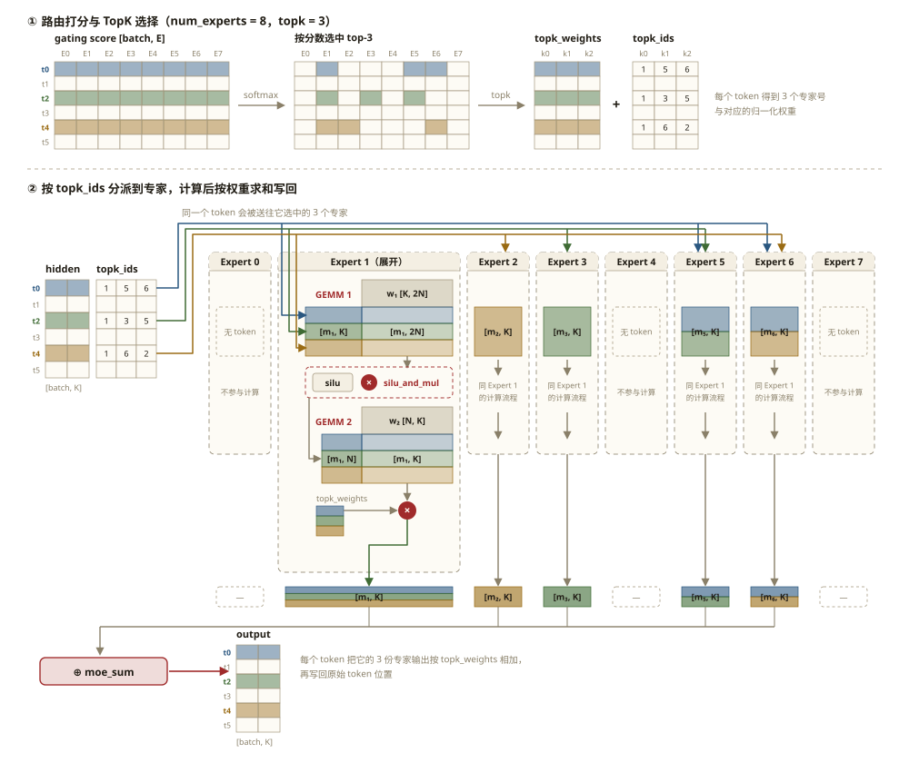
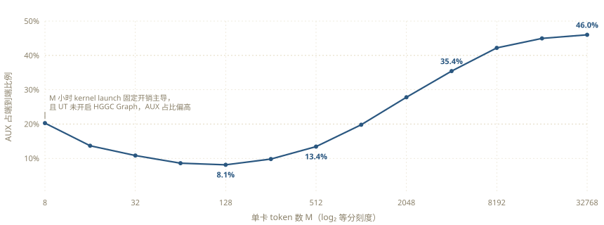
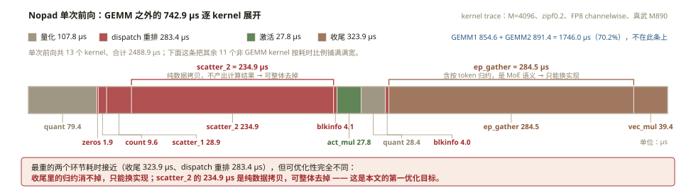
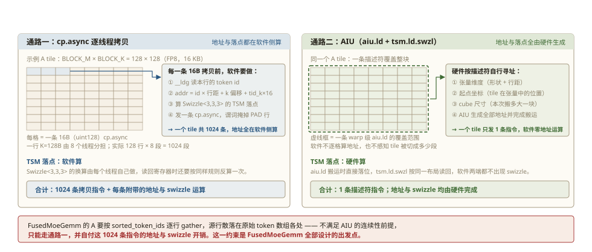
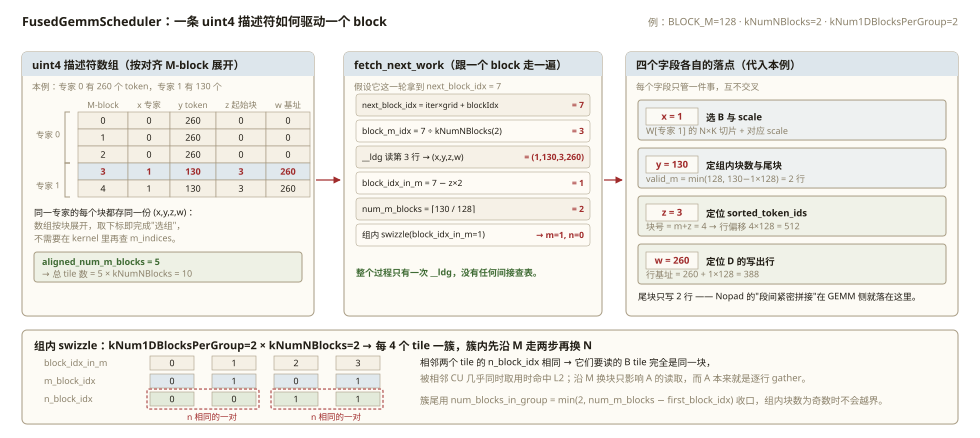
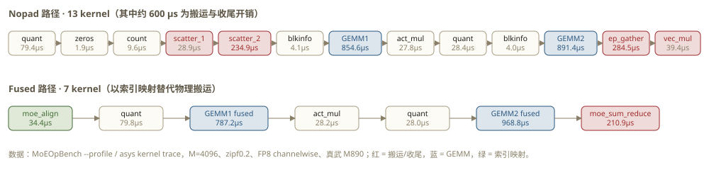
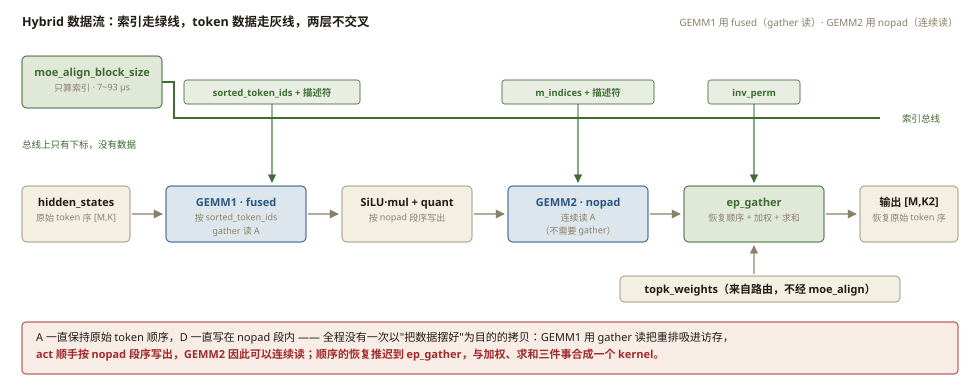
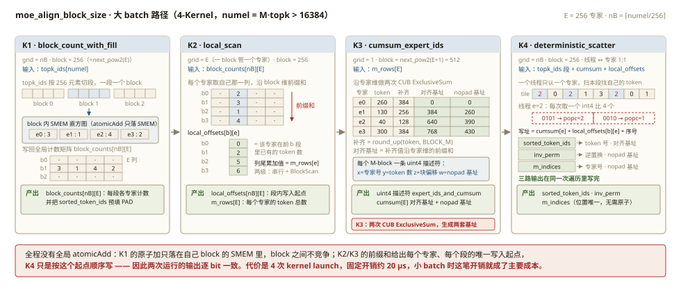
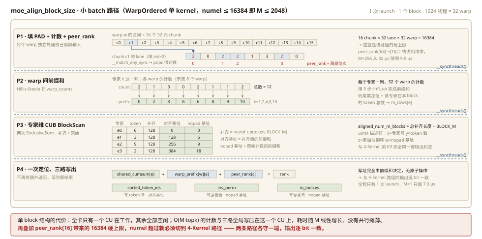
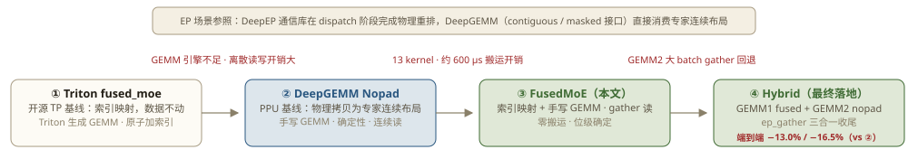

# 从 Nopad 到 Fused：TP 场景下的 PPU FusedMoE 设计与实践

目录

1.  [摘要](#abstract)
2.  [背景](#background)
    -   [MoE 的基本原理](#moe-overview)
    -   [专家重排问题](#expert-reordering)
    -   [开源界的两种方案及其场景](#open-source-approaches)
    -   [PPU 上的既有实践：Nopad 路径（TP 场景）](#nopad-baseline)
3.  [FusedMoE 的方案与实现](#fusedmoe-design)
    -   [动机：兼得两者](#design-motivation)
    -   [PPU 的 HBM→TSM 搬运通路](#hbm-tsm-paths)
    -   [FusedMoeGemm：按索引计算的 GEMM 核心](#fusedmoe-gemm)
    -   [从 Fused 到 Hybrid](#hybrid-design)
    -   [moe\_align\_block\_size：一次算清全部索引](#moe-align)
4.  [性能评估](#performance)
5.  [总结与展望](#summary)

## 摘要

本文介绍真武 M890 平台上 FusedMoE 的设计、实现与性能表现。MoE 推理中，token 需要按专家重新排列才能进行分组 GEMM。PPU 上的基线实现（DeepGEMM Nopad）通过 scatter 操作把 token 数据在显存中物理重排，连同量化与收尾，这条辅助链路在大 batch 下可占到端到端时延的近一半。FusedMoE 的做法是：先由辅助 kernel moe\_align\_block\_size 计算索引映射，再由 GEMM kernel 按索引直接 gather 读取数据，从而完全省去数据的物理重排。

最终落地的 Hybrid 方案（GEMM1 用 fused、GEMM2 用 nopad）相对基线端到端降低 13.0%（M=4096）、16.5%（M=32768），其中辅助开销降低 35.7%（M=4096）。索引构建同时做到了位级确定，相同输入产生逐 bit 相同的中间结果，便于逐层比对定位问题。

## 背景

### MoE 的基本原理

稠密模型的每个 FFN 层对所有 token 做同一组矩阵乘。MoE（Mixture of Experts）把一个 FFN 换成 E 个并行的专家 FFN 和一个路由器：每个 token 先经路由器打分，选出得分最高的 topk 个专家，分别计算后再按路由权重加权求和。这样模型参数量可以做得很大，而单个 token 的计算量只与激活的专家数成正比。

一个 MoE 层的前向计算由此分解为六步：路由打分 → TopK 选专家 → GEMM1（gate/up 投影）→ 激活函数（SiLU·mul）→ GEMM2（down 投影）→ 按路由权重加权求和、写回原始 token 顺序。

图 1 · MoE 前向六步：路由打分 → TopK 选专家 → GEMM1 → SiLU·mul → GEMM2 → 加权求和写回（num\_experts=8、topk=3 示意）。

### 专家重排问题

GEMM 占全部计算量的 95% 以上。但分组 GEMM 有一个前提：同一个专家的 token 必须在内存中连续排列。而输入数据是按 token 顺序排列的，因此 GEMM 之前必须先把 token 按专家重新分组，这一步通常称为 dispatch 或重排。重排如何做、开销多大，直接影响端到端时延，是本文讨论的核心。

### 开源界的两种方案及其场景

开源推理框架（sglang、vLLM 等）中有两种主流的大模型并行方案：TP（张量并行）按矩阵维度切分权重，EP（专家并行）按专家切分。具体到 MoE，两者对应两种不同的重排做法。

#### TP 场景：Triton fused\_moe

TP（张量并行）按矩阵维度切分：每个专家的 GEMM1 沿输出维切、GEMM2 沿输入维切，每张卡持有全部专家的权重切片。由此带来两个后果：每张卡要处理路由到所有专家的 token；GEMM 的形状是 M 保持本卡全量、N 与 K 被切小。sglang、vLLM 等开源推理框架在 TP 场景下的标准实现是 Triton 的 fused\_moe kernel：dispatch 阶段由 moe\_align\_block\_size 只计算索引映射：每个 token 在按专家排好序的序列中的位置，数据本身不动；Triton grouped GEMM 按索引 gather 读取输入，并在 kernel 内融合路由权重；最后由 moe\_sum\_reduce 求和收尾。整条路径不做任何物理重排，结构简洁。

#### EP 场景：DeepEP + DeepGEMM

另一条路线是 EP（专家并行）：sglang 的 EP 路径用 DeepEP 做跨卡通信、DeepGEMM 做 grouped GEMM。EP 按专家切分：每张卡只持有一部分专家的完整权重（K 与中间维都不切），token 必须先由通信层发送到目标专家所在的卡：DeepEP 在跨卡 dispatch 的同时就把 token 按目标专家物理重排好，算完再 combine 回各卡。EP 下 GEMM 的形状是 N、K 完整、M 被分散到各卡。DeepGEMM 的 grouped GEMM 直接消费这种专家连续布局，自身不含重排逻辑。这个"输入即专家连续布局"的契约，对后面的演进至关重要。

### PPU 上的既有实践：Nopad 路径（TP 场景）

由上面的对比可以看出两条路线的本质区别：EP 的专家连续布局由跨卡通信"顺手"完成；而 TP 不按专家切分，数据按原始 token 顺序到达，专家连续布局只能在卡内自己构造。

我们的工作面向 TP 部署，下面的实验与示例都以 GLM-5.3 为例。它共 78 层（前 3 层为 dense 层，其余为 MoE 层），hidden size 6144；每个 MoE 层包含 256 个路由专家与 1 个共享专家，topk=8，专家中间维度 2048；总参数约 750B，单 token 激活参数约 52B。按 TP8 部署时，每张卡持有全部 256 个专家的权重切片（GEMM1 沿输出维切、每卡 N=512；GEMM2 沿输入维切、每卡 K=256），要处理路由到全部专家的 token。

#### 为什么不直接用 Triton

把上游 Triton 路径直接搬到 PPU，会遇到两个问题：

-   GEMM 引擎差距：GEMM 是 MoE 的计算主体。Triton 编译器在 PPU 上对张量单元流水线的利用程度不如手工调优的 [SAIL 版 DeepGEMM Kernel](https://github.com/t-head/DeepGEMM-for-sail)，计算主体的效率差距会直接体现在端到端时延上；
-   离散访存开销：fused\_moe 的 gather 读（GEMM 内按索引间接寻址取输入行）与输出的散射写/归约收尾属于离散访存模式，这类访问在 PPU 内存子系统上的开销更为突出。

结论很直接：GEMM 引擎必须换成手工调优的 DeepGEMM kernel。

#### 从 Contiguous 到 Nopad

基于上面的分析，我们把 GEMM 引擎换成手工调优的 DeepGEMM kernel。前文介绍 EP 场景时提到，它的接口直接消费专家连续布局的数据；sglang 并没有为 TP 场景新写一套重排，而是把 EP 路径已有的 kernel 复用到卡内：用 ep\_scatter\_sail 把 token 数据在本卡物理拷贝为专家连续布局（相当于把 EP 的跨卡通信重排换成一次卡内拷贝），再交给 DeepGEMM grouped GEMM 连续切片计算，最后由 ep\_gather 一个 kernel 完成"恢复原始顺序 + 乘路由权重 + 求和"三步收尾。

PPU 最早的版本沿用了其中的 contiguous grouped GEMM 接口，但它有一个隐性要求：每个专家的段长必须向上对齐到 BLOCK\_M 的整数倍。\[注 1\] 于是调用方必须为每个专家补齐段长，补齐的行作为无效数据照常参与 GEMM 计算（算出即丢弃），同时还占用显存。

注 1：BLOCK\_M 在上游 contiguous 实现中取固定值 128（kLegacyMKAlignmentForContiguousLayout）。根源是 TMA tensormap 全局统一、按"块号 × BLOCK\_M"统一偏移寻址，专家编号按 tile 首行查 m\_indices 得到，地址计算里没有"每个专家的段起点"这个概念，段起点只能落在 tile 边界上。

这部分无效计算在常见场景下相当可观（以下按开源实现的 BLOCK\_M=128 估算）：

-   **decode 等小 batch 场景**：单卡 token 数少，分配摊到 256 个专家后每个专家只有几个 token。以平均每专家 8 个 token 为例，补齐到 128 意味着 GEMM 计算量被放大约 16 倍；
-   **长尾分布的流量**：线上流量的专家热度是偏斜的（本文测试用 zipf 分布拟合），大量冷门专家只分到 1~2 个 token，但每个冷专家仍要独占一段 128 行的空间，负载越偏斜，这类"几乎全空"的段越多；
-   只有 prefill 大 batch 且负载均匀时，每个专家分到的 token 远超 128，padding 占比才可以忽略。

PPU 上的实现因此演进为 Nopad 变体：调度器不再依赖统一偏移，而是按专家逐组推进、为每组显式维护段起点（curr\_m\_start），每组只分配 ⌈m\_i/BLOCK\_M⌉ 个 tile（BLOCK\_M 随形状调优选取，非固定值），末尾 tile 按实际行数截断，段与段之间紧密拼接、不再为对齐补无效行，从布局上去掉了这部分无效计算与显存占用。

#### Nopad 的优势与代价

Nopad 路径相比 Triton 的优势有两点：手写 GEMM 引擎充分利用张量单元；A 的读与 D 的写都落在连续行上，省掉了逐行算地址的开销。确定性上两者相当，都是 MoE FFN 层端到端确定。它因此成为 PPU 上的基线。

但代价是引入了一条完整的数据搬运链路，且其开销占比随 M 增大持续走高。理论上：搬运链路的 kernel（scatter、量化、ep\_gather）都是访存型操作，开销与数据量成正比，即随 M 线性增长；GEMM 是计算型操作，单 token 成本随 M 增大而下降：小 batch 时 tile 填充率与 CU 利用率低，大 batch 时张量单元趋于跑满、单位成本下降直至饱和。

实测的每 token 开销正是如此（Nopad，zipf0.6）：GEMM 从 M=256 的 2.32 µs/token 降到 M=32768 的 0.19 µs/token，而 AUX（本文用它统称全部辅助 kernel：量化、重排、激活、收尾）稳定在 0.16 µs/token 附近不再下降。一个线性增长、一个单位成本下降，两者相除，辅助开销占比必然随 M 走高：AUX 占比从 M=256 的 9.8% 一路上升到 M=4096 的 35.4%、M=32768 的 46.0%（曲线左端的小 M 区间是另一个极端：kernel launch 固定开销主导，且 UT 未开启 HGGC Graph，AUX 占比同样偏高）。

图 2 · Nopad 辅助开销占比随 M 走高：谷底约 8% 后持续抬升，M=4096 达 35.4%、M=32768 达 46.0%（小 M 段受 launch 固定开销抬高）。

占比曲线只给出趋势，要看清这条链路的开销结构，接下来以 M=4096 这个具体 case 做逐 kernel 的拆解。它落在占比曲线的上升段中部，AUX 占比约 35%。单次 MoE 前向共 13 个 kernel：

图 3 · Nopad 单次前向中 GEMM 之外的 11 个 kernel（M=4096）：scatter\_2（234.9 µs 纯拷贝、可去）与 ep\_gather（284.5 µs 含归约、只能换实现）最重。

GEMM 之外的辅助部分合计 742.9 µs，其中不含量化与激活的纯搬运与收尾约 600 µs。最重的两个环节是收尾（323.9 µs）与 dispatch 重排（283.4 µs），但两者的可优化空间完全不同：收尾的主体 ep\_gather 承担恢复原始顺序、乘路由权重、按 token 求和三件事，其中的归约是 MoE 语义的一部分，无法消除，只能换实现；而 dispatch 重排的 283.4 µs 中，scatter\_2 的 234.9 µs 是纯数据拷贝，不产出任何计算结果，可整体去掉；其余 48.5 µs 是前缀和与 m\_indices 这类索引工作，只能换个更省的实现。这是本文的第一优化目标。

## FusedMoE 的方案与实现

### 动机：兼得两者

回顾这两条路径：Triton 路径的结构简洁：数据不动、只做索引映射，但它的 GEMM 由 Triton 编译器生成，在 PPU 上引擎效率与离散访存都不达标；Nopad 路径换上了手工调优的 DeepGEMM GEMM、改为连续读取，代价是多出一条物理搬运链路，且如前文所示，其占比随 M 增大持续走高。两条路各解决了一半的问题。

FusedMoE 的目标是兼得两者：保留 Triton 路径"数据不动、只做索引映射"的结构，GEMM 引擎改用 DeepGEMM 手写 kernel，索引构建 kernel（moe\_align\_block\_size）针对 PPU 重新设计。这样 dispatch 从"索引计算 + 物理拷贝"收缩为只算索引：moe\_align 只计算每个 token 属于哪个专家、在排好序的序列中排第几，GEMM kernel 读取时按这些索引直接到原始位置 gather 取数，物理拷贝整体去掉。

### PPU 的 HBM→TSM 搬运通路

PPU 上 HBM→TSM 的数据搬运有两条通路，特点与要求对比如下：

|  | cp.async 通路 | AIU 通路（aiu.ld + tsm.ld.swzl） |
| :--- | :--- | :--- |
| 搬运粒度 | 逐线程异步拷贝，每条指令 4/8/16B | warp 级单指令搬运整个 tile |
| 地址计算 | 每个线程各自计算全局地址与 TSM 落点（含 swizzle 的 XOR 地址变换），tile 越大这部分开销占比越高 | 描述符式参数（张量维度 + 起点坐标 + cube 尺寸），地址计算由 AIU 硬件完成 |
| TSM 写入布局 | 软件层做 Swizzle<3,3,3> 规避 bank conflict | 硬件 swizzle，软件无需感知 |
| 读回寄存器 | 按线程映射取数 | tsm.ld.swzl 一条指令解析 swizzle，直接产出 MMA 所需的寄存器布局 |
| 寻址要求 | 支持任意离散地址 | 源区域必须维度规则、地址连续 |

Nopad 路径的 GEMM 里，A 与 B 都走 AIU 通路：每个 tile 只需一条描述符式指令即可完成搬运，主循环中不再需要 cp.async 路径逐线程计算全局地址、计算 swizzle 落点、按线程映射读回的指令开销；专家连续布局恰好满足它的连续性前提。

但 fused 方案无法使用这条通路：它要按索引到原始 token 位置逐行取数，源地址天然离散，不满足 AIU"维度规则、地址连续"的硬性前提。因此 FusedMoeGemm 的 A 矩阵读取只能选择 cp.async 通路，逐行计算地址、逐条发起拷贝，它要承担的正是 AIU 省掉的那部分开销。这一约束是后面 FusedMoeGemm 设计的出发点。

图 4 · HBM→TSM 两条通路：cp.async 逐线程拷贝、地址与 swizzle 由软件算（一个 tile 约 1024 条）；AIU 一条描述符全交硬件，但要求源连续。

### FusedMoeGemm：按索引计算的 GEMM 核心

第一版 Fused 的开发工作集中在 GEMM kernel 本身，因为辅助 kernel 大部分可以复用开源推理框架里的实现，只有 moe\_align\_block\_size 要按我们 GEMM kernel 的要求重写，这部分留到本节最后单独讲。

相比连续读取的 Nopad grouped GEMM，FusedMoeGemm 要把"按 sorted\_token\_ids 到原始位置取行"这件事做进 kernel，开发因此落在两个重点上：一是调度器（FusedGemmScheduler），它决定每个计算块该读哪份权重、从哪儿取输入、往哪儿写；二是离散读，A 的源地址天然分散，如上一小节所述只能走 cp.async 逐行 gather。下面分别看这两块。

#### 调度器如何工作

调度器要解决的核心问题是：给定一个计算块，如何算出它该读哪份权重、从哪儿取输入、往哪儿写输出。Nopad 与 Fused 的调度器都是在开源 contiguous 实现的基础上逐步改出来的，每一次改动都对应上一版失效的那部分假设。

开源 contiguous 的答案是定长算术。每个专家的段都对齐到 BLOCK\_M，块号 × BLOCK\_M 就是段内偏移，专家编号由块首行查 m\_indices 得到，调度器无需知道任何一个专家的段起点落在哪里。前文注 1 提到的对齐约束正是这套统一寻址的代价。

Nopad 去掉对齐填充后，段起点不再落在块边界上，定长算术随之失效。调度器改为按专家逐组推进，为每组显式维护段起点与累加块偏移，每组只分配 ⌈m\_i/BLOCK\_M⌉ 个块、尾块按实际行数截断。但专家数很多时，每个块都要在 kernel 内从第一个专家开始重走一遍这套推进过程，才能判断自己属于哪一组，相当于每块一次 O(E) 串行扫描。

于是我们把这轮扫描的结果预先算出来，存成一张按块索引的表：表的长度等于对齐后的 M-block 总数，第 i 项记录第 i 个块推进到此处时的那几个量：它属于哪个专家、该组有多少 token、组内该从哪个块号起算、输出段起点在哪。这张表由 GEMM 之前的预处理 kernel 一次算好，调度器拿到自己的块号后直接索引取用，kernel 内不再有任何跨专家的扫描。

Fused 继续沿用这张按块索引的表，只是每一项要多记一个量。原因是 A 不再被物理重排：块内 BLOCK\_M 行散落在原始 token 数组各处，仅知道"属于哪个专家、往哪儿写"还不足以取数，还需知道这些行的 token id 位于索引数组的什么位置。四个量恰好凑成一个 uint4，调度器按块号读一条即可：

-   x：该块所属的专家编号 → 选中对应的 B 权重与 scale；
-   y：该专家实际分到的 token 数 → 决定组内块数与尾块截断；
-   z：该专家之前已排了多少个对齐块 → 加上组内块号，即本块在 sorted\_token\_ids 中的块位置（正是下一小节离散读的块偏移来源）；
-   w：该专家之前实际有多少 token（nopad 基址）→ 组内块号 × BLOCK\_M + w 即本块输出在紧凑布局中的段内起点。

主循环本身则是标准做法：全局块号按（M 块 × N 块）展平，除以 N 块数得到 M-block 下标，读描述符，组内再按 swizzle 取 N 块（kNum1DBlocksPerGroup=2，让相邻 CU 上的块共享 B 的读取，提升 L2 命中率）。

这构成了对辅助 kernel 的第一个要求：在上 GEMM 之前一次性产出按对齐块排列的描述符数组，外加决定 grid 规模的块总数。

图 5 · FusedGemmScheduler：每个对齐 M-block 一条 uint4 描述符（x 选权重、y 定尾块、z 定位 sorted\_token\_ids、w 定位写出），一次 \_\_ldg 取全。

#### 离散读的索引如何计算

A 矩阵的 gather 读落在主循环的 copy\_A\_to\_tsm 中：调度器给出本 block 在对齐后序列中的 M-block 下标，据此定位 sorted\_token\_ids 中属于本块的 BLOCK\_M 个 token id；每个线程用 \_\_ldg 读出自己负责行的 token id，全局地址按"token id × 行距 + K 向偏移"计算，以一条 16 B（128 bit）的 cp.async 发起拷贝；填充位的 id 就等于 shape\_m，谓词 `id < shape_m` 为假时 cp.async 不取源，由 ZFILL 把这 16 B 直接写零。整套机制只依赖两样东西：按对齐块组织的 sorted\_token\_ids（填充位统一记为 M），以及本块在其中的块偏移，这是对辅助 kernel 的第二个要求。

![图 6 · 离散读：按 sorted\_token\_ids 的 id 算全局地址（id×行距 + K 偏移）逐行 gather，PAD 位由 ZFILL 写零；TSM tile 第 i 行 = A 第 id\[i\] 行。](../assets/blog/34/183b7ebee9e23b82.svg)

图 6 · 离散读：按 sorted\_token\_ids 的 id 算全局地址（id×行距 + K 偏移）逐行 gather，PAD 位由 ZFILL 写零；TSM tile 第 i 行 = A 第 id\[i\] 行。

#### 各操作数的读取方式

三个操作数的读取方式汇总如下：

| 操作数 | 读取方式 | 说明 |
| :--- | :--- | :--- |
| A（激活，\[M\_total, K\]） | cp.async 16 B gather（zfill 变体） | 按 sorted\_token\_ids 做索引计算后到原始位置取行，经 Swizzle<3,3,3> 写入 TSM |
| B（专家权重） | AIU descriptor 连续读 | 每组按专家编号选中对应权重，组内连续访问 |
| scale（INT8/FP8） | scaleA 随 A 离散读，scaleB 随 B 走 AIU | scaleA 与 A 一样按索引逐行取（cp.async）；scaleB 与 Nopad 一样 AIU 连续读、随组切换；perchannel 按行、blkwise 按 (1,128,128) 分组 |

FusedMoeGemm 对三种精度/量化路径各提供一个同源 kernel，Python 侧根据 lhs\_scales 的形状自动选择 perchannel 或 blkwise 路径：

| 精度 | kernel | scale 语义 |
| :--- | :--- | :--- |
| BF16 | fused\_moe\_gemm.cuh | — |
| INT8 / FP8 perchannel | fused\_moe\_gemm\_with\_perchannel\_quant.cuh | 按行 |
| FP8 blockwise | fused\_moe\_gemm\_with\_blkwise\_quant.cuh | 按 (1,128,128) 分组 |

### 从 Fused 到 Hybrid

完整 Fused 方案的写出阶段同样按索引计算位置：GEMM1 的输出按专家排序序连续写（输出即专家有序布局），GEMM2 的输出按索引离散写回各 token 对应的槽位，再由 moe\_sum\_reduce 求和收尾。

这套全 Fused 链路的 kernel 级构成见图 7。

图 7 · 全 Fused（两个 GEMM 都 fused）与 Nopad 的 kernel 对比：13 个收缩到 7 个，但 GEMM2 离散写回退（891.4→968.8 µs），故最终改用 Hybrid。

落地后的测试暴露出性能回退，问题出在 GEMM2 的离散写上：fused GEMM2 的 epilogue 需要把输出按索引编码散射回 (token, topk 槽位) 对应的位置，而 GEMM2 的 mainloop 很短（TP8 下 K=256），epilogue 在耗时中的占比本就偏大，离散写把这部分开销进一步放大：图 7 里 GEMM2 从 Nopad 的 891.4 µs 涨到全 Fused 的 968.8 µs（+8.7%），M=32768 时可达 +105%。因此 GEMM2 仍然采用 nopad：它的输入（GEMM1 的输出）已按专家顺序物理写出，连续读取即可，输出也连续写回，收尾交给 ep\_gather。

这个组合还带来一条要求：GEMM2 直接读 GEMM1 写出的中间结果，而写址若靠 atomicAdd 抢号，这份中间结果每次运行都不同：端到端输出不受影响（求和抵消了顺序差异），但逐层比对就失去了基准。为了排查问题时有稳定的中间态可比，我们把辅助 kernel 设计成确定性方案：写址完全由前缀和决定。

基于上述观察，最终方案收敛为 Hybrid 组合：

-   GEMM1 采用 fused：输入是原始 token 顺序的 hidden\_states，必须按专家重排，用索引映射 + kernel 内 gather 读，不做物理拷贝；
-   GEMM2 采用 nopad：输入已是专家有序的连续布局，连续读取、连续写回，避开 epilogue 离散写的回退；
-   收尾采用 ep\_gather：把"恢复原始顺序、乘路由权重、按 token 求和"三步合并为一个 kernel，相比"moe\_sum\_reduce 求和 + 单独一次向量乘"再省一次 elementwise 调用。

### moe\_align\_block\_size：一次算清全部索引

前面两小节给出的只是 GEMM kernel 自身的需求：调度器要一张按对齐块索引的描述符表，外加决定 grid 规模的块总数；gather 要一份按对齐块组织的 sorted\_token\_ids，填充位统一记为 M。Hybrid 的组合又追加了三项：收尾的 ep\_gather 需要逆置换表，才能把每个结果放回原本的槽位；GEMM2 走 nopad，需要 m\_indices 标出每一行属于哪个专家；以及索引构建做到位级确定，便于排查问题时比对中间态。这些加起来，才是 moe\_align 要交付的全部内容。

图 8 · Hybrid 数据流：moe\_align 只产索引，GEMM1 gather 读、GEMM2 连续读、ep\_gather 用 inv\_perm 收尾；token 数据全程不物理重排。

#### 原型：基于开源实现补齐 Hybrid 索引

开源的 moe\_align\_block\_size 已经能够统计各专家的 token 数、计算前缀和，并生成 sorted\_token\_ids、每块的专家编号和对齐后的总长度。我们沿用它的输入输出语义与 PAD=M 约定，在单 kernel 中补充累加块偏移与 nopad 基址；写入位置仍由全局 atomicAdd 分配。

这个原型在小 batch 下足够快（M=1 约 3.5 µs），但存在三个问题：竞争顺序不固定，中间输出不可复现；大 batch 下二十余万个元素竞争全局计数器，M=32768 时耗时 278.9 µs；Hybrid 所需的 inv\_perm 与 m\_indices 仍依赖额外的 torch 算子生成。后续改造由此聚焦在三个目标上：消除全局原子竞争、稳定中间布局，并在一次预处理中生成全部索引。

#### 确定性改造：4-Kernel 路径

为同时解决大 batch 性能和中间布局不稳定的问题，预处理被拆成四个 kernel：K1 只做计数，原子加收敛在各自 block 的共享内存上，block 之间不再竞争；K2 用 CUB BlockScan 为每个专家沿 block 维做前缀和，得到该专家在前若干段中已累计的 token 数，K3 再沿专家维做前缀和，给出每个专家的写入基址；K4 让每个线程固定负责一个专家的回写区间，写入位置由前缀和唯一确定。全程不依赖全局 atomicAdd，输出位级确定，M=32768 降至 134.6 µs（2.07x）。逆置换表也在这一版随 scatter 顺带写出，m\_indices 改为内联生成，省掉了那 8 个 torch 算子。

代价是 4 次 kernel launch 带来约 20 µs 的固定开销。大 batch 下这点开销可以忽略，小 batch 下却成了主导项：M<624 时反而不如原型实现。

图 9 · 大 batch 路径（4-Kernel，numel>16384）：K1 分块计数 → K2 沿 block 维前缀和 → K3 沿专家维前缀和出描述符 → K4 无原子写三路索引，输出位级确定。

#### 小 batch 优化：WarpOrdered 单 kernel

小 batch 的诉求恰好相反：把整轮排序压进单个 block（1024 线程、32 个 warp）一次完成，从根本上省去多次 launch 的固定开销。kernel 分四个阶段：P1 各 warp 用 \_\_match\_any\_sync + popc 以 O(1) 复杂度统计本 warp 输入区间内各专家的 token 数，并用寄存器数组 peer\_rank 记下每个元素在 warp 内的局部位次；P2 在 warp 间做 Hillis-Steele 前缀和；P3 用 CUB BlockScan 对 256 个专家做块级前缀和并生成调度描述符；P4 按"专家基址 + warp 前缀 + 局部位次"一次写出 sorted\_token\_ids、逆置换表与 m\_indices。写入位置同样由前缀和唯一确定，结果与 v2 逐 bit 一致，M=1 只需 7.0 µs。

但单 block 结构决定了它不能用于大 batch：全卡只有一个 CU 在工作，其余 CU 全部空闲，O(M·topk) 的计数与三路全局写全部压在这一个 CU 上，耗时随 M 线性增长、没有任何并行摊薄。更硬的上限来自寄存器：每个 warp 用 peer\_rank\[16\] 记录 16 个 32 元 chunk 的局部位次，32 个 warp 合计最多处理 16384 个元素，一旦超过这一规模，该实现便无法运行。

图 10 · 小 batch 路径（WarpOrdered 单 block，M≤2048）：warp 内 \_\_match\_any\_sync 计数 + 两级前缀和，一次 launch 写出三路索引，与 4-Kernel 逐 bit 一致。

#### 最终方案：按规模选择路径

最终实现按规模选择路径：numel = M·topk ≤ 16384（即 M ≤ 2048）时使用 WarpOrdered 单 kernel，否则使用 4-Kernel 路径。两条路径遵循相同的输出约定，结果逐 bit 一致。最终版本实测 M=1 为 7.0 µs，M=32768 为 92.9 µs。

| 阶段 | 方案 | M=1 | M=32768 | 结论 |
| :--- | :--- | :--- | :--- | :--- |
| 原型 | 单 kernel + 全局 atomicAdd scatter | ~3.5 µs | 278.9 µs | 小 M 快、大 M 慢；顺序不固定，中间结果不可复现 |
| 4-Kernel | TSM 计数 + CUB 前缀和 + 确定性 scatter | 慢于原型 | 134.6 µs | 大 M 提升 2.07x 且位级确定；4 次 launch 约 20 µs，M<624 时不如原型 |
| 最终 | WarpOrdered 与 4-Kernel 按 numel 分流 | 7.0 µs | 92.9 µs | 小、大 batch 分别选择合适路径，输出逐 bit 一致 |

这里附带一个寄存器层面的优化：WarpOrdered 初版使用 peer\_rank\[64\]（256 B），超出寄存器容量后被编译器溢出到 local memory（栈占用 260 B）。改用 peer\_rank\[16\]（64 B）后数组完整驻留寄存器、栈占用清零，M=256 的耗时从 32 µs 降至 9.5 µs（3.4x）。16 这一上限恰好覆盖 M≤2048 时每个 warp 需要处理的 16 个区间，是容量与需求精确匹配的结果。

最终形态下，moe\_align 的输入是 topk\_ids \[M, topk\]（每个 token 选中的专家编号），一次调用产出这条路径需要的全部索引：

| 返回值 | 形状 / 类型 | 用途 |
| :--- | :--- | :--- |
| config | — | GEMM launch 配置 |
| aligned\_num\_m\_blocks | int32 | 对齐后的 M-block 总数，决定 grid 规模 |
| expert\_ids\_and\_cumsum | \[max\_num\_m\_blocks\] uint4 | 调度描述符：x=专家编号，y=该组 token 数，z=累加块偏移，w=nopad 基址 |
| sorted\_token\_ids | \[对齐后总长\] int32 | gather 索引，内容为 token 原始序号，填充位记为 M |
| m\_rows | \[E\] int32 | 每个专家实际分到的 token 数 |
| m\_indices | \[对齐后总长\] int32 | 每一行属于哪个专家，GEMM2 的 nopad 路径使用 |
| inv\_perm | \[M·topk\] int32 | 逆置换表，ep\_gather 收尾使用 |

## 性能评估

所有性能数据均在正确性验证通过后采集：14 个 case 的用例集（覆盖各档 batch、部分尾块、空专家等边界）在真武 M890 上 BF16/INT8/FP8 三精度 14/14 通过。

主口径：MoEOpBench TP8 实测（sglang 0.5.12），GLM-5.3 配置（256 路由专家 / topk=8 / hidden 6144），zipf0.6，FP8 channelwise。测试负载中专家热度服从 zipf 分布，与线上流量的长尾特征一致。表中 sum 为 GEMM1 + GEMM2 + AUX 的总和，AUX 指量化、重排、收尾等全部辅助 kernel 的开销。

| M | Nopad sum (µs) | Hybrid sum (µs) | 变化 |
| :--- | :--- | :--- | :--- |
| 1 | 71.28 | 65.55 | −8.0% |
| 256 | 658.77 | 639.16 | −3.0% |
| 1024 | 904.09 | 850.91 | −5.9% |
| 4096 | 1867.69 | 1624.45 | −13.0% |
| 32768 | 11475.58 | 9579.56 | −16.5% |

以 M=4096 为例分解收益来源，GEMM 主体基本不变，收益几乎全部来自辅助链路：

| 分段 | Nopad (µs) | Hybrid (µs) | 变化 |
| :--- | :--- | :--- | :--- |
| GEMM1 | 716.97 | 702.33 | −2.0% |
| GEMM2 | 489.02 | 496.76 | +1.6% |
| AUX（量化+重排+收尾） | 661.70 | 425.36 | −35.7% |
| SUM | 1867.69 | 1624.45 | −13.0% |

AUX 减少的 236.3 µs 中，绝大部分来自 dispatch 环节的物理拷贝被 moe\_align 索引映射替代。需要说明的是，gather 读在大 batch 下有小幅回退：M=32768 时 GEMM1 比 Nopad 慢 9.9%，但辅助环节的收益足以覆盖，端到端仍降低 16.5%。

| GEMM1 | AUX · 量化 + 重排 + 收尾 | SUM · GEMM1 + GEMM2 + AUX |
| :--- | :--- | :--- |
|  |  |  |

Nopad=1.0 基准　 Hybrid

图 11 · 三张比率图（Nopad=1.0 基准，64 个 zipf0.6 case）：GEMM1 仅大 M 有 gather 回退，AUX 是收益主来源，SUM 为端到端净收益。

三张图各说明一件事：

-   **GEMM1：gather 读的回退只在大 M 出现。** 小 M 下两条线基本重合，回退直到 M≈4500 才出现（M=4096 时 Hybrid 的 GEMM1 还快 2.0%，M=4522 跳到 +9.6%），此后稳定在 +9%~+12%，M=32768 时慢 9.9%。原因在搬运通路的差别：Nopad 的 A 是重排后的连续段，一个 tile 用一条 AIU 描述符整块搬入，地址由硬件生成；Fused 的 A 要按 `sorted_token_ids` 逐行 gather，源地址离散，只能退回 cp.async：一个 128×128 的 FP8 tile 要发约 1024 条 16B 拷贝，每条的全局地址与 TSM 落点都由软件算。这份额外指令开销正比于 tile 数量；而 GEMM1 的时间构成随 M 变化：小 M 时它远未打满，取数延迟被 launch 与尾部效应盖住，大 M 时 mainloop 成为主体，多出来的地址计算就直接摊在关键路径上，越过那一档之后它在 GEMM1 里的占比趋于恒定，实测落在 +8.7%~+11.9%、均值 +9.8%（大 M 段 15 个点全为正，σ=0.85%）。代价可以接受的理由是它换掉的东西更贵：软件侧多付的是 GEMM1 内约 10% 的取数开销，省掉的是整条物理重排链路，后者比它大一个量级，同一点上端到端仍降低 16.5%。
-   **AUX：收益的来源。** Hybrid 的辅助开销在大 M 段约为 Nopad 的 60%~75%，M=32768 时约为 60.2%，且随 M 增大优势更加明显。辅助链路是本方案的主要优化对象，也是 T-Head SAIL 软件栈后续仍有空间的方向。
-   **SUM：两项相抵后的净结果。** Hybrid 在全范围低于 Nopad，M≥1024 后降幅稳定在 5.0~16.5%，且 M 越大收益越大，因为 AUX 在总时间中的占比本身随 M 上升（图 2）。

三张图指向同一个判断：收益来自辅助链路，代价在 GEMM1 的取数，两者量级差一档，因此 M 越大越划算。

## 总结与展望

图 12 · PPU 上 MoE 实现的演进链：Triton → Nopad → FusedMoE → Hybrid，红色标注每次迁移的驱动因素。

回到起点的问题：TP 场景下的重排不必真的搬数据。把它化为索引、让 GEMM 按索引取数，省掉的是一条随 M 增长却不产出结果的拷贝链路；代价是索引构建必须足够快，且 GEMM2 那一段仍要退回 nopad 才不亏。

软件侧仍可优化的部分主要集中在辅助链路。两个方向的量级并不相同，判断标准是它最多能覆盖多少辅助开销：

-   **激活函数融合**：GEMM1 与 SiLU·mul 之间目前是一次独立的 elementwise 读写，融进 GEMM1 的 epilogue 可以省掉这次中间结果的往返。但按 M=4096 的 trace，act\_mul 只有 27.8 µs，占辅助部分不到 4%，收益上限就在这一档，属于确定但有限的小修。
-   **EP 场景的融合**：本文面向 TP 场景。EP 下 token 已由跨卡通信按专家重排，不存在卡内搬运的问题，但有另一个融合方向：把 dispatch 通信与 GEMM 计算做进同一个 kernel。MegaMoE 已经把 EP dispatch + GEMM1 + SwiGLU + GEMM2 + combine 融为单 kernel，用 symmetric memory 做跨卡零拷贝、让通信与张量单元计算重叠。它动的是通信与计算的重叠度，量级远大于前者，但在 PPU 上的可行性需要另行验证。
