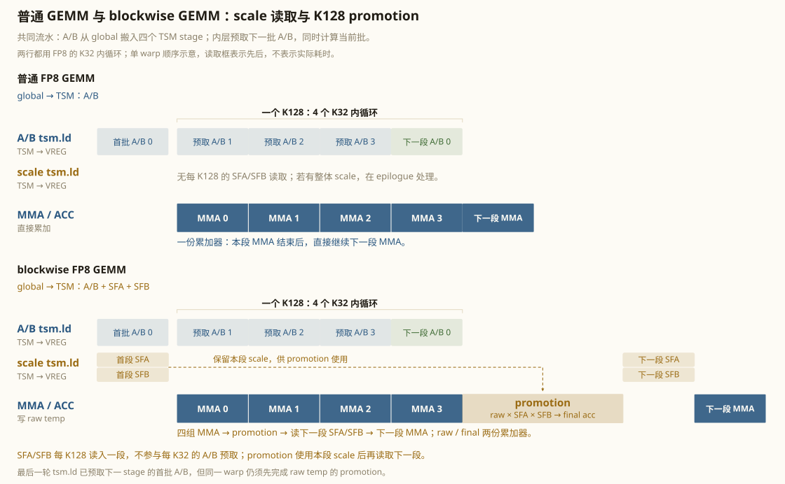
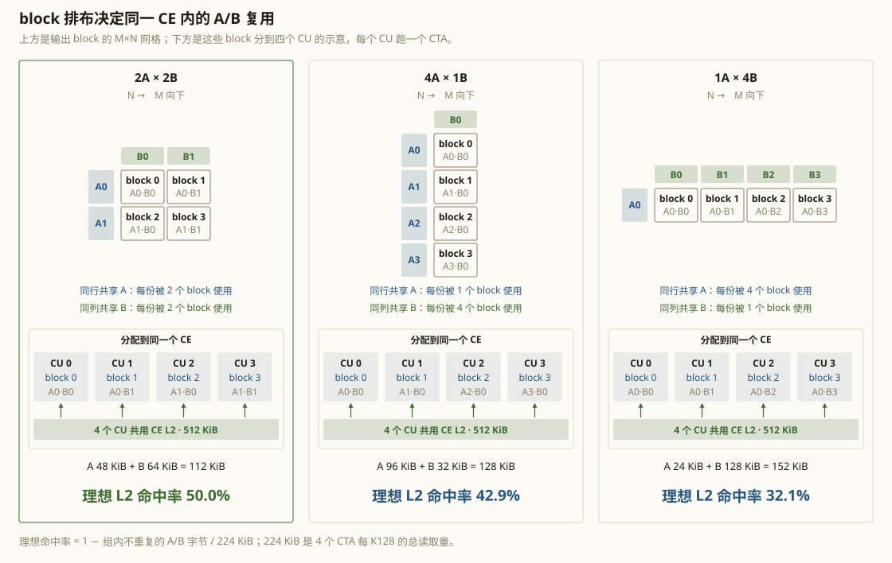
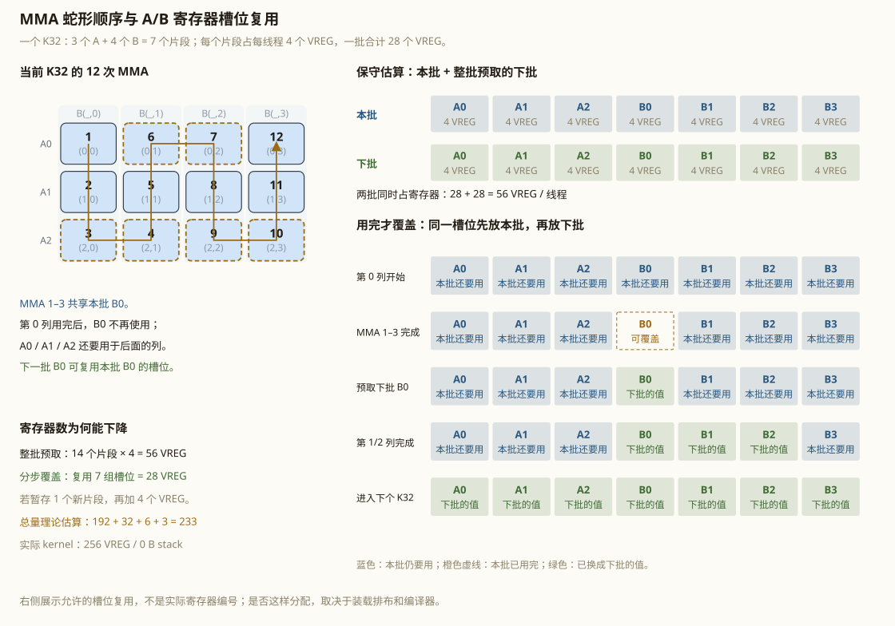
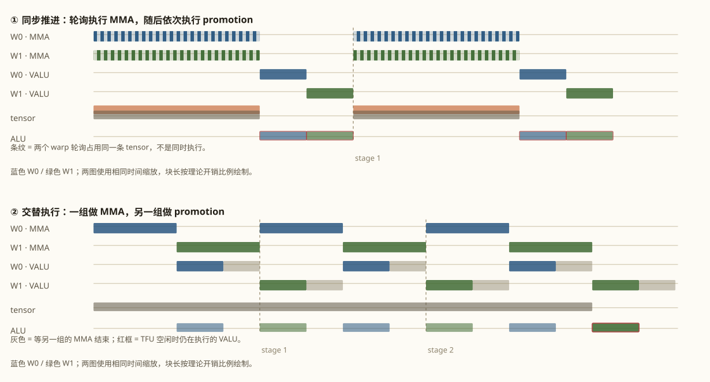
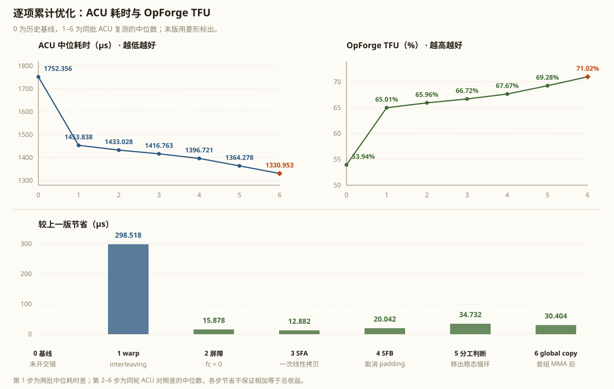
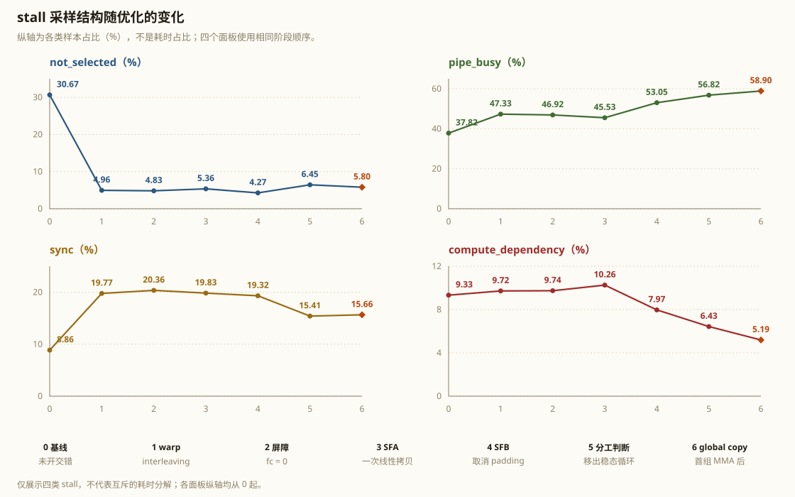

# 真武 M890 上 FP8 blockwise GEMM 的实现与优化

目录

1.  [1\. 背景](#1-背景)
    1.  [1.1 blockwise GEMM 的输入输出](#blockwise-gemm-的输入输出)
    2.  [1.2 与普通 GEMM 的区别和实现挑战](#与普通-gemm-的区别和实现挑战)
2.  [2\. 理论分析和 tile 选择](#2-理论分析和-tile-选择)
    1.  [2.1 选 tile 的原则和普通 GEMM 的 tile 选择](#选-tile-的原则和普通-gemm-的-tile-选择)
    2.  [2.2 blockwise 为什么用不了这个 tile](#blockwise-为什么用不了这个-tile)
    3.  [2.3 roofline 分析和 cache 命中率分析](#roofline-分析和-cache-命中率分析)
    4.  [2.4 指令开销分析](#指令开销分析)
3.  [3\. 性能优化实践](#3-性能优化实践)
    1.  [3.1 基线与测量口径](#3-1-基线与测量口径)
    2.  [3.2 性能优化之一：如何节省寄存器](#3-2-性能优化之一-如何节省寄存器)
    3.  [3.3 性能优化之二：使用 warp interleaving 掩盖 promotion 开销](#3-3-性能优化之二-使用-warp-interleaving-掩盖-promotion-开销)
    4.  [3.4 性能优化手段三：降低指令 issue、调度和同步的压力](#3-4-性能优化手段三-降低指令-issue-调度和同步的压力)
4.  [4\. 性能评估](#4-性能评估)
    1.  [4.1 累计收益](#4-1-累计收益)
    2.  [4.2 收益结构](#4-2-收益结构)
5.  [5\. 总结](#5-总结)

## 1\. 背景

GEMM 在大模型中被广泛应用。受带宽和算力限制，为了在同样的显存里放下更多参数、让 FFN 层算得更快，量化是常用手段。量化的粒度和数值格式经历了很多轮演进：粒度从 per-tensor 到 per-channel、per-token，再到 per-group、per-block 这类更细的粒度；数值格式包括 INT8、FP8、FP4，以及 MXFP8、MXFP4 这类带 block scale 的格式。每一种组合都对应不同的 GEMM 实现和优化问题。

本文聚焦 FP8 的 blockwise 方案：激活按 per-token 的 `1×128` tile、权重按 `128×128` block 分块，各自一个 FP32 scale。这套方案最早由 DeepSeek-V3 提出，后来被 Qwen3、GLM-4.5、MiniMax-M2 等开源模型采用，已经成为一类很常见的 FP8 量化实现；各家的 block 形状和 scale 类型略有差异。DeepGEMM 把它作为库中的一类 GEMM，NVIDIA Transformer Engine 也把 `1×128` 和 `128×128` 列为 FP8 blockwise scaling 的支持项；对真武 PPU 来说，这是一类必须支持的 GEMM。本文以真武 M890（ppu0015）为目标硬件，讨论这条 blockwise 路径的实现和优化，量化算法本身不在范围内。

### 1.1 blockwise GEMM 的输入输出

这个 GEMM 的输入是 A（`M×K`，E4M3）、B（`K×N`，E4M3）、A 的 scale（`1×128`）和 B 的 scale（`128×128`），输出是 D（`M×N`，BF16）。K 方向按 128 切块，每个 K128 走一遍下面的流水线。

图 1 对比普通 GEMM 与 blockwise GEMM 的流水。两者都用 TSM stage 重叠搬运与计算，并在内循环中预取下一批 A/B、执行当前批 MMA。blockwise 还随 K128 stage 搬运 SFA/SFB，并在首段计算前读入 scale 寄存器；四个 K32 全部算完后做一次 promotion，把 raw 结果反量化后累到 final acc，再读下一段 SFA/SFB、进入下一段 MMA。普通 GEMM 不需要每 K128 读取 scale 和 promotion，直接继续累加。

图 1 · 普通 GEMM 与 blockwise GEMM 的流水对比：A/B 的 tsm.ld/MMA 流水相同；blockwise 额外搬运 SFA/SFB，每 K128 读入 scale，并在四个 K32 后用它们完成 promotion。

### 1.2 与普通 GEMM 的区别和实现挑战

普通 GEMM 没有这一步 promotion，MMA 直接累加；它只有一份累加器，scale 要么没有，要么在 epilogue 一次处理。blockwise 每算完一个 K128，都要用这一段的 A/B scale 把 MMA 的 raw 结果做一次 FP32 promotion，再累加到最终结果；为了同时保留 raw 和 final，累加器从一份变成两份。MMA 写 temp、promotion 读 temp、下一个 MMA 覆写 temp，三步在同一个 warp 内是 RAW/WAR 串行。promotion 读 temp 的期间，同一个 warp 发不出下一条 MMA；两个 warp 如果同相，tensor pipe 就会在这段时间空转，TFU 利用率被直接拉低，stall 明显上升。串行的 promotion 和两份累加器，就是真武 PPU 上实现这个 kernel 的两个主要挑战。

## 2\. 理论分析和 tile 选择

在进行具体的优化操作之前，我们首先进行一些理论分析，从而对实现和优化方向做出最通用的判断。

### 2.1 选 tile 的原则和普通 GEMM 的 tile 选择

MAC（Multiply–Accumulate）是乘加累积，即 $c \gets c + a \times b$。一次 MAC 包含一次乘法和一次加法，通常计为 2 FLOP。

一个 $B_M\times B_N$ 的 tile 在 K 方向每走一步，读 $B_M$ 个 A 元素和 $B_N$ 个 B 元素，做 $B_M\times B_N$ 次 MAC。设元素字节数为 $s$，则：

$$
\begin{aligned} \mathrm{bytes/MAC} &= \frac{(B_M+B_N)s}{B_M B_N} \\ \mathrm{AI} &= \frac{2B_M B_N}{(B_M+B_N)s} \end{aligned}
$$

AI 表示算术强度，单位为 FLOP/B。从公式可以直接读出两条：

-   固定形状时，tile 越大，$\mathrm{bytes/MAC}$ 越小；
-   固定面积 $B_M B_N$ 时，$B_M+B_N$ 在 $B_M=B_N$ 时最小，所以方形 tile 的 $\mathrm{bytes/MAC}$ 最低。

于是选 tile 的原则是：在 SMEM 和寄存器放得下的前提下，尽量大、尽量方；stage 数在 SMEM 预算内取最深。

以 FP8（$s=1$）为例：

| tile | A/B 字节/MAC | 相对 256×256 | 算术强度 |
| :--- | ---: | ---: | ---: |
| 256×256 | 0.0078 | 1.00 | 256 |
| 192×256 | 0.0091 | 1.17 | 219 |
| 128×256、256×128 | 0.0117 | 1.50 | 171 |
| 128×128 | 0.0156 | 2.00 | 128 |

表里 `128×256` 这一行已经说明了问题：面积只有 `256×256` 的一半，A/B 字节却多搬 50%。所以 tile 定在 `256×256`，接下来由 SMEM 和寄存器决定它的 BK、warp tile 和 stage 数。

先看 SMEM。每个 stage 放 A（$256\times B_K$）和 B（$B_K\times256$）。K 行按 128B 对齐：BF16 下 $B_K=64$（64×2B），FP8 下 $B_K=128$（128×1B），两种情况下每个 stage 都是 $(256+256)\times128\,\mathrm{B}=64\,\mathrm{KiB}$。stage 数决定预取深度：4 层是 256KiB，3 层是 192KiB，5 层是 320KiB。4 层是 SMEM 能放下的最深层数；3 层更浅，5 层放不下。

再看寄存器。16 个 warp 覆盖 `256×256`，按 4×4 切成 `64×64` 的 warp tile。FP32 累加器占每线程 $\frac{64\times64}{32}=128$ 个 VREG；BF16 的 A/B 片段再加约 64，合计 192，离 256 还有 64 的余量。继续增大 CTA，需要增加 warp 数，超出当前 512 线程的配置，或增大 warp tile，进一步挤压 A/B 的寄存器空间。

所以普通 GEMM 落在 `256×256×64`、warp `64×64`、K 行 128B、4 stages：tile 由复用率定，BK、warp tile 和 stage 数由 SMEM 与寄存器定。

### 2.2 blockwise 为什么用不了这个 tile

首先卡在寄存器。按每 WE 两个 warp、每 warp 256 VREG 的预算，`64×64` warp tile 的一份 FP32 累加器占每线程 $\frac{64\times64}{32}=128$ 个 VREG；blockwise 要同时留 MMA 的 raw 结果和最终结果，$2\,\mathrm{ACC}=256$，A/B 片段没有空间。所以 warp tile 缩到 `48×64`：一份累加器 $\frac{48\times64}{32}=96$，两份 192，留出约 64 给 A/B 与 SFA。CTA 随之从 `256×256` 变成 `192×256`，正好是 4×4 个 `48×64` warp。

A/B 和累加器的寄存器账可以直接列成表。`48×64` 是 3×4 个 `m16n16k32` atom；一个片段按 lane 是 16B = 4 VREG，所以一个 K-atom 的 A/B 是 $3\times4+4\times4=28$，双缓冲是 $2\times28=56$。SFA 每个 stage 是 192 个 FP32 scale（每行一个），按 32 lane 分，每 lane 6 个，即 6 VREG。

| 项 | 公式 | VREG / 线程 |
| :--- | :--- | ---: |
| 累加器 | 2 × (48×64 / 32) | 192 |
| A/B 双缓冲 | 2 × (3×4 + 4×4) | 56 |
| SFA | 192 / 32 | 6 |
| 合计 |  | **254** |

合计 254，离 256 只剩 2 个余量；循环变量、地址计算、变量更新等还要占寄存器，寄存器非常紧，代码如果不在装载顺序、变量生命周期上精细控制，很容易 spill。也是出于这个考虑，SFA/SFB 的 load 量虽然很小，还是采用 AIU load，省下地址和标量寄存器；后面对应章节会详细说明。

SMEM 是第二道约束。`256×256` 的 4 个 stage 要 256KiB，再加 SFA/SFB 的 scale 存储就放不下；`192×256` 的 4 个 stage 是 $(192+256)\times128\times4=229\,376\,\mathrm{B}$，加 scale 3,328B 正好 232,704B。

到这一步，资源只允许每 CU 驻留一个 CTA：232,704B 超过 256KiB TSM 的一半；16 个 warp 对 8 个 WE，正好每个 WE 两个 warp；16 个 warp 按每 warp 256 个 VREG 计，需要 4096 个 32-lane 向量寄存器，而每 CU 的 8 个 WE、每 WE 512 个，合计也是 4096。所以这个 kernel 是 1 CTA/CU，一个 CU 同时只跑一个 CTA。

算术强度也从 256 降到 219，每 MAC 的 A/B 字节高约 17%，但这是寄存器允许的最大 tile。`128×256` 或 `256×128` 寄存器更宽松，但算术强度只有 171，每 MAC 字节比 `256×256` 高约 50%，所以不作为主候选。

### 2.3 roofline 分析和 cache 命中率分析

tile 定下来之后，接着用 roofline 模型估一遍理论边界：这套 tile 和流水最高能到多少 TFU，限制又落在哪一层。roofline 不是一条线，而是按缓存层级分成几条带宽屋顶。按照理论计算，每一层的屋脊点是：

$$
\begin{aligned} \mathrm{ridge}_{\mathrm{L2}} &= 62.4\;\mathrm{FLOP/B} \\ \mathrm{ridge}_{\mathrm{fabric}} &= 312.0\;\mathrm{FLOP/B} \\ \mathrm{ridge}_{\mathrm{DRAM}} &= 312.0\;\mathrm{FLOP/B} \end{aligned}
$$

屋脊点是 `峰值算力 / 这一层的带宽`：L2→CU 整卡 10240 B/cycle，1.3 GHz 下是 13.312 TB/s；fabric 单向读 2048 B/cycle 是 2.6624 TB/s。按 FP8 峰值 830.7 TFLOPS 相除，分别得到 62.4 和 312.0 FLOP/B。本例的 AI 约 219.43，是 L2 屋脊点的 3.5 倍，所以在这套带宽模型中，L2→CU 不构成供数上限；这不表示实测读取总能及时完成。

在仅统计 A/B 读取、DRAM 与 fabric 使用相同峰值带宽的模型中，DRAM 字节数不多于 fabric，可省略单独的 DRAM roof。L2 命中率 $\mathrm{hit}_{\mathrm{L2}}$ 决定 fabric 上要搬多少字节：

$$
\mathrm{TFU}(\%) = 100\min\left(1,\frac{\mathrm{AI}}{62.4},\frac{\mathrm{AI}}{312.0\left(1-\mathrm{hit}_{\mathrm{L2}}\right)}\right)
$$

先算没有跨 CTA 的 A/B 复用时（$\mathrm{hit}_{\mathrm{L2}}=0$）的供数上限：

$$
\begin{aligned} \mathrm{AI} &= \frac{2\times192\times256}{192+256} \approx 219.43\;\mathrm{FLOP/B} \\ \text{零复用的供数上限} &= \frac{219.43}{312.0} \approx 70.3\% \end{aligned}
$$

跨 CTA 的 L2 复用可抬高这条供数上限。模型中要支持 100% 的峰值算力，L2 命中率至少需要约 29.7%（$1-\frac{219.43}{312.0}$）；它是带宽条件，不是实测满供的保证。

取一个 4 个 CU 均可用的 CE，本 kernel 每个 CU 驻留一个 CTA，它们共用 512KiB 的 L2。决定组内 A/B 复用的是这四个 CU 所计算的 block 如何排布。

这 4 个 CTA 每个 K128 各读 A 24KiB、B 32KiB，共 56KiB，4 个合起来 224KiB。几种 block 排布及其理想 L2 命中率如图 2 所示：同行 block 共享 A，同列 block 共享 B。

图 2 · block 排布与理想 L2 命中率：对比 2×2、4×1、1×4 输出 block 的 A/B 共享关系，以及这些 block 在同一 CE 四个 CU 上的落点。

图中的比例只统计这组 4 个 CTA 共享的 A/B 字节。实际命中率还取决于推进时机和组外复用，不能由排布图直接推定。

### 2.4 指令开销分析

tile 和供数两头算完，最后看指令侧。按每 WE 两个 warp，先假设 promotion 与 MMA 完全不重叠，估算串行执行的开销。

$$
\begin{aligned} T_{\mathrm{tensor}} &= 2\times48\times8 = 768\;\mathrm{cycle} \\ T_{\mathrm{VALU}} &= 2\times(96\;\mathrm{FMA}+12\;\mathrm{MUL})\times2 = 432\;\mathrm{cycle} \\ T_{\mathrm{serial}} &= 768+432 = 1200\;\mathrm{cycle} \\ \text{串行拖慢倍率} &= \frac{1200}{768} \approx 1.56 \\ \text{TFU 上限} &= \frac{768}{1200} = 64\% \end{aligned}
$$

不重叠时，promotion 的 432 cycle 全压在 tensor 之外：指令层面的 pipeline 慢 1.56×，TFU 上限从 100% 掉到 64%。在 kernel 未优化时，普遍测出来的基线 TFU 利用率在 50% 上下，比 64% 还低得多。这说明除了 promotion 依赖，还有交接、同步和 scale 搬运的开销。后面的优化分别处理这两件事。

## 3\. 性能优化实践

tile 已经定下来，供数和指令两侧的理论上限也算清楚了。接下来把 kernel 放到一个具体的 problem shape 上做优化。为了避免 wave 拖尾，problem size 要能被 tile 完全切分、又正好铺满整数轮：真武 M890 有 39 个 CU，于是 M 取 $192\times39=7488$，N 取 $256\times20=5120$，K 取 $128\times80=10240$。780 个输出 tile 由 39 个常驻 CTA 处理 20 轮，没有尾块；K 方向对 K128 和 4 个 stage 也都整除。

### 3.1 基线与测量口径

基线是未做任何优化的 FP8 GEMM：在普通 GEMM 的基础上增加了 SFA/SFB 的读取和反量化。测量工具为 Asight Compute，历史基线的五轮中位数为 1752.356 µs、TFU 53.9385%。

作为对比，同字节量的非 blockwise GEMM（BF16，`7488×5120×5120`、`256×256` tile）实测 1108.7 µs、TFU 85.26%。两个 shape 的 A/B/D 字节数逐项相同；按各自峰值计算，理想耗时均约 945 µs，可作为非 blockwise GEMM 的性能参照。

受 blockwise 的 promotion 开销影响，FP8 的 TFU 利用率难以达到 BF16 的水平。本次优化设定的验收门槛是 TFU ≥ 70%，等价于耗时 ≤ 1350.279 µs。

### 3.2 性能优化之一：如何节省寄存器

本 kernel 每个 warp 使用 256 个 VREG，同一个 WE 的 512 个 VREG 由两个 warp 共享。前面已经算过，仅 2·ACC、A/B 双缓冲和 SFA 的预估就占到 254，只剩 2 个余量；同步、循环控制、变量更新这些开销再挤进来，很容易 spill。这一节的两项改动都在把寄存器占用降下来：一是复用寄存器，调整 MMA 与 FMA 的指令排布，减少同时占用的 VREG；二是把 scale 的搬运交给 AIU，省掉散在 warp 里的地址与谓词寄存器。

#### 寄存器复用与 MMA 蛇形走位

双缓冲的 56 VREG 是把本批 28 和下一批 28 同时计入的保守估算。一个 K32 的 12 次 MMA 只用 3 个 A 片段和 4 个 B 片段，每个片段占每线程 4 个 VREG；A 被 4 个 N atom 复用，B 被 3 个 M atom 复用。

蛇形顺序决定了各片段最后一次使用的位置。例如第 0 列的 MMA 1–3 完成后，本批 B0 不再使用，但 A0/A1/A2 还要用于后面的列。如果装载排布允许把下一批 B0 推迟到这时，编译器就可以让它复用本批 B0 的槽位。其他 B 片段同理，A 片段则在最后一列用完后覆盖。复用 7 组槽位需要 28 VREG，若额外暂存一个片段则再加 4，对应总量理论估算 $192+32+9=233$（9 = SFA 6 + 其他 3）。实际 kernel 为 256 VREG / 0 B stack，槽位复用过程如图 3 所示。

图 3 · MMA 蛇形顺序与寄存器槽位复用：左侧保留 12 次 MMA 的蛇形顺序，右侧对照整批预取与用完后覆盖的槽位变化；一个格子代表每线程 4 个 VREG。

FMA 一侧也有同样的机会。默认情况下，编译器按数据依赖混排指令，把没有依赖的 FMA 插进 MMA 之间，用 VALU 去填 tensor 的空隙；它优化的是单 warp 的指令级并行，并不关心另一个 warp 在做什么。我们的做法相反：让 MMA 与 FMA 各自成段、互不交错，再手动控制 warp 间的执行顺序，让两个 warp 的两段互相掩盖，下一节展开讲这个优化手段。这样安排有两个好处：一是两条指令流相对独立，两个 warp 才能错开、互相掩盖；二是 FMA 集中在同一段时可以调整先后顺序，让中间结果在被覆盖前复用同一批寄存器，进一步压低用量。这与编译器选项有关：同时开启 `-mllvm -ppu-pref-mma-reuse=true` 和 `-mllvm -ppu-pref-fma-reuse=true`，编译器在调度时会优先考虑 MMA 与 FMA 的寄存器复用；实际占用仍以编译结果为准。

#### scale 的 load 方式

SFA 原来由多个 warp 分散搬运，走的是逐线程的 `ppu.cp.async`：每个线程算自己的地址、带自己的 `cp-size`，越界部分靠 `src-size` 补零。这条路径要维护每 lane 的地址、谓词和边界判断，寄存器开销不小。

AIU 是另一种形态：`cp.async.aiu` 是 warp 级的批量搬运，用一组描述符（维度、起点坐标、cube 尺寸）驱动整个 tile，不再由每个 lane 计算地址，越界由 `.padz` 补零，写入 TSM 的布局由硬件处理。对 SFA 这种每个 stage 只有 192 行、768 B 的小块，换过去省掉的正是地址计算和每 lane 的地址、谓词寄存器，而这套 kernel 的寄存器本来就只剩 2 个余量。由 `cp.async` 切换为 AIU load，这一项省 16.485 µs：388,440 次 zfill 消失，`s.cmp` 和 `s.csel` 大幅下降。

SFB 的量更小：B 的 scale 按 `128×128` 分块，一个 stage 的 256 列里只有 2 块，也就是 2 个 float。它同样走 AIU load，一次就能取完，不需要像 SFA 那样合并发射。

#### 性能收益

寄存器排布没安排好的代价，可以用一次同卡对照说明：原始版本带 72 B stack（spill），耗时 2935.280 µs；spill 消掉后是 1752.356 µs，省 1,182.924 µs，约 40%，这也是本文基线的起点。

### 3.3 性能优化之二：使用 warp interleaving 掩盖 promotion 开销

#### promotion 为什么会让 TFU 停下来

前一节已经算出：promotion 与 MMA 完全不重叠时，TFU 上限是 64%。原因在 WE 内部。一个 WE 挂两个 warp，共享一条 tensor pipe 和 512 个 VREG，两个 warp 的 MMA 只能轮流发，不能同时发。

默认实现里两个 warp 同步推进：一起进 MMA，再一起进 promotion。MMA 段 tensor 是满的；promotion 段一条 MMA 都发不出去，只能等两个 warp 的 promotion 都做完。一个 K128 里 tensor 因此空转掉整整一段 promotion，正好对上 64%。

能不能在单个 warp 内把 promotion 藏到 MMA 后面？不行。raw 累加器只有一份，MMA 写它、promotion 读它、下一个 MMA 覆写它，三步必须按顺序；要双缓冲就得再加一份 ACC，$3\,\mathrm{ACC}=288$，超过 256 VREG。所以单个 warp 内想把 FMA 的开销藏起来非常困难，除非做复杂的切片调度；更合理的做法是转到 warp 之间。真武 M890 不支持动态调整同一个 WE 上不同 warp 的寄存器资源，因此没法把数据加载 warp 和 math warp 分成专门的两组；但仍然可以用 barrier 做更合理的 warp 调度。

图 4 · 两个 warp 同步推进与错开：上下两张泳道图，每张四条泳道（W0·MMA、W1·MMA、W0·VALU、W1·VALU），再加 tensor、ALU 两条占用带。上：两个 warp 同时跑满 MMA，随后两段 VALU 依次占用 ALU，tensor 整段空转；下：W0 领先一个 MMA 段，promotion 落在对方的 MMA 窗口内，末尾各留一段灰色等待。条纹表示两个 warp 轮询同一条 tensor；蓝色对应 W0，绿色对应 W1，红框表示 tensor 空闲时仍在执行的 VALU。上图的条纹 MMA 块是两个 warp 共用的窗口。

#### warp interleaving：barrier 怎么工作

真武 PPU 的硬件屏障是线程块内的 16 个独立槽位（编号 0–15）：一个槽位记录到达的线程数，收满后统一放行并重置。两条指令分工不同：

-   `ppu.bar.sync id, count`：阻塞，直到该槽位收满 count 个线程；
-   `ppu.bar.arrive id, count`：只登记自己这一份，不等待，继续往下执行。

count 省略时整块参与，显式给出时必须是 32 的整数倍，`arrive` 必须给出非零 count。

交错就是拿这套屏障把 16 个 warp 分成两组。编译条件是 `NumThreadsPerCTA == 512`，当前锚点满足；warp 按 `warp_idx / 8` 分成 8+8 两个物理 group，握手槽位 5、6 的 count 均为 512，组内槽位 3、4 的 count 为 256。每个 K128 开始时，`preprocess_scale` 用 `sync` 等对方组到达；对方组在 promotion 之前用 `arrive` 报到，不等待、接着做自己的 promotion；TSM 提交也改成按组的 8-warp 屏障，替掉 CTA 级的 `__syncthreads()`。一方 `arrive` 后继续执行，另一方 `sync` 等它。一个组做 MMA 时另一个组做 promotion，promotion 就落在对方的 MMA 窗口里（图 4 下半）。

握手目前放在 K128 边界，两组错开一整段，如图 4 所示。

#### 性能收益

加入 warp interleaving 后的复测中位时间为 1453.838 µs、TFU 65.01%，较历史基线低约 298.5 µs。其余五项改动继续将中位时间降低约 122.9 µs。

### 3.4 性能优化手段三：降低指令 issue、调度和同步的压力

warp interleaving 减少了两组一起执行 promotion 时的 tensor 空档，但一个 stage 中仍有发不出 MMA 的时间。MMA、FMA、MUL 的条数由 tile 和 K128 的形状决定，优化前后没有变化：每个 warp、每 K128 的数学指令主体是 156 条，其余地址计算、operand 读、角色判断、分支和 wait 也要占用发射窗口。

本节介绍减少这部分指令、以及调整等待位置的几项改动，时间收益见 4. 性能评估。动态指令计数来自整个 kernel，摊销值按每个 warp、每 K128 表示。

#### warp group 等待同步不再排空在途的 TSM 请求

`__ppu_barrier_sync` 默认的 `fc` 会在屏障前把在途 TSM 请求排空到 0，warp group 等待同步时都会引入一次额外的等待。

warp group 之间的等待同步和组内提交的两处屏障显式传 0 之后，屏障本身、到达计数和必要的 `cp.async` wait 都保留，只是不再执行这次排空。除 `s.wait` 外，两版的动态指令计数逐项相同；`s.wait` 从 16.17 降到 15.17 次/(warp·K128)。

#### 用一次线性拷贝完成 scale 搬运

SFA 每个 stage 包含 192 个 float，768 B。默认的 swizzled AIU 拷贝把单次拷贝的连续长度限制在 swizzle 粒度内，因此需要六条 `1×32` atom，每条都带一份地址与坐标计算。linear 偏特化取消这一限制后，SFA 改用一条 `1×192` 线性 atom 完成整个 stage 的搬运，descriptor 的 `dim_h=K/128`、`dim_w=M`、`stride=M`、原始坐标与 `padz` 保持不变，TSM 布局与读取方式也不变。FP32 scale 的 AIU load 次数从 453,180 降到 129,480，`s.add.i32` 减少 390,312，`s.mov.b32` 减少 704,028。

SFB 的逻辑 tile 更小，同样受粒度约束，tile 被 padding 到 `MinAiuContElemSize`，一个 tile 的两个 scale 在 TSM 中不相邻，需要两次 `tsm.ld.b32`。使用同一个 linear 偏特化按逻辑 tile 摆放之后，padding 取消，两个 scale 相邻，可以合并为一次 `tsm.ld.b32x2`。`tsm.ld.b32` 从 8,087,040 降到 6,065,280，新增 1,010,880 次 `tsm.ld.b32x2`，减少的次数是新增次数的两倍，TSM 读指令合计减少 1,010,880 次。

#### 将角色判断移出稳态循环

两个物理 warp group 在稳态的分工固定：谁搬 A/B、谁搬 SFA、谁搬 SFB、谁不参与搬运。通用循环体不区分分工，每轮都按 `warp_idx` 和 `warp_group_id` 判断一次，拷贝分支和 barrier id 都是运行时值。

将分工选择移到循环外，为每种分工生成独立的循环体：只有负责搬运的 warp 的循环体包含 gmem 拷贝，barrier id 为编译期常量，其余 warp 的循环体不含拷贝。静态代码因此增大，动态执行减少：`s.mov.b32` 从 7.316 降到 1.957，`s.cbr.az` 从 2.045 降到 0.193，`s.cbr.nz` 从 2.115 降到 1.138 次/(warp·K128)。

#### 把 global copy 放到首个 K32 的 MMA 组之后

稳态循环里，global copy、commit 和索引推进构成一个完整的块，原先位于每个 K128 的首组 MMA 之前。A/B、SFA、SFB 分别由三个 warp 搬运，这些 warp 要先完成本通路的拷贝发射和地址计算，才轮到 MMA。拷贝为后续 tile 准备数据，当前 MMA 的输入已经就绪，这段拷贝和地址计算占了 K128 开头的发射窗口。

我们的优化把这个块挪到首个 K32 的 12 次 MMA 调用之后，先发出这一组 MMA，再发出后续 tile 的搬运。同一次改动还交换了两条 scale 通路的搬运 warp：warp 1 搬 SFB，warp 2 搬 SFA。

对应的 ACU 类别采样数中位数发生变化：compute\_dependency 从 4,407 降到 3,386，memory\_dependency 从 3,711 降到 3,362。

## 4\. 性能评估

### 4.1 累计收益

以未开 warp interleaving 的历史版本为 baseline，逐项累计；开交错后的六个版本使用同一批三轮 ACU 复测。

图 5 · 累计性能收益：上方分别展示 ACU 中位耗时和 OpForge TFU，下方展示每步较上一版的 ACU 耗时节省；编号对应累计加入的改动。

中位时间从 1752.356 µs 降到 1330.953 µs，TFU 从 53.94% 提到 71.02%。

### 4.2 收益结构

总耗时差约 421.4 µs，从历史基线到交错后的版本降低约 298.5 µs，占七成左右；后五步的终点耗时再降低约 122.9 µs。按同轮 ACU 对照差的中位数，单项收益最大的是把分工判断移出稳态循环。

stall 的采样结构来自历史基线及六个累计版本的 ACU 报告。类别名（not\_selected、pipe\_busy、sync、compute\_dependency、memory\_dependency 等）沿用 ACU 报告中 stall 采样的分类字段原文。各类别采样数分别取中位数，再按这些中位数之和归一。

图 6 · stall 采样结构的变化：四个面板分别展示 not\_selected、pipe\_busy、sync 和 compute\_dependency；阶段顺序与图 5 一致，纵轴为样本占比，不是耗时占比。

最显著的变化是 `not_selected` 从 30.67% 降到 5% 左右；`pipe_busy` 的占比则升到 58.90%。占比变化同时涉及类别采样数和归一分母，不能只由占比反推某类等待的绝对耗时。

指令方面，MMA 总数不变。将整个 kernel 的指令数摊到每个 warp、每 K128，非数学指令从 142.6 降到 122.1。

## 5\. 总结

blockwise 比普通 GEMM 多两道限制：promotion 的串行依赖，以及两份累加器把 warp tile 从 `64×64` 压到 `48×64`、算术强度从 256 降到 219。前者让 tensor pipe 在 promotion 期间停下来，后者压低了同样供数压力下能达到的算力利用率。

两个抓手也由此而来。warp interleaving 让同一个 WE 上的两个 warp 错开执行，把 promotion 藏进对方的 MMA 窗口，是收益最大的一项；在此之上，减少 scale 拷贝的发射次数、把分工判断移出稳态循环、放松屏障的内存序、调整 global copy 的发射位置，继续压缩与 MMA 抢发射窗口的非数学指令和等待。

最终锚点 case 的中位时间从 1752.356 µs 降到 1330.953 µs，TFU 从 53.94% 提到 71.02%。采样结构同步变化：`not_selected` 的占比从 30.67% 降到 5.80%，`pipe_busy` 的占比从 37.82% 升到 58.90%；MMA 总数不变，非数学指令摊销值从每 warp、每 K128 的 142.6 条降到 122.1 条。
